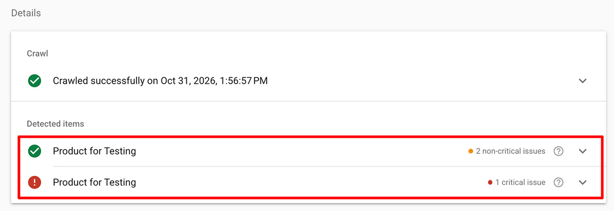
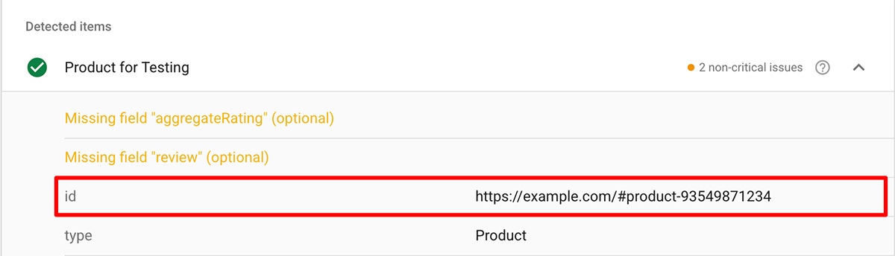
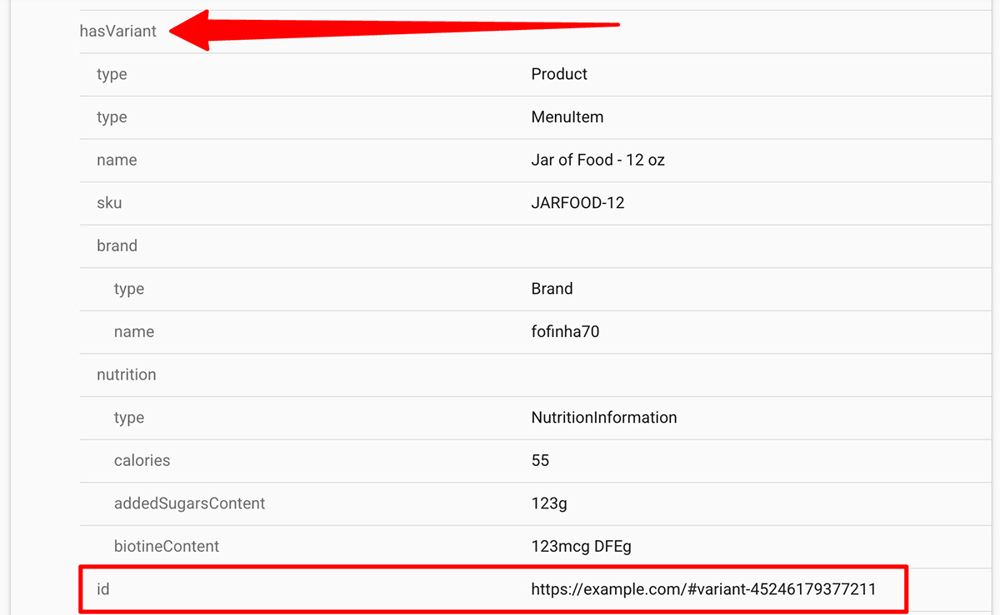

import Link from '@site/src/components/ItsGot/Link';
import StructuredDataAppEmbedLink from '@site/src/components/ItsGot/StructuredDataAppEmbedLink';

# Using Structured Data for Improved SEO and AIO

Structured data provides product background information to your store's pages so search engines and AI assistants can instantly understand key details like prices, stock, and product attributes.
This helps search platforms display eye-catching Rich Snippets in their results and accurately cite your products in AI answers, driving higher search visibility and click-through rates.

It's Got can output nutrition data as part of your product's structured data. If you're using our product reviews feature the review data will be output as well.

## Shopify

Shopify users must <StructuredDataAppEmbedLink>enable the Structured Data for SEO app embed</StructuredDataAppEmbedLink> in their theme. Once enabled the app's product and variant structured data will be automatically output on product pages.

### Product Identifiers

Identifiers are how structured data snippets are associated with each other.
If your Shopify theme contains existing structured product data the nutrition information and/or review information output by the app should be linked to it automatically.
If it is not you must define the identifier to use.

You can use Google's [Rich Result Test](https://search.google.com/test/rich-results) to determine if you need to explicitly specify an identifier:

1. Go to the [Rich Result Test](https://search.google.com/test/rich-results)
1. Enter a product page's URL
1. Click "Test"

If you see your product listed more than once:

  

You will have to [configure the product identifier in the app](#setting-a-default-product-identifier).

### Setting a Default Product Identifier

Setting a product identifier is only necessary if you're not using [Shopify's default product/variant identifier](#product-identifiers).

To set a product identifier in the app you must first find out what identifier your theme is currently using:

1. Go to [Google's Rich Result Test](https://search.google.com/test/rich-results)
1. Enter a product page's URL
1. Click "Test"
1. On the results page click on the product's name. If you do not see your product's name you may first have to click on "Product snippets"
1. Under the product's name find the "id" entry:
   

     
   

1. Here your identifier is `#product-ID` where `ID` is the Shopify product ID. You can ignore the domain portion (`https://example.com`).
1. Go to the <Link path="/settings/edit#structured_data">settings page's Structured Data section</Link>
1. In the *Product identifier* field, enter: `#product-{{product_id}}`
1. Click "Save"

Now the structured data generated by the app will match your theme's existing output.

For variants you can repeat these steps, though in this case you do not want to use the first "id" entry in the Rich Result Test. You want to use the one under "hasVariant":

  

