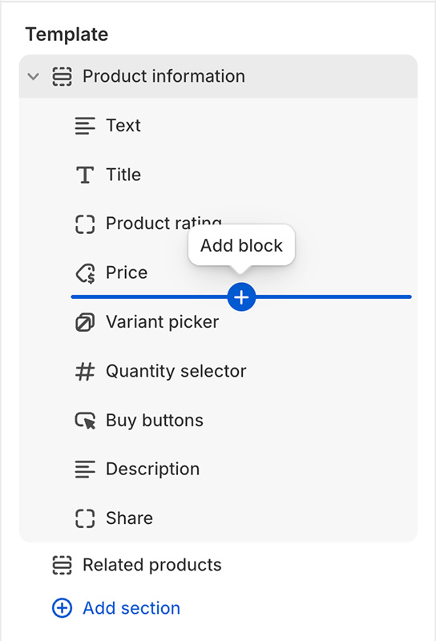

import Link from '@site/src/components/ProductExpirationDates/Link';
import ShopifyCurrentTheme from '@site/src/components/ShopifyCurrentTheme';

# Uploading Documents to a Batch

***Support for Document Uploads is not available under the <Link path="/charges/recurring/new">Basic Plan</Link>***

Link Certificates of Analysis (COAs), organic certifications, shelf-life data, safety/regulatory sheets, and more to your products' inventory batches.
Each batch supports the addition of multiple documents. Uploaded documents for the batch are automatically associated with orders and viewable on the order's page in the app.

To upload a document:

1. Go to the <Link path="/inventory_expiration_date_allocations">Inventory Batches page</Link> in the app
1. Find the product whose batches you want to upload documents to
1. Under the batches tab, find the target batch
1. Click "View" > "Documents"
1. Select "Choose file" and select the documents to upload

The selected documents are now associated with the batch.

## Adding Batch Documents to Product Pages

Batch documents can be added to product pages and made accessible to users via our [Shopify theme editor](https://help.shopify.com/en/manual/onine-store/themes/customizing-themes/theme-editor/using-the-theme-editor#access-the-theme-editor) integration. This allows one to add [a section or block](https://help.shopify.com/en/manual/online-store/themes/customizing-themes/theme-editor/using-the-theme-editor#sections-and-blocks) that gives users the ability to view available batch documents for the given product.

Only documents with public visibility are shown. Public visibility can be set when viewing a batch's documents in the app by selecting "Public" from the "Visibility" field.

Documents associated with batches that are no longer available for purchase will not be shown.

To add batch documents to your product pages:

1.  <ShopifyCurrentTheme>Open your theme</ShopifyCurrentTheme> in the Shopify theme editor
1.  In the theme editor select the product template:

    

1.  Select the desired display location within the product template. This can be done by hovering your cursor over the desired insertion area:

    

1.  Click on the add block button and select Inventory Batch Documents from the Apps section:

    

1.  This will add an Inventory Batches Document block to the product template:

    

1.  Click on the block to access its configuration options. Note that a document description can be added via the "Description" field when viewing a batch's documents in the app.

1.  Click <kbd>Save</kbd>

Users will now be able to view documents associated with the product's current inventory batch(es).

## Viewing an Order Line Item's Batch Documents

To view the documents associated with the batches assigned to an order line item:

1. Go to the <Link path="/order_line_items">Orders page</Link> in the app
1. Find the order whose upload documents you'd like to view
1. Click on the order and find the desired order line item
1. Click "Actions" > "View Documents"
1. Click on the document name you'd like to view
