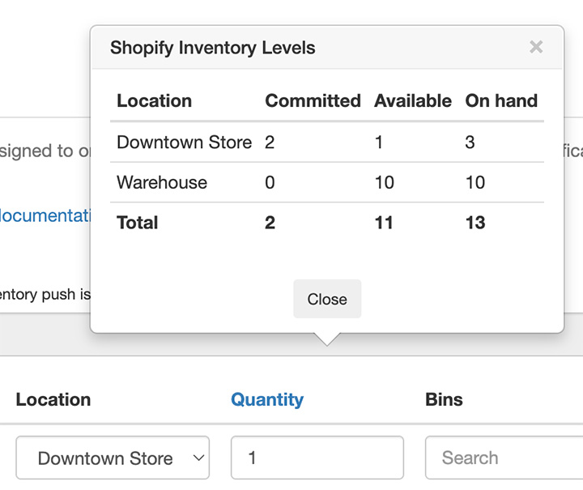

import Link from '@site/src/components/ProductExpirationDates/Link';

# Ablaufdaten zu Produkten hinzufügen

Ablaufdaten können zu Ihren Produkten auf der <Link path="/inventories/new">Seite für Bestandschargen</Link> des Produkts hinzugefügt werden. Sie können Ablaufdaten auch [per Stapelimport importieren](/docs/product-expiration-dates/batch-import) oder durch [Scannen des Barcodes eines Produkts](/docs/product-expiration-dates/barcode-scanner) erfassen. Es können 3 Datensätze bereitgestellt werden:

-   Bestandschargen
-   Werte für „Verbrauch innerhalb von“
-   Produktrabatte

Ein Einführungsvideo finden Sie [hier](https://youtu.be/vjLB_v1OHpw).

## Bestandschargen

Bestandschargen bilden die primäre Grundlage der Ablaufdaten. Die eingegebenen Werte werden Bestellungen zugewiesen, zum Versenden von Ablaufbenachrichtigungen verwendet und bestimmen, wann ein Produkt rabattiert wird.
Sie können [Bestandschargen-Informationen auch auf Ihrer Website anzeigen](/docs/product-expiration-dates/shopify-pages), um Kunden das MHD und/oder die Empfehlung für den Verbrauch nach dem Öffnen zu präsentieren.

:::info
Vergewissern Sie sich vor dem Anlegen von Chargen, dass Sie Ihr [Verfahren zur Bestandsverwaltung ausgewählt](/docs/product-expiration-dates/selecting-inventory-management-method) haben.
:::

### Wann Bestandschargen zugewiesen werden

Das Feld „Lagerstapel zuweisen, wenn“ legt fest, wann eine Bestandscharge einer Bestellung zugewiesen wird: wenn die Bestellung aufgegeben wird oder wenn eine Bestellposition ausgeführt wird. Standardmäßig erfolgt die Zuweisung, wenn eine Bestellung aufgegeben wird. Wenn Sie beispielsweise die <Link path="/settings#inventory">Bestandsverwaltungsmethode</Link> „First Expired, First Out“ (FEFO) verwenden, wird neuen Bestellungen die am frühesten ablaufende Charge zugewiesen. Informationen zur Konfiguration des Standorts finden Sie unter [Standortzuweisung von Bestandschargen für Bestellungen](/docs/product-expiration-dates/order-batch-location-assignment).

### MHD, Charge, Menge und Standort

MHD ist das Verfalls- bzw. Mindesthaltbarkeitsdatum für die jeweilige Charge. Die Menge ist der verfügbare Bestand (siehe jedoch *Verfügbare vs. Vorhandene Menge* weiter unten). Der Standort ist der Shopify-Standort, an dem sich die Charge befindet. Die Chargennummer ist optional. Sie können die bei Shopify verfügbare Menge für das jeweilige Produkt bzw. die Variante anzeigen, indem Sie auf den Link „Anzahl“ (bzw. „Quantity“) klicken: 

Beispiel: Produkt A hat bei Shopify am Standort Warehouse eine Menge von 10. Davon laufen 6 im Jahr 2025 ab und 4 im Jahr 2024. Dies führt zu folgenden Einträgen in der App:

-   MHD: `2025-01-01`, Anzahl: `6`, Standort: `Warehouse`
-   MHD: `2024-11-21`, Anzahl: `4`, Standort: `Warehouse`

### Rechnungsnummer, Losnummer, Eingangsdatum, Herstellungsdatum, Notizen usw. {/* #lot-number-etc-assignment */}

Jeder Bestandscharge können zusätzliche Daten zugeordnet werden. Sie können diesen Werten Daten zuweisen, indem Sie deren Anzeige auf der Registerkarte „Chargen“ aktivieren, indem Sie auf das Zahnrad-Symbol klicken:

Wählen Sie die gewünschten Felder aus und klicken Sie auf die Schaltfläche <kbd>Speichern</kbd>.

### Verfügbare vs. Vorhandene Menge

Wenn Sie die Bestandsübermittlung (Inventory Push) verwenden, können Sie entweder die vorhandene Menge (on hand) oder die verfügbare Menge (available) festlegen. Weitere Informationen finden Sie in der Dokumentation zur [Bestandsübermittlung (Inventory Push)](/docs/product-expiration-dates/inventory-push).

### Konfiguration von Standorten für die Ausführung

Siehe [Standortzuweisung von Bestandschargen für Bestellungen](/docs/product-expiration-dates/order-batch-location-assignment).

### Was passiert als Nächstes?

Angenommen, Sie verwenden das <Link path="/settings#inventory">Verfahren zur Bestandsverwaltung</Link> „First Expired, First Out“ (FEFO), haben Bestandschargendaten für ein Produkt eingegeben und bei der Option „Lagerstapel zuweisen, wenn“ die Einstellung „Die Bestellung wurde aufgegeben“ ausgewählt. Wenn nun eine Bestellung für dieses Produkt eingeht, weist die App die am frühesten ablaufende Bestandscharge des der Bestellung zugewiesenen Standorts zu (bei Bestellungen im Ladengeschäft). Falls der Bestellung kein Standort zugewiesen ist, weist die App die am frühesten ablaufende Bestandscharge aus den erfassten Werten zu. Wenn eine Bestellposition wieder eingelagert, erstattet usw. wird, wird die am frühesten ablaufende Bestandscharge freigegeben und steht für künftige Bestellungen wieder zur Verfügung.

Welche Bestandscharge einer Bestellung zugewiesen wurde, können Sie auf der <Link path="/order_line_items">Bestellseite der App</Link> einsehen.

Sie können die [ablaufbezogenen Informationen auch auf Ihrer Website anzeigen](/docs/product-expiration-dates/shopify-pages) oder [zu Ihren Lieferscheinen oder Benachrichtigungen hinzufügen](/docs/product-expiration-dates/notifications-and-packing-slip).

## Werte für „Verbrauch innerhalb von“

Hierbei handelt es sich um zusätzliche Informationen, die auf Ihrer Website angezeigt werden können. Sie geben den Zeitraum an, innerhalb dessen der Hersteller empfiehlt, ein Produkt nach dem Öffnen zu verwenden oder zu verbrauchen. Sie können beispielsweise über die Bestandschargen ein `Mindestens haltbar bis 1. Juli 2025` und hier ein `Verbrauch innerhalb von 30 Tagen` angeben.

## Produktrabatte

***Produktrabatte sind ab dem <Link path="/charges/recurring/new">Premium-Tarif</Link> verfügbar***

:::info
Wir empfehlen die Verwendung von [Regelsätzen](/docs/product-expiration-dates/discounts#rulesets), um Produktrabatte zu erstellen.
Mit Regelsätzen können Sie mehrstufige Rabatte einrichten, was mit den herkömmlichen Rabatten über die Einstellungen oder die Registerkarte „Rabatte“ nicht möglich ist.
:::

Produktspezifische Rabatte können auf der Registerkarte „Rabatte“ eingegeben werden. Wenn sich eine Bestandscharge ihrem Ablaufdatum nähert, wird der Preis des Produkts um den angegebenen Prozentsatz reduziert.

Standardwerte für diese Felder können auf der Seite für Rabatteinstellungen im <Link path="/settings#discounts~product_defaults">Abschnitt „Produkt-Standardwerte“</Link> eingegeben werden. Beim Hinzufügen neuer Produkte zur App werden die hier eingegebenen Werte verwendet, um die Felder auf der Registerkarte „Rabatte“ vorzubelegen.

Informationen zur Konfiguration globaler Rabatte für alle Produkte finden Sie unter [Ablaufende Produkte mit Rabatt verkaufen](/docs/product-expiration-dates/discounts).
