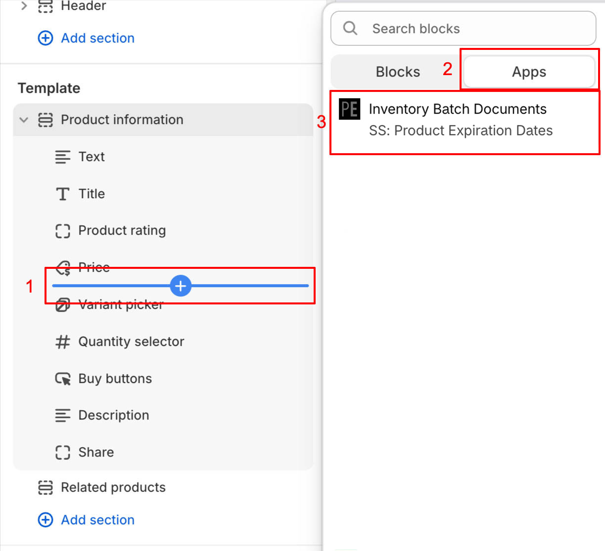

import Link from '@site/src/components/ProductExpirationDates/Link';
import ShopifyCurrentTheme from '@site/src/components/ShopifyCurrentTheme';

# Hochladen von Dokumenten zu einer Charge

***Das Hochladen von Dokumenten wird im <Link path="/charges/recurring/new">Basic-Tarif</Link> nicht unterstützt***

Verknüpfen Sie Analysezertifikate (COAs), Bio-Zertifikate, Haltbarkeitsdaten, Sicherheits- und Regulierungsinformationen und mehr mit den Bestandschargen Ihrer Produkte.
Jede Charge unterstützt das Hinzufügen mehrerer Dokumente. Hochgeladene Dokumente für die Charge werden automatisch Bestellungen zugeordnet und können auf der Bestellseite in der App eingesehen werden.

So laden Sie ein Dokument hoch:

1. Rufen Sie in der App die Seite <Link path="/inventory_expiration_date_allocations">Bestandschargen</Link> auf
1. Suchen Sie das Produkt, zu dessen Chargen Sie Dokumente hochladen möchten
1. Suchen Sie unter der Registerkarte „Chargen“ die gewünschte Charge
1. Klicken Sie auf „Anzeigen“ > „Dokumente“
1. Wählen Sie „Datei auswählen“ und wählen Sie die hochzuladenden Dokumente aus

Die ausgewählten Dokumente sind nun mit der Charge verknüpft.

## Hinzufügen von Chargendokumenten zu Produktseiten

Chargendokumente können zu Produktseiten hinzugefügt und Benutzern über unsere Integration für den [Shopify-Theme-Editor](https://help.shopify.com/de/manual/online-store/themes/customizing-themes/theme-editor/using-the-theme-editor#access-the-theme-editor) zugänglich gemacht werden. Dadurch können Sie [einen Abschnitt oder Block](https://help.shopify.com/de/manual/online-store/themes/customizing-themes/theme-editor/using-the-theme-editor#sections-and-blocks) hinzufügen, mit dem Benutzer die verfügbaren Chargendokumente für das jeweilige Produkt anzeigen können.

Es werden nur Dokumente mit öffentlicher Sichtbarkeit angezeigt. Die öffentliche Sichtbarkeit kann beim Anzeigen der Dokumente einer Charge in der App festgelegt werden, indem im Feld „Sichtbarkeit“ die Option „Öffentlich“ ausgewählt wird.

Dokumente, die Chargen zugeordnet sind, die nicht mehr zum Verkauf stehen, werden nicht angezeigt.

So fügen Sie Chargendokumente zu Ihren Produktseiten hinzu:

1.  <ShopifyCurrentTheme>Öffnen Sie Ihr Theme</ShopifyCurrentTheme> im Shopify-Theme-Editor
1.  Wählen Sie im Theme-Editor die Produktvorlage aus:

    

1.  Wählen Sie die gewünschte Anzeigestelle innerhalb der Produktvorlage aus. Bewegen Sie dazu den Mauszeiger über den gewünschten Einfügebereich:

    

1.  Klicken Sie auf „Block hinzufügen“ und wählen Sie im Bereich „Apps“ den Eintrag „Bestandschargen-Dokumente“:

    

1.  Dadurch wird der Produktvorlage ein Block für Bestandschargen-Dokumente hinzugefügt:

    

1.  Klicken Sie auf den Block, um seine Konfigurationsoptionen aufzurufen. Beachten Sie, dass beim Anzeigen der Dokumente einer Charge in der App über das Feld „Beschreibung“ eine Dokumentbeschreibung hinzugefügt werden kann.

1.  Klicken Sie auf <kbd>Speichern</kbd>

Benutzer können nun Dokumente anzeigen, die der/den aktuellen Bestandscharge(n) des Produkts zugeordnet sind.

## Anzeigen von Chargendokumenten einer Bestellposition

So zeigen Sie die Dokumente an, die den einer Bestellposition zugewiesenen Chargen zugeordnet sind:

1. Rufen Sie in der App die Seite <Link path="/order_line_items">Bestellungen</Link> auf
1. Suchen Sie die Bestellung, deren hochgeladene Dokumente Sie anzeigen möchten
1. Klicken Sie auf die Bestellung und suchen Sie die gewünschte Bestellposition
1. Klicken Sie auf „Aktionen“ > „Dokumente anzeigen“
1. Klicken Sie auf den Namen des Dokuments, das Sie anzeigen möchten
