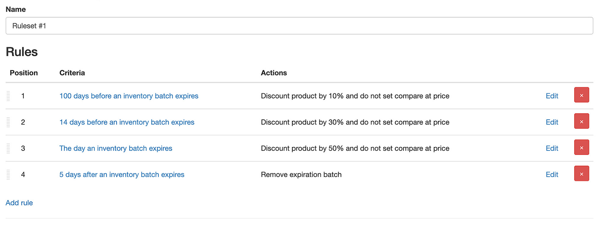

import Link from '@site/src/components/ProductExpirationDates/Link';

# Ablaufende Produkte mit Rabatt verkaufen

Produkte können rabattiert werden, sobald sie eine Bestandscharge enthalten, die sich innerhalb eines definierten Ablaufzeitraums befindet. Es gibt zwei Möglichkeiten, Rabatte zu konfigurieren: 1) [die herkömmliche Methode](/docs/product-expiration-dates/discounts#legacy-discounts) 2) [Regelsätze](/docs/product-expiration-dates/discounts#rulesets). Regelsätze sind die empfohlene Methode und ermöglichen die Einrichtung mehrstufiger bzw. gestaffelter Rabatte. Beispielsweise können Sie ein Produkt 100 Tage vor Ablauf um 10 % und 5 Tage vor Ablauf um 30 % rabattieren.

Weitere Informationen zu beiden Methoden finden Sie nachfolgend.

## Regelsätze {/* #rulesets */}

***Regelsätze sind nur im <Link path="/charges/recurring/new">Platinum-Tarif</Link> verfügbar***

Mit Regelsätzen können Sie Kriterien definieren, die auf ein Produkt angewendet werden, und Aktionen ausführen, sobald die Kriterien zutreffen. Regelsätze dienen nicht nur für Rabatte – sie können auch verwendet werden, um Tags hinzuzufügen oder zu entfernen, Produkttitel zu ändern und vieles mehr! Betrachten wir ein Beispiel. Angenommen, Sie möchten ein Produkt nach folgenden Bedingungen rabattieren:

-   100 Tage vor Ablauf: 10 % Rabatt
-   14 Tage vor Ablauf: 30 % Rabatt
-   Am Tag des Ablaufs: 50 % Rabatt
-   5 Tage nach Ablauf: abgelaufene Chargen entfernen

Dies lässt sich durch Erstellen eines einzelnen Regelsatzes mit 4 Regeln realisieren. Jede Regel enthält die gewünschten Kriterien (100 Tage zuvor, 14 Tage zuvor usw.) und Aktionen (10 % Rabatt, 30 % Rabatt usw.). Wenn die Kriterien einer Regel erfüllt sind, werden die zugehörigen Aktionen ausgeführt.

**Hinweis:** Rabattprozentsätze beziehen sich auf den Produktpreis zum Zeitpunkt der Rabattierung. Wenn Sie den Rabatt auf den ursprünglichen Preis vor dem Rabatt beziehen möchten, müssen Sie auf jeder Stufe neben der Aktion „Rabatt hinzufügen“ auch die Aktion „Rabatt entfernen“ hinzufügen.

### 100 Tage vor Ablauf: 10 % Rabatt

1.  Rufen Sie die Seite <Link path="/inventory_rules/rule_sets">Regelsätze</Link> auf
2.  Klicken Sie auf „Regelsatz hinzufügen“
3.  Auf der Seite für den neuen Regelsatz können Sie dem Regelsatz einen Namen geben
4.  Klicken Sie auf <kbd>Speichern</kbd>
5.  Dadurch gelangen Sie zur Seite des neuen Regelsatzes, auf der die Rabattregeln hinzugefügt werden können
6.  Klicken Sie auf „Regel hinzufügen“
7.  Wählen Sie im Feld „Kriterien“ die Option „Vor Ablauf einer Bestandscharge“ (Before an Inventory Batch Expires)
8.  Geben Sie im Feld „Tage vor Ablauf“ den Wert 100 ein
9.  Wählen Sie weiter unten im Bereich „Maßnahmen“ die Aktion „Rabatt hinzufügen“
10. Geben Sie im Feld „Rabattprozentsatz“ 10 ein. Um den Vergleichspreis bei Shopify auf den Preis vor dem Rabatt festzulegen, aktivieren Sie „Verwenden Sie den regulären Preis als Vergleichspreis“
11. Klicken Sie auf <kbd>Speichern</kbd>
12. Nun enthält der Regelsatz eine Regel; wir fügen noch 3 weitere hinzu

### 14 Tage vor Ablauf: 30 % Rabatt

1.  Klicken Sie auf der Seite des Regelsatzes auf „Regel hinzufügen“
2.  Wählen Sie im Feld „Kriterien“ die Option „Vor Ablauf einer Bestandscharge“
3.  Geben Sie im Feld „Tage vor Ablauf“ den Wert 14 ein
4.  Wählen Sie im Bereich „Maßnahmen“ die Aktion „Rabatt hinzufügen“
5.  Geben Sie im Feld „Rabattprozentsatz“ 30 ein
6.  Klicken Sie auf <kbd>Speichern</kbd>
7.  Der Regelsatz enthält nun 2 Regeln; es fehlen noch 2

### Am Tag des Ablaufs: 50 % Rabatt

1.  Klicken Sie auf der Seite des Regelsatzes auf „Regel hinzufügen“
2.  Wählen Sie im Feld „Kriterien“ die Option „Nach Ablauf einer Bestandscharge“ (After an Inventory Batch Expires)
3.  Geben Sie im Feld „Tage nach Ablauf“ den Wert 0 ein. Dadurch gilt das Kriterium für den Tag, an dem das Produkt abläuft
4.  Wählen Sie im Bereich „Maßnahmen“ die Aktion „Rabatt hinzufügen“
5.  Geben Sie im Feld „Rabattprozentsatz“ 50 ein
6.  Klicken Sie auf <kbd>Speichern</kbd>
7.  Der Regelsatz enthält nun 3 Regeln – noch eine letzte!

### 5 Tage nach Ablauf: abgelaufene Chargen entfernen

1.  Klicken Sie auf der Seite des Regelsatzes auf „Regel hinzufügen“
2.  Wählen Sie im Feld „Kriterien“ die Option „Nach Ablauf einer Bestandscharge“
3.  Geben Sie im Feld „Tage nach Ablauf“ den Wert 5 ein
4.  Wählen Sie im Bereich „Maßnahmen“ die Aktion „Bestandscharge entfernen“
5.  Klicken Sie auf <kbd>Speichern</kbd>

Der fertige Regelsatz sollte wie folgt aussehen:

Dieser Regelsatz gilt für alle Produkte in Ihrem Shop. Sie können ihn auf bestimmte Produkte oder Varianten einschränken, indem Sie beim Erstellen einer Regel das Kriterium „Das Produkt ist“ (With Matching Product) auswählen. Sobald die Mengen der ablaufenden Charge verkauft sind, wird der Regelsatz zurückgesetzt und das Produkt bzw. die Variante erhält wieder den Preis zum Zeitpunkt des Greifens von Regel 1.

Sofern die Option „Rückwirkend anwenden“ nicht ausgewählt ist (siehe unten), **müssen die Regeln eines Regelsatzes in der Reihenfolge zutreffen, in der sie definiert wurden.** Regel 3 greift beispielsweise nicht, bevor nicht Regel 1 und 2 zugetroffen haben.

## Rückwirkendes Anwenden {/* #ruleset-retroactive-matching */}

Normalerweise greift ein Regelsatz für eine Bestandscharge erst ab dem Moment, an dem seine erste Regel zutrifft. Befindet sich eine Charge zeitlich bereits hinter dieser ersten Regel – beispielsweise wenn der Regelsatz erst nach dem Erfassen der Charge erstellt wurde –, wird der Regelsatz nie auf diese Charge angewendet.

Durch Aktivieren der Option „Rückwirkend anwenden“ kann eine Charge dem Regelsatz bei derjenigen Regel beitreten, die ihrem aktuellen Datum entspricht, und alle Aktionen vorheriger Regeln werden gleichzeitig ausgeführt. Bezogen auf das obige Beispiel: Für ein Produkt, das noch 10 Tage bis zum Ablauf hat, werden Regel 1 und 2 und deren zugehörige Aktionen in einem einzigen Durchgang angewendet. Für eine Charge, die vor 2 Tagen abgelaufen ist, werden Regel 1, 2 und 3 angewendet, selbst wenn Regel 1 und 2 für sich genommen nicht mehr zutreffen.

Nach diesem anfänglichen Abgleich werden nachfolgende Regeln regulär angewendet, genau wie ohne „Rückwirkend anwenden“.

## Herkömmliche Rabattmethode {/* #legacy-discounts */}

***Herkömmliche Rabatte sind nur im <Link path="/charges/recurring/new">Pro-Tarif</Link> verfügbar***

Herkömmliche Rabatte können nach Kollektion, Produkttyp oder direkt am einzelnen Produkt konfiguriert werden. Ein aktiver Rabatt bleibt so lange bestehen, bis alle ablaufenden Mengen verkauft wurden oder bis die jeweiligen Ablaufdaten so geändert werden, dass sie nicht mehr im konfigurierten Rabattzeitraum liegen.

**Standardmäßig wird der Rabatt auf alle verfügbaren Mengen angewendet.** Wenn Sie beispielsweise 10 Produkte haben und nur 3 davon ablaufen, kann ein Kunde beim Anbieten eines Rabatts dennoch **10** Stück zum reduzierten Preis erwerben. Dies liegt an der Funktionsweise der Produktpreisgestaltung in Shopify. Wenn Sie einen Rabatt ausschließlich für die ablaufende Menge anbieten möchten, gibt es verschiedene Lösungen. Bitte [kontaktieren Sie den Support](https://screenstaring.com/#contact), um die Optionen zu besprechen und die beste Lösung für Ihren Shop zu ermitteln.

Es kann einige Minuten dauern, bis der Rabatt bzw. der wiederhergestellte Preis in Ihrem Onlineshop erscheint.

## Aktivierung pro Produkt

1.  [Geben Sie die Ablaufdaten](/docs/product-expiration-dates/adding-expiration-data) für das gewünschte Produkt in die App ein
2.  Klicken Sie auf der Produktseite in der App auf die Registerkarte „Rabatte“
3.  Aktivieren Sie auf der Registerkarte „Rabatte“ die Option „Bieten Sie einen Rabatt an, wenn sich eine Lagercharge innerhalb ihres Verfallszeitraums befindet“
4.  Geben Sie im Feld „Rabattprozentsatz“ den Prozentsatz ein, um den der reguläre Produktpreis reduziert werden soll.  
    Wenn ein Produkt beispielsweise 50 kostet und 10 eingegeben wird, wird das Produkt bei aktivem Rabatt für 45 verkauft.
5.  Geben Sie im Feld „Rabatt-Tage vor Ablauf“ die Anzahl der Tage vor Ablauf ein, an denen der Rabatt aktiviert werden soll.  
    Hat ein Produkt beispielsweise ein Ablaufdatum am 15. Januar und 10 wird eingegeben, wird das Produkt ab dem 5. Januar rabattiert.
6.  Klicken Sie auf die Schaltfläche <kbd>Speichern</kbd>

## Aktivierung nach Kollektion

1.  [Geben Sie die Ablaufdaten](/docs/product-expiration-dates/adding-expiration-data) für das gewünschte Produkt in die App ein
2.  Klicken Sie auf der Produktseite in der App auf die Registerkarte „Rabatte“
3.  Aktivieren Sie auf der Registerkarte „Rabatte“ die Option „Bieten Sie einen Rabatt an, wenn sich eine Lagercharge innerhalb ihres Verfallszeitraums befindet“
4.  Geben Sie im Feld „Rabattprozentsatz“ den gewünschten Prozentsatz ein.  
    Wenn ein Produkt beispielsweise 50 kostet und 10 eingegeben wird, wird das Produkt bei aktivem Rabatt für 45 verkauft.
5.  Geben Sie keinen Wert in das Feld „Rabatt-Tage vor Ablauf“ ein. Dieser wird in einem späteren Schritt bei der Konfiguration der Kollektion festgelegt
6.  Klicken Sie auf die Schaltfläche <kbd>Speichern</kbd>
7.  Gehen Sie in den Einstellungen der App auf <Link path="/settings#discounts">Rabatte</Link>
8.  Gehen Sie zum Abschnitt „Nach Kollektion“
9.  Wählen Sie im Feld „Titel“ die Kollektion aus, für die Sie den Rabatt konfigurieren möchten
10. Geben Sie im Feld „Tage vor Ablauf“ die Anzahl der Tage vor dem Ablaufdatum der Produkte in der Kollektion ein. Dies bestimmt, wann der Rabatt aktiviert wird.  
    Hat ein Produkt beispielsweise ein Ablaufdatum am 15. Januar und 10 wird eingegeben, wird das Produkt ab dem 5. Januar rabattiert.
11. Um eine weitere Kollektion hinzuzufügen, klicken Sie auf den Link „Mehr hinzufügen“
12. Klicken Sie auf die Schaltfläche <kbd>Aktualisierung</kbd>

## Aktivierung nach Produkttyp

1.  [Geben Sie die Ablaufdaten](/docs/product-expiration-dates/adding-expiration-data) für das gewünschte Produkt in die App ein
2.  Klicken Sie auf der Produktseite in der App auf die Registerkarte „Rabatte“
3.  Aktivieren Sie auf der Registerkarte „Rabatte“ die Option „Bieten Sie einen Rabatt an, wenn sich eine Lagercharge innerhalb ihres Verfallszeitraums befindet“
4.  Geben Sie im Feld „Rabattprozentsatz“ den gewünschten Prozentsatz ein.  
    Wenn ein Produkt beispielsweise 50 kostet und 10 eingegeben wird, wird das Produkt bei aktivem Rabatt für 45 verkauft.
5.  Geben Sie keinen Wert in das Feld „Rabatt-Tage vor Ablauf“ ein. Dieser wird in einem späteren Schritt bei der Konfiguration des Produkttyps festgelegt
6.  Klicken Sie auf die Schaltfläche <kbd>Speichern</kbd>
7.  Gehen Sie in den Einstellungen der App auf <Link path="/settings#discounts">Rabatte</Link>
8.  Gehen Sie zum Abschnitt „Nach Produkttyp“
9.  Wählen Sie im Feld „Titel“ den Produkttyp aus, für den Sie den Rabatt konfigurieren möchten. Es werden nur Produkttypen für Produkte angezeigt, die in der App erfasst wurden.
10. Geben Sie im Feld „Tage vor Ablauf“ die Anzahl der Tage vor dem Ablaufdatum der Produkte mit diesem Produkttyp ein. Dies bestimmt, wann der Rabatt aktiviert wird.  
    Hat ein Produkt beispielsweise ein Ablaufdatum am 15. Januar und 10 wird eingegeben, wird das Produkt ab dem 5. Januar rabattiert.
11. Um einen weiteren Produkttyp hinzuzufügen, klicken Sie auf den Link „Mehr hinzufügen“
12. Klicken Sie auf die Schaltfläche <kbd>Aktualisierung</kbd>
