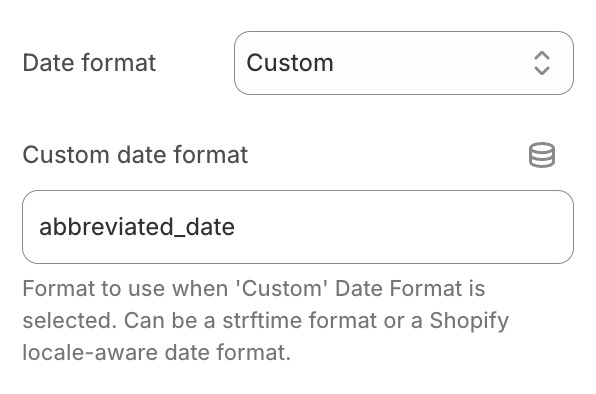

# Datumsformat nach ausgewähltem Land anpassen

Das Format des Ablaufdatums kann an das vom Benutzer ausgewählte Land angepasst werden. Dies richtet sich nach den Datumsformaten, die im [Theme-Inhalt-Editor](https://help.shopify.com/de/manual/online-store/themes/customizing-themes/language/change-wording#overview-of-the-language-editor) des Shopify-Adminbereichs hinterlegt sind.

Wenn Sie [unsere Shopify-Theme-Integration](/docs/product-expiration-dates/shopify-pages) nutzen, können Sie dazu im Feld „Datumsformat“ (Date format) die Option „Benutzerdefiniert“ (Custom) auswählen und den Namen eines gebietsschemaabhängigen Shopify-Datumsformats eingeben. Wenn das gewünschte Format beispielsweise `abbreviated_date` heißt, konfigurieren Sie Folgendes:

Shopify beschränkt die Liste der zulässigen Namen für Datumsformate auf folgende:

-   `abbreviated_date`
-   `basic`
-   `date`
-   `date_at_time`
-   `default`
-   `on_date`
-   `short`
-   `long`

Eigene Formatbezeichnungen können verwendet werden, funktionieren jedoch nicht mit der Standard-Shopify-Theme-Integration. In diesem Fall müssen Sie das [Snippet manuell zu Ihrem Theme hinzufügen](/docs/product-expiration-dates/shopify-pages#adding-liquid-snippet) und das Format explizit über `{{ allocation.time | date: format: "ihr_formatname" }}` angeben.
