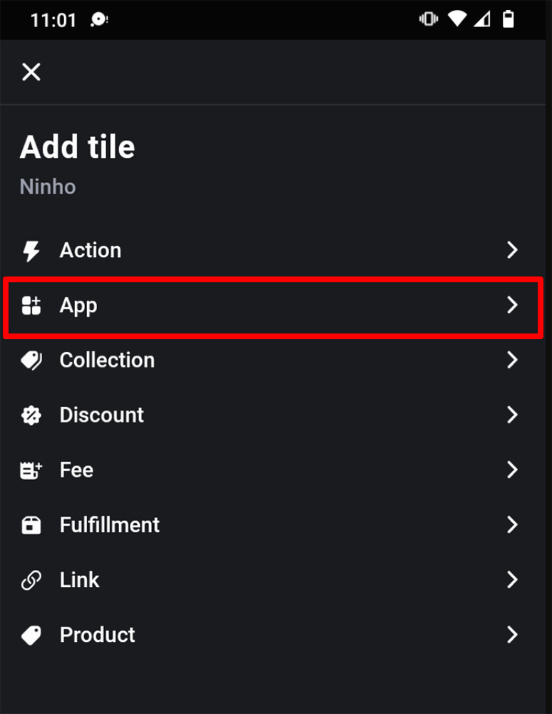
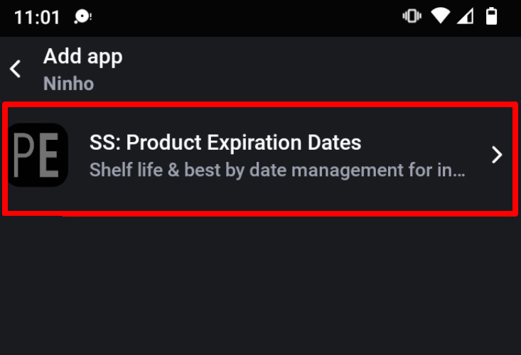
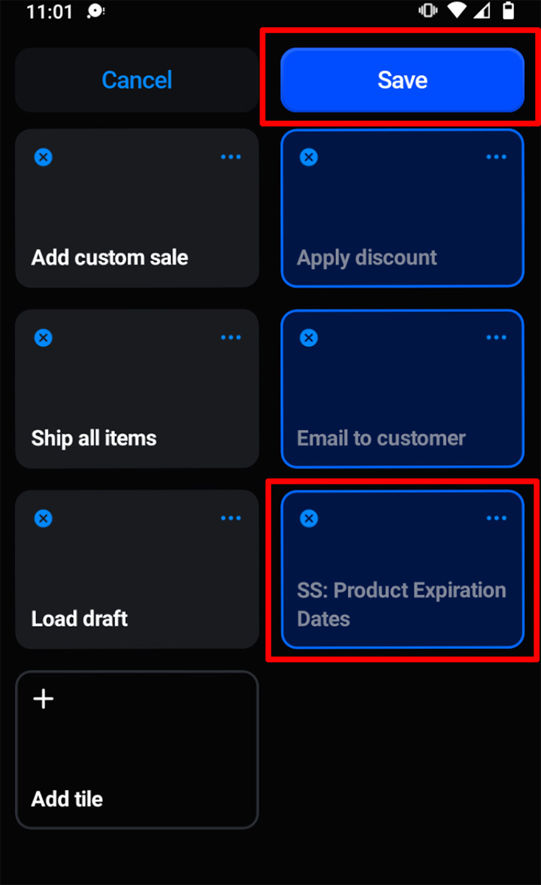

import Link from '@site/src/components/ProductExpirationDates/Link';

# Shopify Point of Sale (POS) Integration

***Die Shopify POS Integration ist nur im <Link path="/charges/recurring/new">Platinum-Tarif</Link> verfügbar***

Unsere Shopify POS Integration ermöglicht es, Bestandschargen direkt innerhalb des Shopify POS System zu Bestellungen zuzuweisen. Fügen Sie zur Einrichtung die Product Expiration Dates App als Kachel auf dem Startbildschirm des POS hinzu:

1.  Tippen Sie auf dem POS-Startbildschirm auf „Kachel hinzufügen“ und wählen Sie „App“:
    
    
    
2.  Wählen Sie aus der App-Liste „SS: Product Expiration Dates“:
    
    
    
3.  Tippen Sie neben „Ablaufdaten zu Produkten zuweisen“ (Assign expiration data to products) auf „Hinzufügen“:
    
    
    
4.  Dadurch wird die Kachel „SS: Product Expiration Dates“ auf der Startseite angezeigt:
    
    
    
5.  Tippen Sie auf „Speichern“

Wenn sich nun Artikel im Warenkorb befinden, können Sie auf die Kachel „SS: Product Expiration Dates“ tippen und Bestandschargen zuweisen. Es werden die Chargen des entsprechenden POS-Standorts angezeigt.
