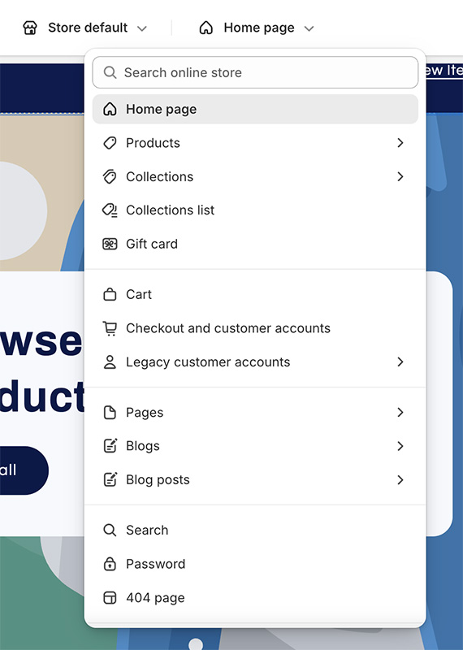
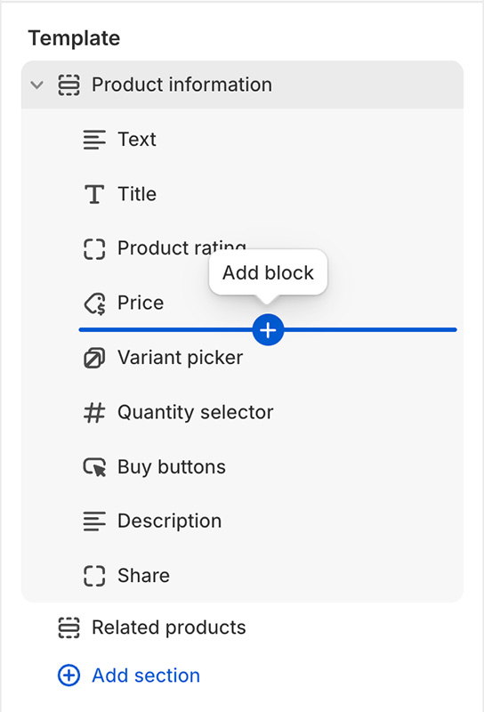
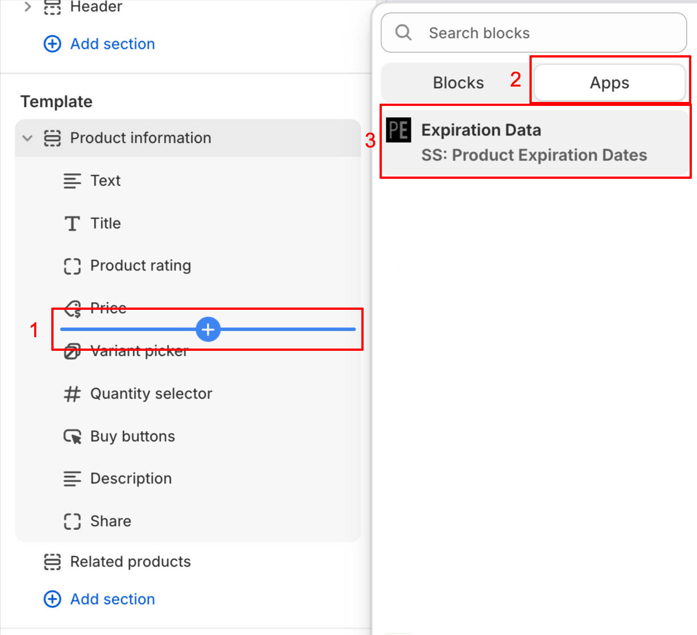
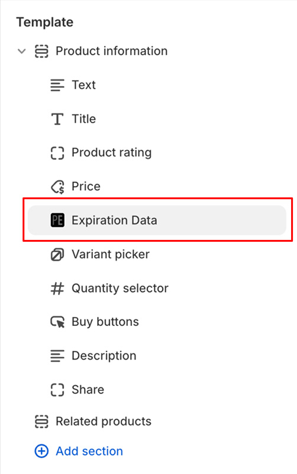

import ShopifyLink from '@theme/ShopifyAdminLink';
import ShopifyCurrentTheme from '@site/src/components/ShopifyCurrentTheme';

# Ablaufdaten zu Ihrer Website hinzufügen

Sie können Ablaufdaten direkt in Ihrem Onlineshop abrufen und/oder anzeigen. Dazu gehören Ablaufdaten, deren Mengen und Angaben zum Verbrauch nach dem Öffnen („Verbrauch innerhalb von“). Der einfachste Weg, diese Informationen anzuzeigen, ist die Verwendung unserer Integration für den [Shopify-Theme-Editor](https://help.shopify.com/de/manual/online-store/themes/customizing-themes/theme-editor/using-the-theme-editor#access-the-theme-editor), mit der Ablaufdaten [als Abschnitt oder Block](https://help.shopify.com/de/manual/online-store/themes/customizing-themes/theme-editor/using-the-theme-editor#sections-and-blocks) hinzugefügt werden können.

1.  <ShopifyCurrentTheme>Öffnen Sie Ihr Theme</ShopifyCurrentTheme> im Theme-Editor
1.  Wählen Sie im Theme-Editor die Vorlage aus, zu der Sie Ablaufdaten hinzufügen möchten:

    

1.  Wählen Sie die gewünschte Stelle innerhalb der Vorlage aus. Bewegen Sie dazu den Mauszeiger über den gewünschten Einfügebereich:

    

1.  Klicken Sie auf „Block hinzufügen“ und wählen Sie im Bereich „Apps“ den Eintrag „Expiration Data“:

    

1.  Dadurch wird der ausgewählten Vorlage ein Block für Ablaufdaten hinzugefügt:

    

1.  Klicken Sie auf den Block „Expiration Data“, um weitere Konfigurationsoptionen aufzurufen. Bei Produkten mit mehreren Varianten werden die Ablaufdaten der jeweils ausgewählten Variante angezeigt. Es können mehrere Blöcke hinzugefügt werden, um verschiedene Anwendungsfälle abzudecken – z. B. ein Block für Ablaufdaten und ein weiterer für die Empfehlung zum Verbrauch nach dem Öffnen.
1.  Klicken Sie auf <kbd>Speichern</kbd>

## Hinzufügen unseres Snippets zu Ihrem Theme {/* #adding-liquid-snippet */}

**Das Hinzufügen von Ablaufdaten sollte in der Regel über [unsere Shopify-Theme-Integration](/docs/product-expiration-dates/shopify-pages) erfolgen. Das manuelle Hinzufügen des Snippets ist nur für spezielle Anwendungsfälle erforderlich.**

1.  <ShopifyLink href={(shopify) => shopify.toString()}>Rufen Sie den Shopify-Adminbereich auf</ShopifyLink>
2.  [Öffnen Sie den Code-Editor Ihres Themes](https://shopify.dev/docs/storefronts/themes/tools/code-editor#accessing-the-code-editor)
3.  [Fügen Sie eine neue Theme-Datei hinzu](https://shopify.dev/docs/storefronts/themes/tools/code-editor#adding-theme-files)
    -   Klicken Sie auf das Verzeichnis „snippets“
    -   Klicken Sie auf „Neues Snippet hinzufügen“
    -   Verwenden Sie als Dateinamen `ss-product-expiration-dates`
    -   Klicken Sie auf „Fertig“
4.  Dadurch wird im Editor ein neuer leerer Tab namens `snippets/ss-product-expiration-dates.liquid` geöffnet
5.  Kopieren Sie den Code aus [unserem Liquid-Snippet](/product-expiration-dates/images/ss-product-expiration-dates.txt) und fügen Sie ihn in den Tab ein
6.  Klicken Sie auf <kbd>Speichern</kbd>

## Anzeigen der Ablaufdaten

Nachdem Sie [unser Snippet zu Ihrem Theme hinzugefügt](/docs/product-expiration-dates/shopify-pages#adding-liquid-snippet) haben, besteht der nächste Schritt darin, es an der Stelle zu rendern, an der die Ablaufdaten angezeigt werden sollen. Dies kann über den Shopify-Adminbereich auf der Theme-Anpassungsseite erfolgen.

1.  <ShopifyCurrentTheme>Öffnen Sie Ihr Theme</ShopifyCurrentTheme> im Theme-Editor
1.  Wählen Sie im Theme-Editor „Produkte“ und dann „Standardprodukt“ (oder die gewünschte Vorlage) aus
1.  Klicken Sie im Bereich „Vorlage“ auf „Block hinzufügen“
1.  Wählen Sie „Benutzerdefiniertes Liquid“ (Custom liquid) oder, falls nicht verfügbar, „HTML“ (beachten Sie, dass der HTML-Block Liquid unterstützen muss)

-   Falls Ihr Theme weder die Option „Benutzerdefiniertes Liquid“ noch „HTML“ anbietet, müssen Sie das Snippet manuell in Ihrem Theme rendern
-   Dies kann über den [Theme-Code-Editor](https://shopify.dev/docs/themes/tools/code-editor) erfolgen
-   Wenn Sie Unterstützung benötigen, [wenden Sie sich bitte an den Support](https://screenstaring.com/#contact)

1.  Nach der Auswahl können Sie den Block „Benutzerdefiniertes Liquid“ an die Stelle verschieben, an der die Ablaufdaten erscheinen sollen
1.  Klicken Sie auf den neu hinzugefügten Block „Benutzerdefiniertes Liquid“
1.  Fügen Sie in das Feld für benutzerdefiniertes Liquid den gewünschten Render-Code ein (Beispiele finden Sie unten)
1.  Klicken Sie auf <kbd>Speichern</kbd>

## Ablaufdaten basierend auf Sprache/Region des Benutzers anzeigen {/* #display-language-region */}

Wenn Sie Ihre Website in mehreren Sprachen bereitstellen, können Sie das Datumsformat und den Text für das Ablaufdatum abhängig von der aktuell ausgewählten Sprache und/oder Region anpassen. Anstelle des Standard-Codes:

```liquid
{% render "ss-product-expiration-dates", product: product, prefix: "Best by:", format: "%B %d, %Y" %}
```

Können Sie den folgenden Code verwenden, um die ausgewählte Sprache und/oder Region zu prüfen und das Ablaufdatum sowie den Text in einem passenden Format anzuzeigen:

```liquid



  {% render "ss-product-expiration-dates", product: product, prefix: "Consúmase antes de:", format: "%d/%m/%Y" %}

  {% render "ss-product-expiration-dates", product: product, prefix: "Mindestens haltbar bis:", format: "%d.%m.%Y" %}

  {% render "ss-product-expiration-dates", product: product, prefix: "Best by:", format: "%B %d, %Y" %}

```

Wenn die Sprache Deutsch (`"de"`) ist, wird der Text `"Mindestens haltbar bis:"` verwendet und das Datum im Format `TT.MM.JJJJ` angezeigt. Wenn die Sprache Spanisch (`"es"`) ist, wird der spanische Text angezeigt, andernfalls wird ein englischsprachiges Format verwendet.

Wenn Sie den Text sowohl anhand der Sprache **als auch** des Landes anzeigen möchten, können Sie eine Bedingung hinzufügen, die die Variable `locale` prüft. In diesem Beispiel zeigen wir das Format `JJJJ/MM/TT` an, wenn sich der Benutzer in Spanien befindet, und `TT/MM/JJJJ`, wenn er sich in einem anderen spanischsprachigen Land befindet:

```liquid



  {% render "ss-product-expiration-dates", product: product, prefix: "Consúmase antes de:", format: "%Y/%m/%d" %}

  {% render "ss-product-expiration-dates", product: product, prefix: "Consúmase antes de:", format: "%d/%m/%Y" %}

  {% render "ss-product-expiration-dates", product: product, prefix: "Mindestens haltbar bis:", format: "%d.%m.%Y" %}

  {% render "ss-product-expiration-dates", product: product, prefix: "Best by:", format: "%B %d, %Y" %}

```
