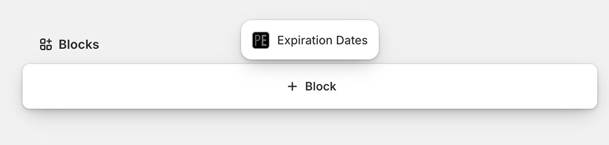
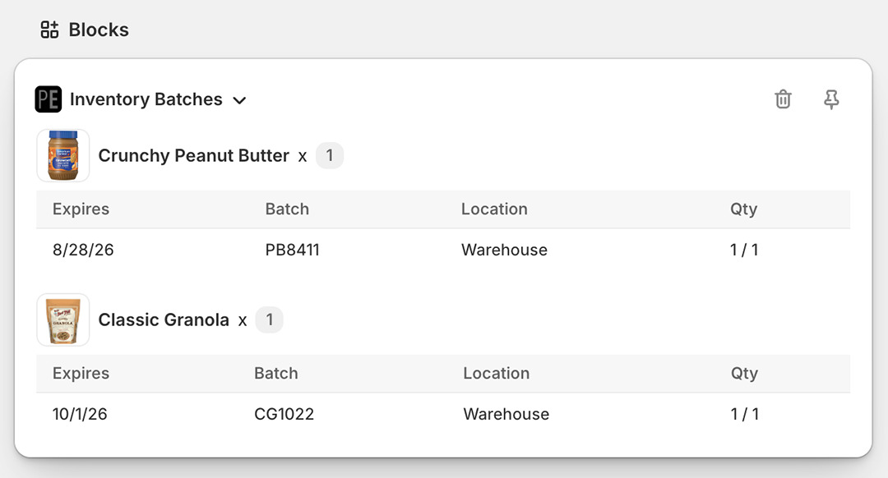
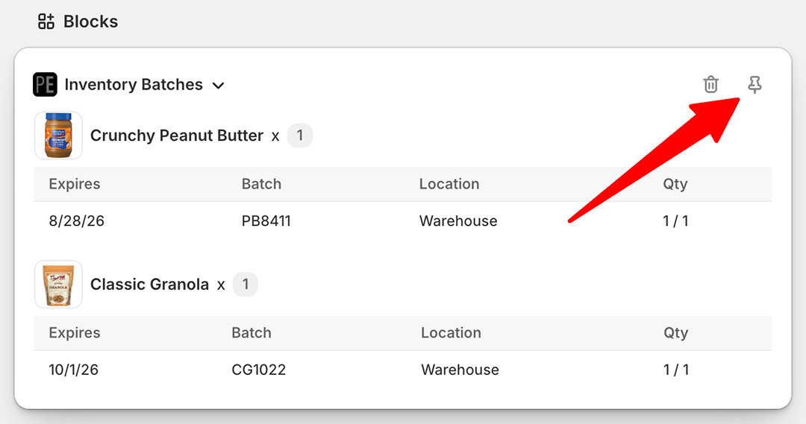
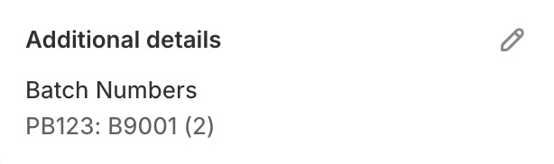

import Link from '@site/src/components/ProductExpirationDates/Link';

# MHDs und Chargennummern von Bestellungen in Shopify einsehen

Es gibt mehrere Möglichkeiten, einer Bestellung zugewiesene Chargennummern und MHDs direkt auf der [Bestellseite im Shopify-Adminbereich](https://help.shopify.com/de/manual/orders/manage-orders#view-an-order) einzusehen.

## Admin-Block

So fügen Sie den Block „Expiration Dates“ zur Bestellseite hinzu:

1.  Öffnen Sie Ihre Bestellung im [Shopify-Adminbereich](https://help.shopify.com/de/manual/orders/manage-orders#view-an-order)
2.  Scrollen Sie auf der Bestellseite nach unten und wählen Sie „Block hinzufügen“

    

3.  Wählen Sie „Expiration Dates“ aus dem Popup-Menü
4.  Dadurch werden die den Bestellpositionen zugewiesenen Ablaufdaten angezeigt, sofern vorhanden. Beachten Sie, dass Daten nur für Bestellungen **nach** dem 11. September 2026 angezeigt werden:

    

5.  Damit der Block dauerhaft auf der Bestellseite erscheint, klicken Sie auf das Stecknadel-Symbol (Anheften):

    

## Abschnitt „Zusätzliche Angaben“ (Additional Details)

Chargennummern können auf der Bestellseite auch im Abschnitt „Zusätzliche Angaben“ hinzugefügt werden:

1.  Gehen Sie in den Einstellungen der App auf die <Link path="/settings#orders">Registerkarte „Bestellungen“</Link>
1.  Wählen Sie „Erstellen Sie einen Eintrag unter „Zusätzliche Angaben“ zur Bestellung mit den Lagerchargen der Bestellung“
1.  Klicken Sie zum Speichern auf die Schaltfläche <kbd>Aktualisierung</kbd>

Bestandschargen für neue Bestellungen werden nun im Abschnitt „Zusätzliche Angaben“ (Additional Details) der Bestellung im Shopify-Adminbereich aufgeführt:

   

Folgende Informationen sind enthalten:

- `PB123`: die SKU der Bestellposition
- `B9001`: die der Bestellposition zugewiesene Chargennummer
- `(2)`: die Menge

## Anzeigen der Bestellung in der App

So öffnen Sie die Bestellseite in der App:

1.  Öffnen Sie Ihre Bestellung im Shopify-Adminbereich
2.  Wählen Sie auf der Bestellseite „Weitere Aktionen“
3.  Wählen Sie „Expiration Dates“
