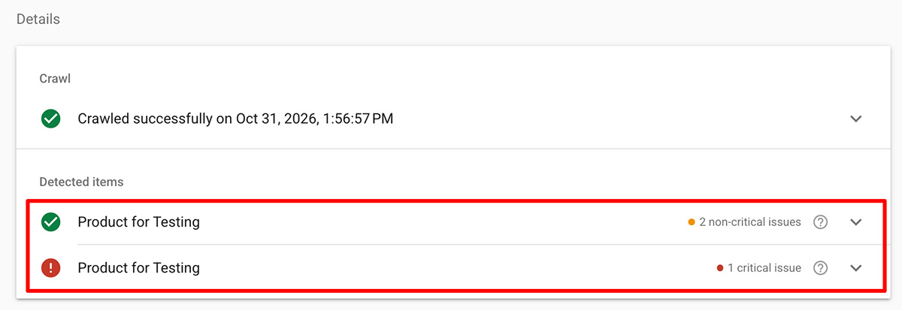
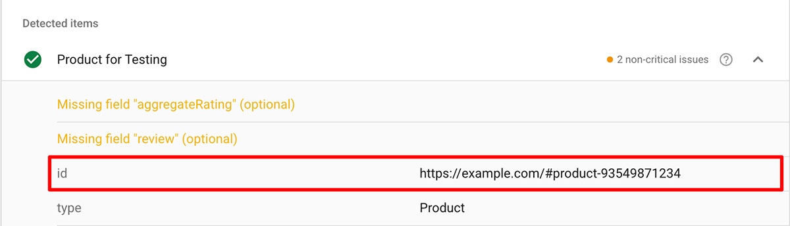
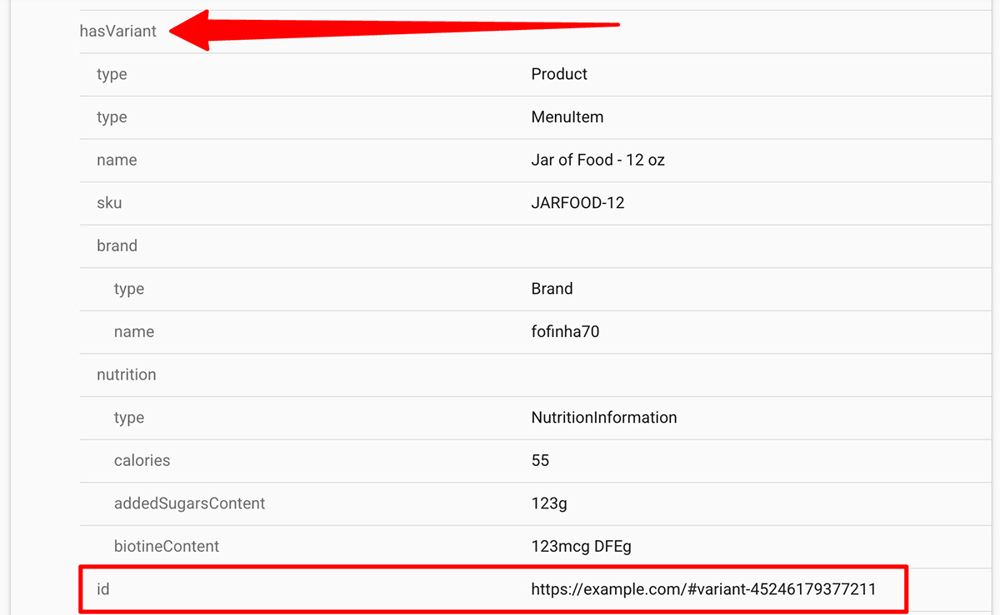

import Link from '@site/src/components/ItsGot/Link';
import StructuredDataAppEmbedLink from '@site/src/components/ItsGot/StructuredDataAppEmbedLink';

# Usar datos estructurados para mejorar el SEO y las AIO

Los datos estructurados proporcionan información de contexto de los productos a las páginas de tu tienda para que los motores de búsqueda y los asistentes de IA puedan entender al instante detalles clave como precios, existencias y atributos de los productos.
Esto ayuda a que las plataformas de búsqueda muestren Rich Snippets llamativos en sus resultados y citen con precisión tus productos en las respuestas de IA, lo que aumenta la visibilidad en las búsquedas y la tasa de clics.

It's Got puede mostrar los datos nutricionales como parte de los datos estructurados de tus productos. Si usas nuestra función de reseñas de productos, los datos de las reseñas también se mostrarán.

## Shopify

Los usuarios de Shopify deben <StructuredDataAppEmbedLink>activar la incrustación de aplicación *Datos estructurados para SEO*</StructuredDataAppEmbedLink> en su tema. Una vez activada, los datos estructurados de productos y variantes de la aplicación se mostrarán automáticamente en las páginas de producto.

### Identificadores de producto {/* #product-identifiers */}

Los identificadores son la forma en que los fragmentos de datos estructurados se asocian entre sí.
Si tu tema de Shopify contiene datos estructurados de productos existentes, la información nutricional y/o la información de reseñas que muestra la aplicación deberían vincularse a ellos automáticamente.
Si no es así, debes definir el identificador a usar.

Puedes usar la [Prueba de resultados enriquecidos](https://search.google.com/test/rich-results) de Google para determinar si necesitas especificar explícitamente un identificador:

1. Ve a la [Prueba de resultados enriquecidos](https://search.google.com/test/rich-results)
1. Introduce la URL de la página de un producto
1. Haz clic en "Probar URL"

Si ves tu producto listado más de una vez:

  

Tendrás que [configurar el identificador del producto en la aplicación](#setting-a-default-product-identifier).

### Configurar un identificador de producto predeterminado {/* #setting-a-default-product-identifier */}

Solo es necesario configurar un identificador de producto si no usas el [identificador de producto/variante predeterminado de Shopify](#product-identifiers).

Para configurar un identificador de producto en la aplicación, primero debes averiguar qué identificador está usando actualmente tu tema:

1. Ve a la [Prueba de resultados enriquecidos de Google](https://search.google.com/test/rich-results)
1. Introduce la URL de la página de un producto
1. Haz clic en "Probar URL"
1. En la página de resultados, haz clic en el nombre del producto. Si no ves el nombre de tu producto, es posible que primero tengas que hacer clic en "Fragmentos de producto"
1. Debajo del nombre del producto, busca la entrada "id":
   

     
   

1. Aquí tu identificador es `#product-ID`, donde `ID` es el ID de producto de Shopify. Puedes ignorar la parte del dominio (`https://example.com`).
1. Ve a la sección Datos estructurados de la <Link path="/settings/edit#structured_data">página de configuración</Link>
1. En el campo *Identificador del producto*, introduce: `#product-{{product_id}}`
1. Haz clic en "Guardar"

Ahora los datos estructurados que genera la aplicación coincidirán con la salida existente de tu tema.

Para las variantes puedes repetir estos pasos, aunque en este caso no debes usar la primera entrada "id" de la Prueba de resultados enriquecidos. Debes usar la que está debajo de "hasVariant":

  

