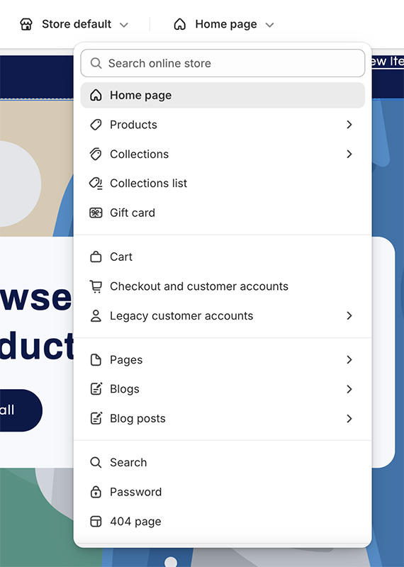

import Link from '@site/src/components/ProductExpirationDates/Link';
import ShopifyCurrentTheme from '@site/src/components/ShopifyCurrentTheme';

# Subir documentos a un lote

***La compatibilidad con la carga de documentos no está disponible con el <Link path="/charges/recurring/new">plan Basic</Link>***

Vincula certificados de análisis (COAs), certificaciones orgánicas, datos de vida útil, hojas de seguridad/normativas y más a los lotes de inventario de tus productos.
Cada lote admite la adición de varios documentos. Los documentos subidos para el lote se asocian automáticamente con los pedidos y se pueden ver en la página del pedido en la aplicación.

Para subir un documento:

1. Ve a la <Link path="/inventory_expiration_date_allocations">página de lotes de inventario</Link> en la aplicación
1. Encuentra el producto a cuyos lotes quieres subir documentos
1. En la pestaña Lotes, encuentra el lote de destino
1. Haz clic en «Ver» > «Documentos»
1. Selecciona «Elegir archivo» y elige los documentos que quieres subir

Los documentos seleccionados quedan ahora asociados al lote.

## Agregar documentos de lote a las páginas de productos

Los documentos de lote se pueden agregar a las páginas de productos y poner a disposición de los usuarios mediante nuestra integración con el [editor de temas de Shopify](https://help.shopify.com/es/manual/online-store/themes/customizing-themes/theme-editor/using-the-theme-editor#access-the-theme-editor). Esto permite agregar [una sección o un bloque](https://help.shopify.com/es/manual/online-store/themes/customizing-themes/theme-editor/using-the-theme-editor#sections-and-blocks) que brinda a los usuarios la posibilidad de ver los documentos de lote disponibles para el producto dado.

Solo se muestran los documentos con visibilidad pública. La visibilidad pública se puede configurar al ver los documentos de un lote en la aplicación seleccionando «Público» en el campo «Visibilidad».

Los documentos asociados con lotes que ya no están disponibles para la compra no se mostrarán.

Para agregar documentos de lote a tus páginas de productos:

1.  <ShopifyCurrentTheme>Abre tu tema</ShopifyCurrentTheme> en el editor de temas de Shopify
1.  En el editor de temas, selecciona la plantilla de producto:

    

1.  Selecciona la ubicación de visualización deseada dentro de la plantilla de producto. Puedes hacerlo pasando el cursor sobre el área de inserción deseada:

    

1.  Haz clic en el botón de agregar bloque y selecciona Documentos de lotes de inventario en la sección Aplicaciones:

    

1.  Esto agregará un bloque Documentos de lotes de inventario a la plantilla de producto:

    

1.  Haz clic en el bloque para acceder a sus opciones de configuración. Ten en cuenta que se puede agregar una descripción del documento a través del campo «Descripción» al ver los documentos de un lote en la aplicación.

1.  Haz clic en <kbd>Guardar</kbd>

Los usuarios ahora podrán ver los documentos asociados con los lotes de inventario actuales del producto.

## Ver los documentos de lote de un artículo del pedido

Para ver los documentos asociados a los lotes asignados a un artículo del pedido:

1. Ve a la <Link path="/order_line_items">página Pedidos</Link> en la aplicación
1. Encuentra el pedido cuyos documentos subidos quieres ver
1. Haz clic en el pedido y encuentra el artículo del pedido deseado
1. Haz clic en «Acciones» > «Ver documentos»
1. Haz clic en el nombre del documento que quieres ver
