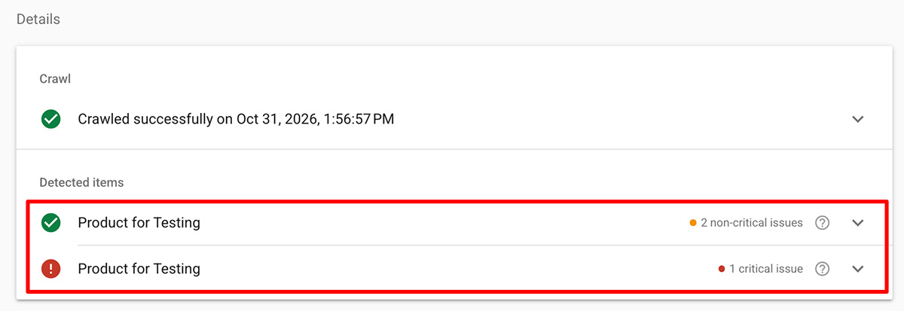
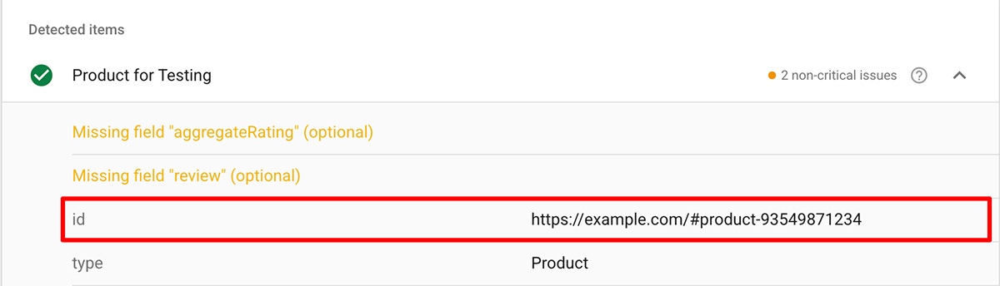
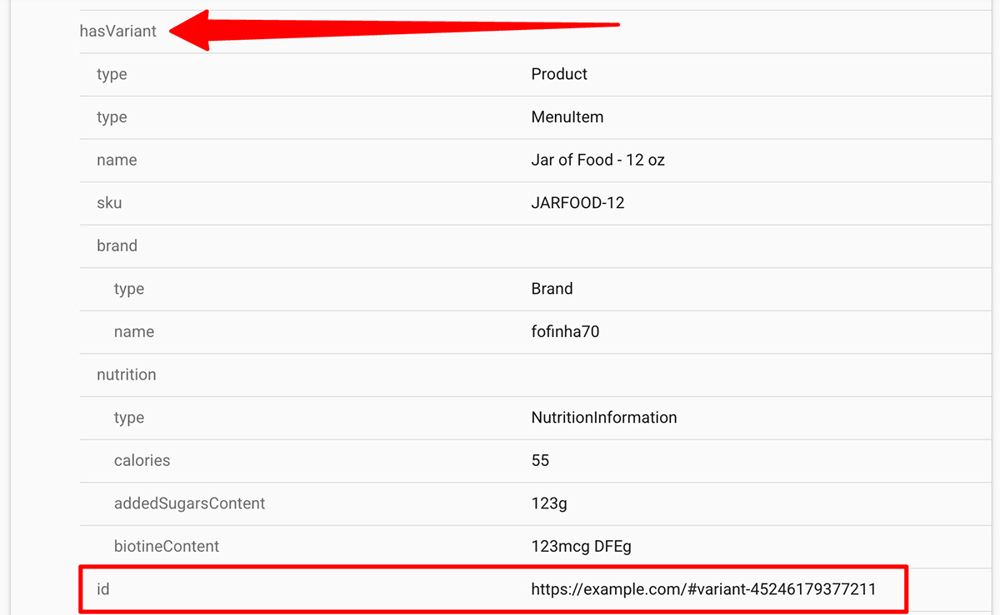

import Link from '@site/src/components/ItsGot/Link';
import StructuredDataAppEmbedLink from '@site/src/components/ItsGot/StructuredDataAppEmbedLink';

# Utiliser des données structurées pour améliorer le SEO et les AIO

Les données structurées fournissent des informations contextuelles sur vos produits aux pages de votre boutique afin que les moteurs de recherche et les assistants IA puissent comprendre instantanément des détails clés comme les prix, les stocks et les attributs des produits.
Cela aide les plateformes de recherche à afficher des Rich Snippets accrocheurs dans leurs résultats et à citer précisément vos produits dans les réponses de l'IA, ce qui améliore la visibilité dans les recherches et les taux de clics.

It's Got peut afficher les données nutritionnelles dans le cadre des données structurées de vos produits. Si vous utilisez notre fonctionnalité d'avis produits, les données des avis seront également affichées.

## Shopify

Les utilisateurs de Shopify doivent <StructuredDataAppEmbedLink>activer l'intégration de l'application *Données structurées pour le SEO*</StructuredDataAppEmbedLink> dans leur thème. Une fois activée, les données structurées de produits et de variantes de l'application s'afficheront automatiquement sur les pages produit.

### Identifiants de produit {/* #product-identifiers */}

Les identifiants permettent d'associer les extraits de données structurées entre eux.
Si votre thème Shopify contient déjà des données structurées de produits, les informations nutritionnelles et/ou les informations d'avis générées par l'application devraient y être liées automatiquement.
Si ce n'est pas le cas, vous devez définir l'identifiant à utiliser.

Vous pouvez utiliser le [Test des résultats enrichis](https://search.google.com/test/rich-results) de Google pour déterminer si vous devez spécifier explicitement un identifiant :

1. Accédez au [Test des résultats enrichis](https://search.google.com/test/rich-results)
1. Saisissez l'URL de la page d'un produit
1. Cliquez sur « Tester l'URL »

Si votre produit apparaît plusieurs fois dans la liste :

  

Vous devrez [configurer l'identifiant du produit dans l'application](#setting-a-default-product-identifier).

### Définir un identifiant de produit par défaut {/* #setting-a-default-product-identifier */}

Il n'est nécessaire de définir un identifiant de produit que si vous n'utilisez pas l'[identifiant de produit/variante par défaut de Shopify](#product-identifiers).

Pour définir un identifiant de produit dans l'application, vous devez d'abord déterminer quel identifiant votre thème utilise actuellement :

1. Accédez au [Test des résultats enrichis de Google](https://search.google.com/test/rich-results)
1. Saisissez l'URL de la page d'un produit
1. Cliquez sur « Tester l'URL »
1. Sur la page de résultats, cliquez sur le nom du produit. Si vous ne voyez pas le nom de votre produit, vous devrez peut-être d'abord cliquer sur « Extraits de produit »
1. Sous le nom du produit, recherchez l'entrée « id » :
   

     
   

1. Ici, votre identifiant est `#product-ID`, où `ID` est l'ID du produit Shopify. Vous pouvez ignorer la partie domaine (`https://example.com`).
1. Accédez à la section Données structurées de la <Link path="/settings/edit#structured_data">page des paramètres</Link>
1. Dans le champ *Identifiant du produit*, saisissez : `#product-{{product_id}}`
1. Cliquez sur « Enregistrer »

Les données structurées générées par l'application correspondront désormais à la sortie existante de votre thème.

Pour les variantes, vous pouvez répéter ces étapes, mais dans ce cas, vous ne devez pas utiliser la première entrée « id » du Test des résultats enrichis. Vous devez utiliser celle qui se trouve sous « hasVariant » :

  

