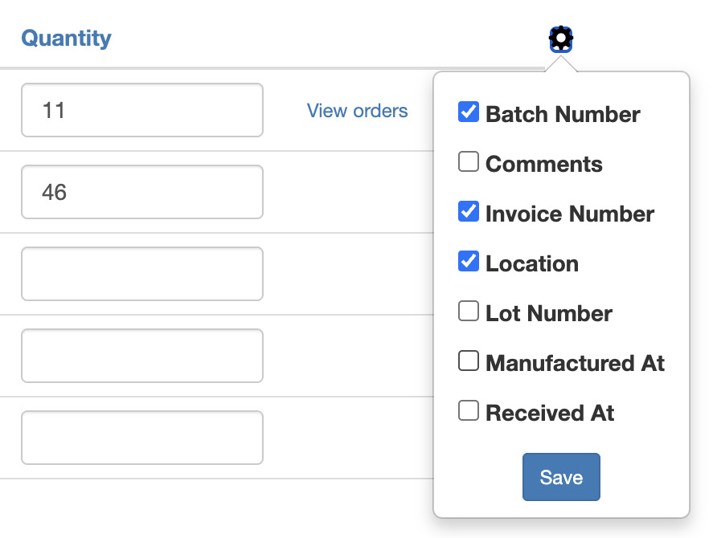

import Link from '@site/src/components/ProductExpirationDates/Link';

# Suivi du coût unitaire d'un lot

Le champ « Coût par article » (« Cost per item ») de Shopify ne stocke qu'un seul coût par variante. Le mettre à jour peut effacer la distinction entre des livraisons achetées à des prix différents.
L'application Product Expiration Dates permet de saisir un coût par lot, ce qui permet aux utilisateurs de suivre précisément l'historique des coûts des livraisons.

Vous pouvez renseigner une valeur pour chaque livraison via le champ « Coût unitaire du lot » :

1. Accédez à la <Link path="/inventories/new">page des lots de stock</Link>
1. Dans l'onglet Lots, cliquez sur l'icône d'engrenage :

1. Un menu présentant des champs supplémentaires s'affiche
1. Sélectionnez « Coût unitaire du lot »
1. Cliquez sur <kbd>Enregistrer</kbd>

Le champ « Coût unitaire du lot » s'affiche désormais chaque fois que vous ajoutez des lots.

Vous pouvez également afficher le coût unitaire des lots sur la page d'accueil des lots de stock en suivant les mêmes étapes.
