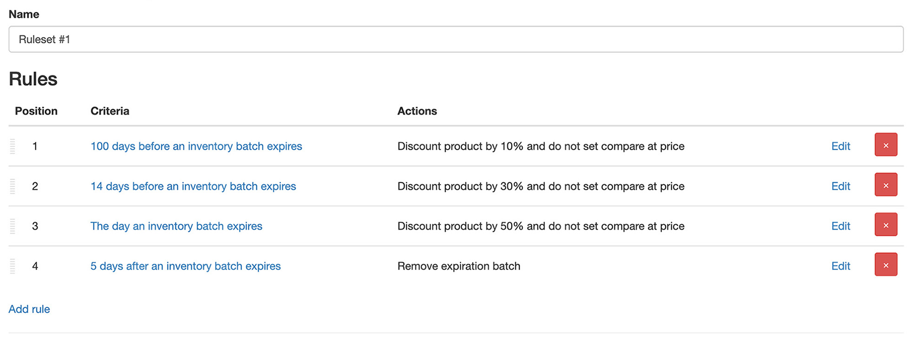

import Link from '@site/src/components/ProductExpirationDates/Link';

# Vendre des produits arrivant à expiration avec une réduction

Les produits peuvent être réduits lorsqu'ils contiennent un lot d'inventaire dans une fenêtre d'expiration. Il y a deux façons de configurer les réductions : 1) [la méthode héritée](/docs/product-expiration-dates/discounts#legacy-discounts) 2) [les ensembles de règles](/docs/product-expiration-dates/discounts#rulesets). Les ensembles de règles sont la méthode privilégiée et permettent de configurer des réductions à plusieurs phases. Par exemple, réduire un produit de 10 % 100 jours avant l'expiration, puis le réduire de 30 % 5 jours avant l'expiration.

Voir la documentation ci-dessous pour chaque type.

## Ensembles de règles {/* #rulesets */}

***Les ensembles de règles ne sont disponibles qu'avec le <Link path="/charges/recurring/new">forfait Platinum</Link>***

Les ensembles de règles permettent de définir un ensemble de critères à appliquer à un produit, et d'exécuter des actions lorsque les critères correspondent. Les ensembles de règles ne servent pas uniquement aux réductions : ils peuvent aussi être utilisés pour ajouter ou retirer des balises, modifier le titre d'un produit, et plus encore ! Regardons un exemple. Disons que vous voulez réduire un produit selon les critères suivants :

-   100 jours avant l'expiration : réduire de 10 %
-   14 jours avant l'expiration : réduire de 30 %
-   Le jour de l'expiration : réduire de 50 %
-   5 jours après l'expiration : supprimer les lots expirés

Cela peut être réalisé en créant un seul ensemble de règles avec 4 règles. Chaque règle contiendra les critères souhaités (100 jours avant, 14 jours avant, etc.) et les actions (réduire de 10 %, réduire de 30 %, etc.). Lorsque les critères d'une règle correspondent, les actions qui lui sont associées seront exécutées.

**Note :** les pourcentages de réduction sont basés sur le prix du produit au moment où la réduction est appliquée. Si vous voulez les baser sur le prix d'origine, avant réduction, vous devez ajouter une action « Supprimer la remise » à côté de l'action « Ajouter une remise » à chaque phase.

### 100 jours avant l'expiration : réduire de 10 %

1.  Allez sur la <Link path="/inventory_rules/rule_sets">page des ensembles de règles</Link>
2.  Cliquez sur « Ajouter un ensemble de règles »
3.  Depuis la page Nouvel ensemble de règles d'inventaire, vous pouvez donner un titre à l'ensemble de règles
4.  Cliquez sur <kbd>Enregistrer</kbd>
5.  Cela vous mènera à la page du nouvel ensemble de règles où les règles de réduction peuvent être ajoutées
6.  Cliquez sur « Ajouter une règle »
7.  Dans le champ Critères, sélectionnez « Avant l'expiration d'un lot d'inventaire »
8.  Dans le champ « Jours avant l'expiration », saisissez 100
9.  Ci-dessous, dans la section Actions, sélectionnez « Ajouter une remise »
10.  Dans le champ « Pourcentage de remise », saisissez 10. Pour définir le prix de comparaison sur Shopify au prix d'avant la réduction, cochez « Utiliser le prix normal comme prix de comparaison »
11.  Cliquez sur <kbd>Enregistrer</kbd>
12.  Maintenant l'ensemble de règles ne contient qu'une seule règle, nous devons en ajouter 3 de plus

### 14 jours avant l'expiration : réduire de 30 %

1.  Depuis la page Modifier l'ensemble de règles, cliquez sur « Ajouter une règle »
2.  Dans le champ Critères, sélectionnez « Avant l'expiration d'un lot d'inventaire »
3.  Dans le champ « Jours avant l'expiration », saisissez 14
4.  Dans la section Actions, sélectionnez « Ajouter une remise »
5.  Dans le champ « Pourcentage de remise », saisissez 30
6.  Cliquez sur <kbd>Enregistrer</kbd>
7.  Maintenant l'ensemble de règles contient 2 règles, nous devons en ajouter 2 de plus

### Le jour de l'expiration : réduire de 50 %

1.  Depuis la page Modifier l'ensemble de règles, cliquez sur « Ajouter une règle »
2.  Dans le champ Critères, sélectionnez « Après l'expiration d'un lot d'inventaire »
3.  Dans le champ « Jours après l'expiration », saisissez 0. Cela définit les critères au jour où le produit expire
4.  Dans la section Actions, sélectionnez « Ajouter une remise »
5.  Dans le champ « Pourcentage de remise », saisissez 50
6.  Cliquez sur <kbd>Enregistrer</kbd>
7.  L'ensemble de règles contient 3 règles, encore 1 !

### 5 jours après l'expiration : supprimer les lots expirés

1.  Depuis la page Modifier l'ensemble de règles, cliquez sur « Ajouter une règle »
2.  Dans le champ Critères, sélectionnez « Après l'expiration d'un lot d'inventaire »
3.  Dans le champ « Jours après l'expiration », saisissez 5. Cela définit les critères à 5 jours après l'expiration du produit
4.  Dans la section Actions, sélectionnez « Supprimer le lot d'inventaire »
5.  Cliquez sur <kbd>Enregistrer</kbd>

L'ensemble de règles obtenu devrait ressembler à ceci :

Cet ensemble de règles s'appliquera à tous les produits de votre boutique. Vous pouvez le limiter à des produits ou des variantes spécifiques en sélectionnant le critère « Avec un produit correspondant » lors de la création d'une règle. Si les quantités du lot arrivant à expiration sont vendues, l'ensemble de règles sera annulé et le produit/la variante restauré au prix au moment où la règle 1 a correspondu.

À moins que l'option « Appliquer rétroactivement » ne soit sélectionnée (voir ci-dessous), **les règles d'un ensemble de règles doivent correspondre dans l'ordre où elles sont définies.** Par exemple, la règle 3 ne correspondra pas tant que les règles 1 et 2 n'auront pas correspondu.

## Correspondance rétroactive {/* #ruleset-retroactive-matching */}

Normalement, un ensemble de règles ne peut commencer à s'appliquer à un lot d'inventaire qu'en faisant correspondre sa première règle. Si un lot a déjà dépassé le moment de cette règle — par exemple si l'ensemble de règles a été créé après l'ajout du lot — l'ensemble de règles ne s'y appliquera jamais.

La sélection de l'option « Appliquer rétroactivement » permet à un lot de rejoindre l'ensemble de règles à la règle qui correspond à sa date actuelle, et applique les actions de toutes les règles précédentes en même temps. Avec l'ensemble de règles de l'exemple ci-dessus, un produit à 10 jours de l'expiration verra les règles 1 et 2 et leurs actions associées appliquées en une seule passe. Un lot expiré depuis 2 jours verra les règles 1, 2 et 3 appliquées, même si les règles 1 et 2 ne correspondent plus d'elles-mêmes.

Après ces correspondances initiales, les règles seront appliquées normalement, c'est-à-dire comme elles le seraient si « Appliquer rétroactivement » n'était pas sélectionné.

## Méthode de réduction héritée {/* #legacy-discounts */}

***Les réductions héritées ne sont disponibles qu'avec le <Link path="/charges/recurring/new">forfait Pro</Link>***

Les réductions héritées peuvent être configurées par collection d'un produit, par type de produit, ou sur le produit lui-même. Lorsqu'une réduction est active, elle durera jusqu'à ce que toutes les quantités arrivant à expiration soient vendues ou jusqu'à ce que les dates d'expiration applicables soient modifiées de sorte qu'elles ne soient plus dans la fenêtre de réduction configurée.

**Par défaut, la réduction sera appliquée à toutes les quantités disponibles.** Par exemple, si vous avez 10 produits et que seulement 3 arrivent à expiration, offrir une réduction permettra quand même à l'utilisateur d'acheter les **10** au prix réduit. Cela est dû au fonctionnement des prix des produits chez Shopify. Si vous souhaitez offrir une réduction uniquement pour la quantité arrivant à expiration, il existe plusieurs options. Veuillez [contacter l'assistance](https://screenstaring.com/#contact) pour discuter des options et déterminer ce qui conviendra le mieux à votre boutique.

L'affichage de la réduction ou du prix restauré sur votre site peut prendre plusieurs minutes.

## Activer par produit

1.  Pour le produit que vous voulez réduire, [saisissez ses dates d'expiration](/docs/product-expiration-dates/adding-expiration-data) dans l'application
2.  Sur la page du produit dans l'application, cliquez sur l'onglet « Remises »
3.  Dans l'onglet « Remises », cochez « Proposer une remise lorsqu'un lot d'inventaire entre dans sa fenêtre d'expiration »
4.  Dans le champ « Pourcentage de remise », saisissez le pourcentage de réduction à appliquer au prix normal du produit.  
 Par exemple, si un produit a un prix de 50 et que 10 est saisi, le produit sera vendu au prix de 45 lorsque la réduction est active.
5.  Dans le champ « Jours de remise avant l'expiration », saisissez le nombre de jours avant l'expiration d'un produit à partir duquel vous voulez activer la réduction.  
 Par exemple, si un produit a une date d'expiration au 15 janvier et que 10 est saisi, le produit sera réduit à partir du 5 janvier.
6.  Cliquez sur le bouton <kbd>Enregistrer</kbd>

## Activer par collection

1.  Pour le produit que vous voulez réduire, [saisissez ses dates d'expiration](/docs/product-expiration-dates/adding-expiration-data) dans l'application
2.  Sur la page du produit dans l'application, cliquez sur l'onglet « Remises »
3.  Dans l'onglet « Remises », cochez « Proposer une remise lorsqu'un lot d'inventaire entre dans sa fenêtre d'expiration »
4.  Dans le champ « Pourcentage de remise », saisissez le pourcentage de réduction à appliquer au prix normal du produit.  
 Par exemple, si un produit a un prix de 50 et que 10 est saisi, le produit sera vendu au prix de 45 lorsque la réduction est active.
5.  Ne saisissez pas de valeur dans le champ « Jours de remise avant l'expiration ». Elle sera saisie dans une étape ultérieure lors de la configuration de la collection
6.  Cliquez sur le bouton <kbd>Enregistrer</kbd>
7.  Dans les paramètres de l'application, allez dans l'onglet <Link path="/settings#discounts">Remises</Link>
8.  Allez dans la section « Par collection »
9.  Dans le champ « Titre », sélectionnez la collection pour laquelle vous voulez configurer la réduction
10.  Dans le champ « Jours avant l'expiration », saisissez le nombre de jours avant l'expiration des produits de la collection. Cela déterminera quand activer la réduction.  
 Par exemple, si un produit a une date d'expiration au 15 janvier et que 10 est saisi, le produit sera réduit à partir du 5 janvier.
11.  Pour ajouter une autre collection, cliquez sur le lien « En ajouter »
12.  Cliquez sur le bouton <kbd>Mettre à jour</kbd>

## Activer par type de produit

1.  Pour le produit que vous voulez réduire, [saisissez ses dates d'expiration](/docs/product-expiration-dates/adding-expiration-data) dans l'application
2.  Sur la page du produit dans l'application, cliquez sur l'onglet « Remises »
3.  Dans l'onglet « Remises », cochez « Proposer une remise lorsqu'un lot d'inventaire entre dans sa fenêtre d'expiration »
4.  Dans le champ « Pourcentage de remise », saisissez le pourcentage de réduction à appliquer au prix normal du produit.  
 Par exemple, si un produit a un prix de 50 et que 10 est saisi, le produit sera vendu au prix de 45 lorsque la réduction est active.
5.  Ne saisissez pas de valeur dans le champ « Jours de remise avant l'expiration ». Elle sera saisie dans une étape ultérieure lors de la configuration du type de produit
6.  Cliquez sur le bouton <kbd>Enregistrer</kbd>
7.  Dans les paramètres de l'application, allez dans l'onglet <Link path="/settings#discounts">Remises</Link>
8.  Allez dans la section « Par type de produit »
9.  Dans le champ « Titre », sélectionnez le type de produit pour lequel vous voulez configurer la réduction. Seuls les types de produit des produits qui ont été saisis dans l'application sont affichés.
10.  Dans le champ « Jours avant l'expiration », saisissez le nombre de jours avant l'expiration des produits ayant ce type de produit. Cela déterminera quand activer la réduction.  
 Par exemple, si un produit a une date d'expiration au 15 janvier et que 10 est saisi, le produit sera réduit à partir du 5 janvier.
11.  Pour ajouter un autre type de produit, cliquez sur le lien « En ajouter »
12.  Cliquez sur le bouton <kbd>Mettre à jour</kbd>
