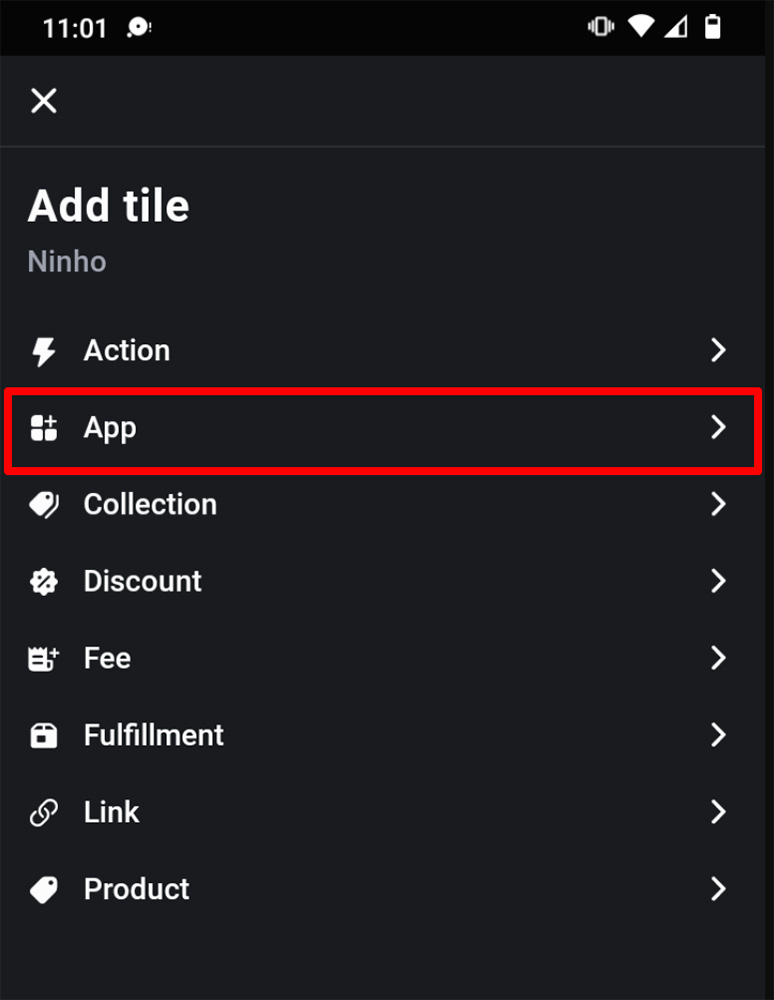
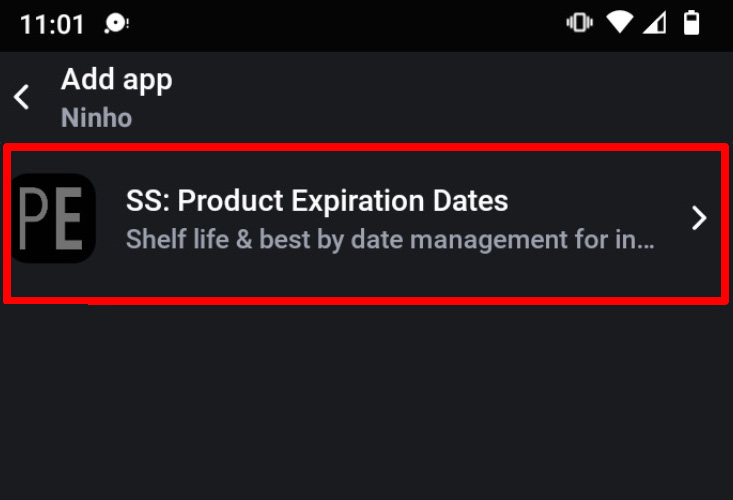
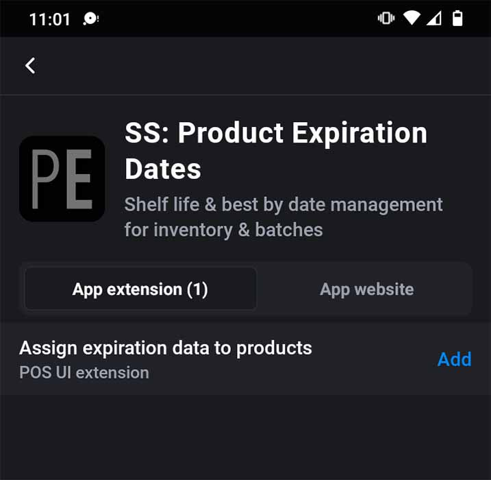
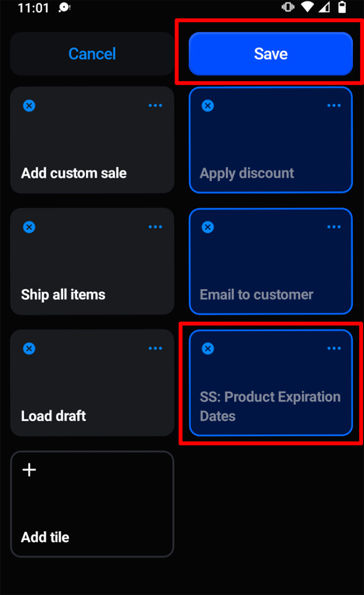

import Link from '@site/src/components/ProductExpirationDates/Link';

# Intégration de Shopify PDV (Point de vente)

***L'intégration de Shopify PDV n'est disponible qu'avec le <Link path="/charges/recurring/new">forfait Platinum</Link>***

Notre intégration avec Shopify PDV permet d'attribuer des lots d'inventaire aux commandes directement depuis Shopify PDV. Pour l'installer, ajoutez l'application Product Expiration Dates comme vignette sur l'écran d'accueil du PDV :

1.  Depuis l'écran d'accueil du PDV, appuyez sur « Add tile » (« Ajouter une vignette ») et sélectionnez « App » (« Application ») :
    
    
    
2.  Dans la liste des applications, sélectionnez « SS: Product Expiration Dates » :
    
    
    
3.  À côté de « Assign expiration data to products », cliquez sur « Add » (« Ajouter ») :
    
    
    
4.  Cela affichera la vignette « SS: Product Expiration Dates » sur la page d'accueil :
    
    
    
5.  Appuyez sur « Save » (« Enregistrer »)

Maintenant, lorsque des articles sont dans le panier, vous pouvez appuyer sur la vignette « SS: Product Expiration Dates » et attribuer des lots d'inventaire. Les lots affichés seront ceux de l'emplacement du PDV.
