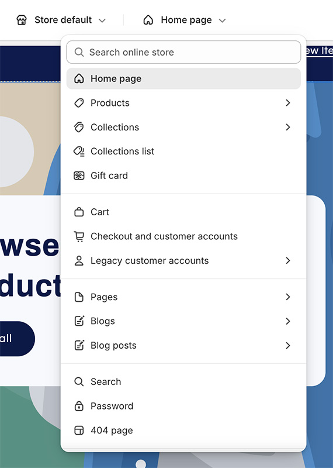
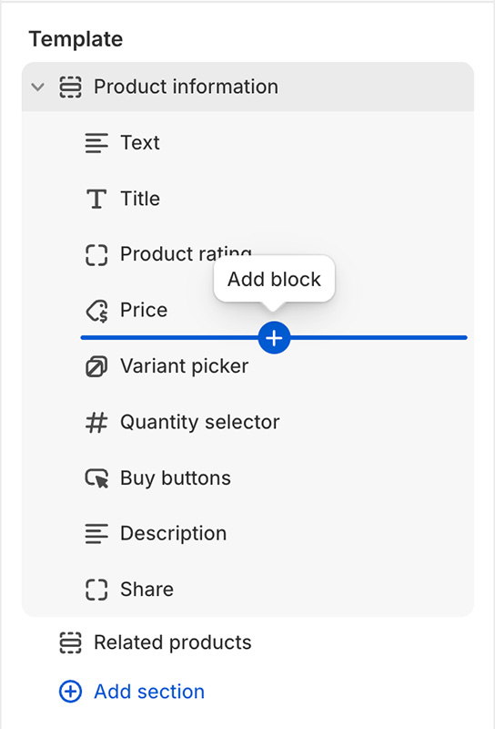
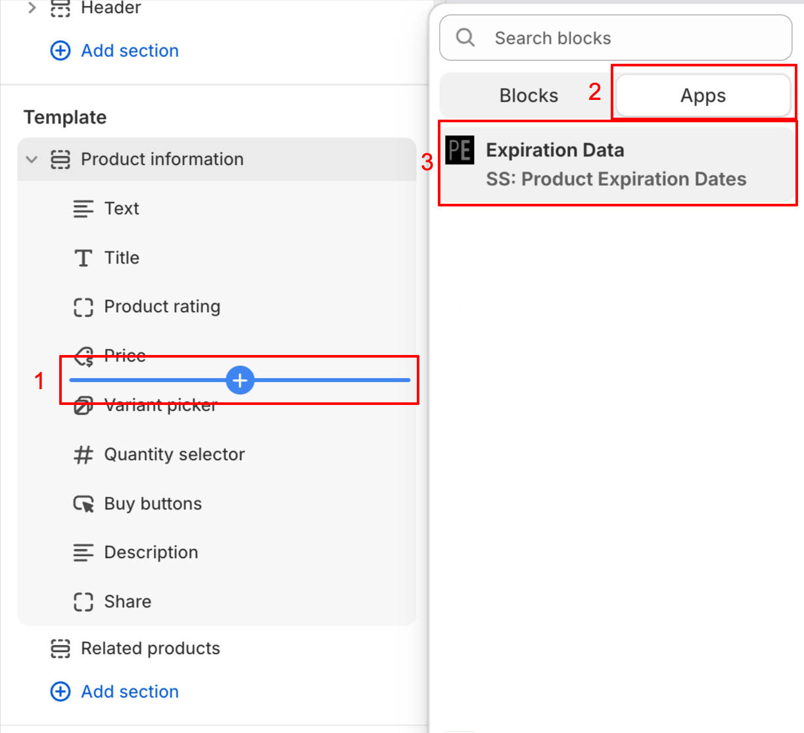
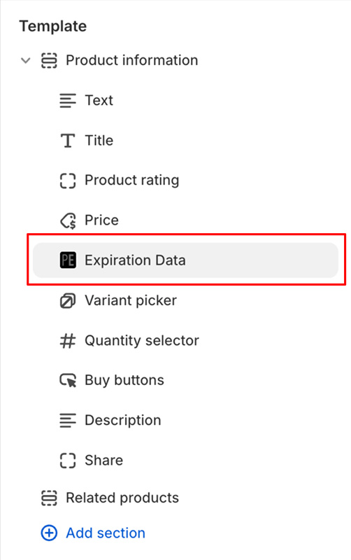

import ShopifyLink from '@theme/ShopifyAdminLink';
import ShopifyCurrentTheme from '@site/src/components/ShopifyCurrentTheme';

# Ajouter des données d'expiration à votre site

Il est possible d'accéder aux données d'expiration de votre site et/ou de les afficher. Cela comprend les dates d'expiration, leurs quantités et les données de délai d'utilisation. La façon la plus simple d'afficher ces informations est d'utiliser notre intégration avec [l'éditeur de thèmes Shopify](https://help.shopify.com/fr/manual/online-store/themes/customizing-themes/theme-editor/using-the-theme-editor#access-the-theme-editor), qui permet d'ajouter les données d'expiration [sous forme de section ou de bloc](https://help.shopify.com/fr/manual/online-store/themes/customizing-themes/theme-editor/using-the-theme-editor#sections-and-blocks).

1.  <ShopifyCurrentTheme>Ouvrez votre thème</ShopifyCurrentTheme> dans l'éditeur de thèmes
1.  Dans l'éditeur de thèmes, sélectionnez le modèle auquel vous souhaitez ajouter les données d'expiration :

    

1.  Sélectionnez l'emplacement souhaité dans le modèle. Cela peut se faire en plaçant le curseur sur la zone d'insertion souhaitée :

    

1.  Cliquez sur le bouton d'ajout de bloc et sélectionnez « Expiration Data » dans la section Applications :

    

1.  Cela ajoutera un bloc « Expiration Data » au modèle sélectionné :

    

1.  Cliquez sur le bloc « Expiration Data » pour accéder à des options de configuration supplémentaires. Pour les produits avec plusieurs variantes, les données d'expiration de la variante sélectionnée seront affichées. Plusieurs blocs peuvent être ajoutés pour répondre à différents cas d'usage. Par exemple, vous pouvez ajouter 1 bloc pour afficher les dates d'expiration, et un autre pour afficher les données de délai d'utilisation.
1.  Cliquez sur <kbd>Enregistrer</kbd>

## Ajouter notre extrait de code à votre thème {/* #adding-liquid-snippet */}

**L'ajout des données d'expiration doit se faire via [notre intégration de thème Shopify](/docs/product-expiration-dates/shopify-pages). Ajouter l'extrait de code explicitement n'est nécessaire que dans des cas particuliers.**

1.  <ShopifyLink href={(shopify) => shopify.toString()}>Accédez à l'interface administrateur Shopify</ShopifyLink>
2.  [Ouvrez l'éditeur de code de votre thème](https://shopify.dev/docs/storefronts/themes/tools/code-editor#accessing-the-code-editor)
3.  [Ajoutez un nouveau fichier de thème](https://shopify.dev/docs/storefronts/themes/tools/code-editor#adding-theme-files)
    -   Cliquez sur le dossier « snippets »
    -   Cliquez sur « Add new snippet » (« Ajouter un extrait »)
    -   Comme nom de fichier, utilisez `ss-product-expiration-dates`
    -   Cliquez sur « Done » (« Terminé »)
4.  Cela ouvrira un nouvel onglet vide dans l'éditeur nommé `snippets/ss-product-expiration-dates.liquid`
5.  Copiez le code de [notre snippet Liquid](/product-expiration-dates/images/ss-product-expiration-dates.txt) et collez-le dans l'onglet
6.  Cliquez sur <kbd>Enregistrer</kbd>

## Afficher les données d'expiration

Une fois que vous avez [ajouté notre extrait de code à votre thème](/docs/product-expiration-dates/shopify-pages#adding-liquid-snippet), l'étape suivante consiste à le rendre à l'endroit où vous voulez que les données d'expiration soient affichées. Cela peut se faire depuis l'interface administrateur Shopify, via l'éditeur de thèmes.

1.  <ShopifyCurrentTheme>Ouvrez votre thème</ShopifyCurrentTheme> dans l'éditeur de thèmes
1.  Dans l'éditeur de thèmes, sélectionnez « Produits » (« Products ») puis « Produit par défaut » (« Default product », ou le modèle souhaité)
1.  Dans la section Modèle, cliquez sur « Ajouter un bloc » (« Add block »)
1.  Sélectionnez « Liquid personnalisé » (« Custom liquid ») ou, s'il n'est pas disponible, « HTML » (notez que le bloc « HTML » doit prendre en charge Liquid)

-   Si votre thème n'a ni l'option « Custom liquid » ni l'option « HTML », vous devez insérer l'extrait dans votre thème manuellement
-   Cela peut se faire via [l'éditeur de code du thème](https://shopify.dev/docs/themes/tools/code-editor)
-   Si vous avez besoin d'aide, veuillez [contacter l'assistance](https://screenstaring.com/#contact)

1.  Une fois sélectionné, vous pouvez déplacer le bloc Liquid personnalisé à l'endroit où vous voulez que les données d'expiration soient affichées
1.  Cliquez sur le bloc Liquid personnalisé que vous venez d'ajouter
1.  Dans le champ « Liquid personnalisé » (« Custom liquid » ou similaire), collez le code de rendu souhaité (voir les options d'affichage des données d'expiration pour des exemples)
1.  Cliquez sur <kbd>Enregistrer</kbd>

## Afficher les dates d'expiration selon la langue/région de l'utilisateur {/* #display-language-region */}

Si vous affichez votre site en plusieurs langues, vous pouvez modifier le format et le texte de la date d'expiration selon la langue et/ou la région sélectionnée. Au lieu de rendre la date d'expiration avec le code par défaut :

```liquid
{% render "ss-product-expiration-dates", product: product, prefix: "Best by:", format: "%B %d, %Y" %}
```

Vous pouvez utiliser le code suivant pour vérifier la langue et/ou la région sélectionnée et afficher la date d'expiration et le texte dans un format spécifique :

```liquid


  {% render "ss-product-expiration-dates", product: product, prefix: "Consúmase antes de:", format: "%d/%m/%Y" %}

  {% render "ss-product-expiration-dates", product: product, prefix: "Mindestens haltbar bis:", format: "%d.%m.%Y" %}

  

```

Ici, si la langue est l'espagnol (`"es"`), le texte `"Consúmase antes de:"` est affiché et la date est présentée au format `DD/MM/YYYY`. Si la langue est l'allemand (`"de"`), le texte et la date sont affichés dans un format adapté aux germanophones. Et si la langue n'est ni l'une ni l'autre, nous affichons la date dans un format adapté aux anglophones.

Si vous voulez afficher du texte en fonction de la langue **et** du pays de l'utilisateur, vous pouvez ajouter un cas qui vérifie la variable `locale`. Dans cet exemple, nous affichons la date au format `YYYY/MM/DD` si l'utilisateur se trouve en Espagne, et au format `DD/MM/YYYY` s'il se trouve dans un autre pays hispanophone :

```liquid


  {% render "ss-product-expiration-dates", product: product, prefix: "Consúmase antes de:", format: "%Y/%m/%d" %}

  {% render "ss-product-expiration-dates", product: product, prefix: "Consúmase antes de:", format: "%d/%m/%Y" %}

```
