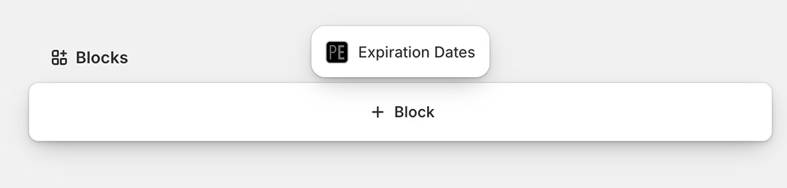
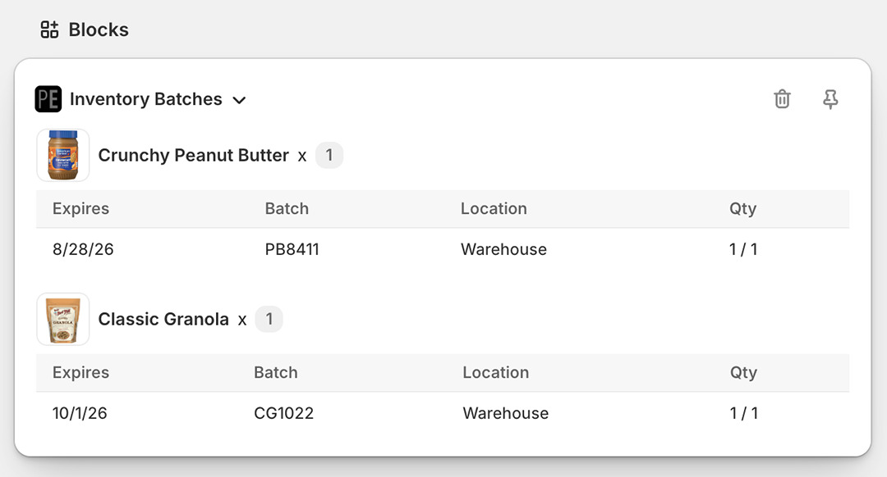
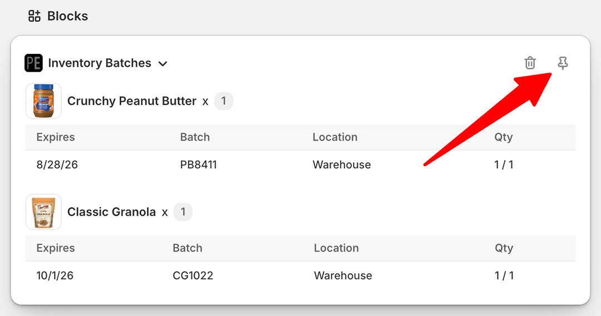
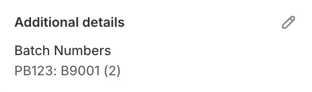

import Link from '@site/src/components/ProductExpirationDates/Link';

# Consulter les dates d'expiration et les numéros de lot des commandes dans Shopify

Il existe plusieurs façons de consulter les numéros de lot et les dates d'expiration attribués à une commande depuis [la page de la commande dans l'interface administrateur Shopify](https://help.shopify.com/fr/manual/orders/manage-orders#view-an-order).

## Bloc de l'administrateur

Pour ajouter le bloc Expiration Dates à la page des commandes :

1.  Ouvrez votre commande dans [l'interface administrateur Shopify](https://help.shopify.com/fr/manual/orders/manage-orders#view-an-order)
2.  Sur la page de la commande, faites défiler vers le bas et sélectionnez « Ajouter un bloc » (« Add block »)

    

3.  Sélectionnez « Expiration Dates » dans le menu qui s'affiche
4.  Cela affichera les dates d'expiration attribuées aux lignes de la commande, s'il y en a. Notez que seules les commandes **après** le 11 septembre 2026 auront leurs dates affichées :

    

5.  Pour que le bloc apparaisse toujours sur la page de la commande, cliquez sur l'icône d'épingle :

    

## Section Détails supplémentaires (« Additional Details »)

Les numéros de lot peuvent être ajoutés à la page des commandes dans la section Détails supplémentaires :

1.  Dans les paramètres de l'application, allez dans <Link path="/settings#orders">l'onglet Commandes</Link>
1.  Sélectionnez « Créer une entrée « détails supplémentaires » de commande avec les lots d'inventaire d'une commande »
1.  Cliquez sur le bouton <kbd>Mettre à jour</kbd> pour enregistrer

Les lots d'inventaire des nouvelles commandes seront maintenant ajoutés à la section Détails supplémentaires (« Additional Details ») de la commande dans l'interface administrateur Shopify :

   

Les informations suivantes sont incluses :

- `PB123` : le SKU de la ligne de commande
- `B9001` : le numéro de lot attribué à la ligne de commande
- `(2)` : la quantité

## Consulter la commande dans l'application

Pour ouvrir la page d'une commande dans l'application :

1.  Ouvrez votre commande dans l'interface administrateur Shopify
2.  Sur la page de la commande, sélectionnez « Autres actions » (« More actions »)
3.  Sélectionnez « Expiration Dates »
