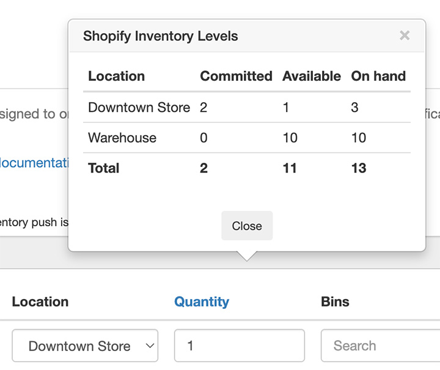

import Link from '@site/src/components/ProductExpirationDates/Link';

# 商品への有効期限データの追加

有効期限データは、商品の<Link path="/inventories/new">在庫バッチページ</Link>で商品に追加できます。また、[有効期限データの一括インポート](/docs/product-expiration-dates/batch-import)や[商品のバーコードのスキャン](/docs/product-expiration-dates/barcode-scanner)によって追加することも可能です。登録できるデータには以下の3種類があります：

-   在庫バッチ
-   使用期限（開封後）の値
-   商品の割引

紹介動画は[こちら](https://youtu.be/vjLB_v1OHpw)からご覧いただけます。

## 在庫バッチ

在庫バッチは、有効期限データの基本となる主要データです。設定された値は注文に割り当てられ、有効期限通知の送信や、商品の割引開始タイミングの判定に使用されます。
また、[サイト上に在庫バッチ情報を表示](/docs/product-expiration-dates/shopify-pages)して、顧客に商品の賞味・消費期限や開封後の使用期限の目安を案内することもできます。

:::info
バッチを作成する前に、必ず[在庫管理方法を選択](/docs/product-expiration-dates/selecting-inventory-management-method)してください。
:::

### 在庫バッチを割り当てるタイミング

「在庫バッチを割り当てるタイミング」項目では、在庫バッチを注文にいつ割り当てるかを指定します。「注文が行われたとき」または「注文アイテムのフルフィルメント完了時」のいずれかを選択できます。デフォルトは「注文が行われたとき」です。例えば、先入先出（FEFO）の<Link path="/settings#inventory">在庫管理方法を使用している</Link>場合、新規注文には有効期限が最も近いバッチが割り当てられます。どのロケーションが選択されるかの設定については、[注文への在庫バッチのロケーション割り当て](/docs/product-expiration-dates/order-batch-location-assignment)をご覧ください。

### 有効期限、バッチ番号、数量、ロケーション

「有効期限（Expires）」はそのバッチの賞味・消費期限です。「数量（Quantity）」は利用可能数量です（下記の「*利用可能数量と手元在庫数量*」も参照してください）。「ロケーション（Location）」はバッチが存在するShopifyのロケーションです。「バッチ番号（Batch）」はバッチ番号です（省略可能）。「Quantity」リンクをクリックすると、該当商品またはバリエーションのShopifyでの利用可能数量を確認できます：

例えば、商品AがShopifyの「Warehouse」ロケーションに10個あるとします。この10個のうち、6個が2025年期限、4個が2024年期限である場合、アプリには以下のように登録します：

-   有効期限: `2025-01-01`, 数量: `6`, ロケーション: `Warehouse`
-   有効期限: `2024-11-21`, 数量: `4`, ロケーション: `Warehouse`

### 請求書番号、ロット番号、入荷日、製造日、メモなど... {/* #lot-number-etc-assignment */}

各在庫バッチには追加データを関連付けることができます。歯車アイコンをクリックして「バッチ」タブでの表示を有効にすることで、これらの項目に値を設定できるようになります：

必要な項目を選択し、<kbd>「保存」</kbd>ボタンをクリックします。

### 利用可能数量と手元在庫数量

在庫プッシュを使用している場合、「手元在庫数量（On Hand）」または「利用可能数量（Available）」のいずれかを設定できます。詳細については[在庫プッシュ](/docs/product-expiration-dates/inventory-push)のドキュメントをご覧ください。

### フルフィルメントロケーションの設定

[注文への在庫バッチのロケーション割り当て](/docs/product-expiration-dates/order-batch-location-assignment)をご覧ください。

### その後の動作

先入先出（FEFO）の<Link path="/settings#inventory">在庫管理方法</Link>を使用し、商品の在庫バッチデータを入力し、「在庫バッチを割り当てるタイミング」で「注文が行われたとき」を選択しているとします。この商品に対する注文が入ると、アプリは注文に割り当てられたロケーション（店舗注文の場合）から有効期限が最も近い在庫バッチを自動で割り当てます。注文にロケーションが割り当てられていない場合は、登録された全データの中から最も有効期限が近い在庫バッチを割り当てます。注文品目が在庫に戻された（再入荷）場合や返金された場合など、有効期限が最も近い在庫バッチの割り当てが解除され、今後の注文に再割り当てできるようになります。

注文にどの在庫バッチが割り当てられたかは、<Link path="/order_line_items">アプリの注文ページ</Link>で確認できます。

また、[有効期限関連の情報をサイト上に表示](/docs/product-expiration-dates/shopify-pages)したり、[納品書や通知に追加](/docs/product-expiration-dates/notifications-and-packing-slip)したりすることもできます。

## 使用期限の値

これはサイト上に表示できる補足情報です。開封後に商品を消費・使用することが推奨されるメーカー推奨期間を表します。例えば、在庫バッチからの「賞味期限：2025年7月1日」と合わせて、ここから「開封後30日以内にお使いください」といった表示が可能です。

## 商品の割引

***商品の割引機能は<Link path="/charges/recurring/new">Premiumプラン</Link>以上でご利用いただけます***

:::info
商品の割引を設定する際は、[ルールセット](/docs/product-expiration-dates/discounts#rulesets)の使用をお勧めします。
ルールセットを使用すると段階的な割引を設定できますが、設定画面や「割引」タブで指定する従来方式の割引では段階的な設定はできません。
:::

商品ごとの個別の割引は「割引」タブで設定できます。在庫バッチの有効期限が近づくと、指定された割合で商品の価格が自動的に引き下げられます。

これらの項目のデフォルト値は、割引設定ページの<Link path="/settings#discounts~product_defaults">「商品のデフォルト設定」セクション</Link>で設定できます。アプリに新しい商品を追加する際、ここで設定した値が「割引」タブの項目に自動で入力されます。

全商品に適用するグローバルな割引を設定する方法については、[期限切れ間近の商品の割引販売](/docs/product-expiration-dates/discounts)をご覧ください。
