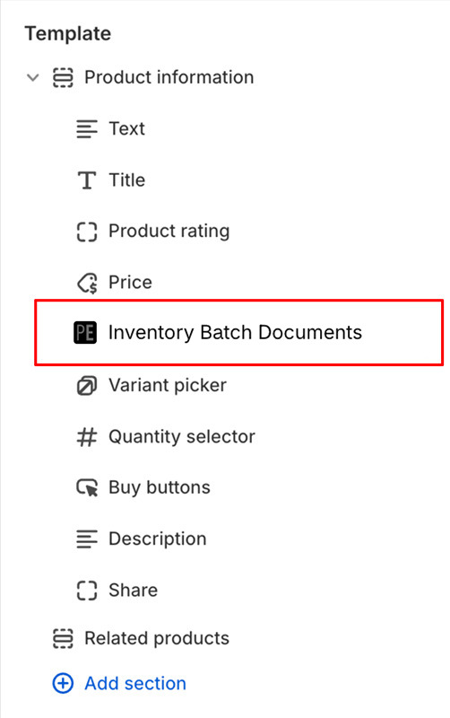

import Link from '@site/src/components/ProductExpirationDates/Link';
import ShopifyCurrentTheme from '@site/src/components/ShopifyCurrentTheme';

# バッチへのドキュメントのアップロード

***<Link path="/charges/recurring/new">Basicプラン</Link>ではドキュメントのアップロード機能はご利用いただけません***

PDF、画像などのファイルをアップロードすることで、分析証明書（COA）、オーガニック認証、賞味期限データ、安全性・規制関連シートなどを商品の在庫バッチに関連付けることができます。
各バッチには複数のドキュメントを追加できます。バッチ用にアップロードされたドキュメントは注文に自動的に関連付けられ、アプリ内の注文ページから確認できます。

ドキュメントをアップロードする手順：

1. アプリの<Link path="/inventory_expiration_date_allocations">在庫バッチページ</Link>に移動します
1. ドキュメントをアップロードしたいバッチを持つ商品を検索します
1. 「バッチ」タブで対象のバッチを見つけます
1. 「表示」>「ドキュメント」をクリックします
1. 「ファイルを選択」をクリックし、アップロードするドキュメントを選択します

これで、選択したドキュメントがバッチに関連付けられます。

## 商品ページへのバッチドキュメントの追加

[Shopifyテーマエディタ](https://help.shopify.com/ja/manual/online-store/themes/customizing-themes/theme-editor/using-the-theme-editor#access-the-theme-editor)連携機能を使用することで、商品ページにバッチドキュメントを追加し、ユーザーがアクセスできるようにすることができます。これにより、該当商品で利用可能なバッチドキュメントをユーザーが閲覧できるようにする[セクションまたはブロック](https://help.shopify.com/ja/manual/online-store/themes/customizing-themes/theme-editor/using-the-theme-editor#sections-and-blocks)を追加できます。

公開設定が「公開」になっているドキュメントのみが表示されます。公開設定は、アプリでバッチのドキュメントを表示している際に、「公開設定」フィールドから「公開」を選択することで設定できます。

購入できなくなったバッチに関連付けられているドキュメントは表示されません。

商品ページにバッチドキュメントを追加する手順：

1.  Shopifyテーマエディタで<ShopifyCurrentTheme>テーマを開きます</ShopifyCurrentTheme>
1.  テーマエディタで商品テンプレートを選択します：

    

1.  商品テンプレート内で希望の表示場所を選択します。挿入したいエリアにカーソルを合わせることで選択できます：

    

1.  ブロック追加ボタンをクリックし、「アプリ」セクションから「在庫バッチのドキュメント」を選択します：

    

1.  これにより、商品テンプレートに「在庫バッチのドキュメント」ブロックが追加されます：

    

1.  ブロックをクリックして設定オプションを開きます。アプリでバッチのドキュメントを表示している際に、「説明」フィールドからドキュメントの説明を追加できる点にご注意ください。

1.  <kbd>保存</kbd>をクリックします

これで、ユーザーは商品の現在の在庫バッチに関連付けられたドキュメントを閲覧できるようになります。

## 注文明細のバッチドキュメントの確認

注文明細に割り当てられたバッチに関連付けられているドキュメントを確認する手順：

1. アプリの<Link path="/order_line_items">注文ページ</Link>に移動します
1. アップロードされたドキュメントを確認したい注文を検索します
1. 注文をクリックし、対象の注文明細を見つけます
1. 「アクション」>「ドキュメントを表示」をクリックします
1. 確認したいドキュメント名をクリックします
