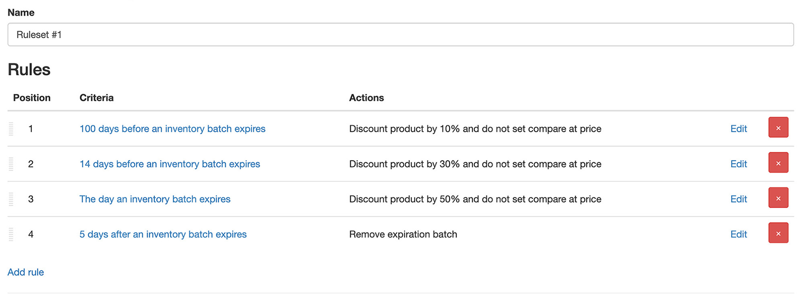

import Link from '@site/src/components/ProductExpirationDates/Link';

# 期限切れ間近の商品の割引販売

商品に設定された有効期限の対象期間内に在庫バッチがある場合、商品を自動的に割引できます。割引の設定には、1) [従来方式](/docs/product-expiration-dates/discounts#legacy-discounts)、2) [ルールセット](/docs/product-expiration-dates/discounts#rulesets) の2つの方法があります。ルールセットは推奨される設定方法で、複数段階（ティア別）の割引を設定できます。例えば、有効期限の100日前に10%割引し、5日前には30%割引するといった設定が可能です。

各方式の詳細については、以下のドキュメントをご覧ください。

## ルールセット {/* #rulesets */}

***ルールセットは<Link path="/charges/recurring/new">Platinumプラン</Link>でのみご利用いただけます***

ルールセットを使用すると、商品に適用する条件を定義し、その条件に一致したときに特定のアクションを実行できます。ルールセットは割引のためだけではなく、タグの追加・削除や商品タイトルの変更など、さまざまな用途に利用できます。例えば、以下のような割引を行いたいとします：

-   有効期限の100日前：10%割引
-   有効期限の14日前：30%割引
-   有効期限の当日：50%割引
-   有効期限の5日後：期限切れバッチを削除

これは、4つのルールを含む1つのルールセットを作成することで実現できます。各ルールには希望する条件（100日前、14日前など）とアクション（10%割引、30%割引など）を設定します。ルールの条件に一致すると、関連付けられたアクションが実行されます。

**注意：** 割引率は、割引が適用された時点での商品価格に基づきます。割引前の元の定価を基準にしたい場合は、各段階で「割引を追加」アクションと同時に「割引を解除」アクションも追加する必要があります。

### 有効期限の100日前：10%割引

1.  <Link path="/inventory_rules/rule_sets">ルールセットページ</Link>に移動します
2.  「ルールセットを追加」をクリックします
3.  新規在庫ルールセットページで、ルールセットに名前を付けます
4.  <kbd>「保存」</kbd>をクリックします
5.  新しいルールセットの詳細ページに移動し、割引ルールを追加できるようになります
6.  「ルールを追加」をクリックします
7.  条件項目で「在庫バッチの有効期限前」を選択します
8.  「有効期限までの日数」項目に「100」と入力します
9.  下部のアクションセクションで「割引を追加」を選択します
10. 「割引率」項目に「10」と入力します。Shopifyの割引前価格に割引前の通常価格を設定したい場合は、「通常価格を割引前価格として使用する」にチェックを入れます
11. <kbd>「保存」</kbd>をクリックします
12. これでルールセットに1つのルールが追加されました。残り3つのルールを追加します

### 有効期限の14日前：30%割引

1.  ルールセットの編集ページで、「ルールを追加」をクリックします
2.  条件項目で「在庫バッチの有効期限前」を選択します
3.  「有効期限までの日数」項目に「14」と入力します
4.  アクションセクションで「割引を追加」を選択します
5.  「割引率」項目に「30」と入力します
6.  <kbd>「保存」</kbd>をクリックします
7.  これでルールセットに2つのルールが追加されました。あと2つ追加します

### 有効期限の当日：50%割引

1.  ルールセットの編集ページで、「ルールを追加」をクリックします
2.  条件項目で「在庫バッチの有効期限後」を選択します
3.  「有効期限切れ後の日数」項目に「0」と入力します。これにより、商品の有効期限当日が条件として設定されます
4.  アクションセクションで「割引を追加」を選択します
5.  「割引率」項目に「50」と入力します
6.  <kbd>「保存」</kbd>をクリックします
7.  ルールセットに3つのルールが追加されました。最後にもう1つ追加します！

### 有効期限の5日後：期限切れバッチを削除

1.  ルールセットの編集ページで、「ルールを追加」をクリックします
2.  条件項目で「在庫バッチの有効期限後」を選択します
3.  「有効期限切れ後の日数」項目に「5」と入力します
4.  アクションセクションで「在庫バッチを削除」を選択します
5.  <kbd>「保存」</kbd>をクリックします

完成したルールセットは以下のようになります：

このルールセットはストア内のすべての商品に適用されます。ルール作成時に「商品」条件を選択することで、特定の商品やバリエーションに限定することも可能です。期限切れ間近のバッチ数量が完売した場合、ルールセットは解除され、商品/バリエーションはルール1が一致した時点の価格に戻されます。

「過去に遡って適用する」オプションを選択しない限り、**ルールセットのルールは定義された順序で一致する必要があります。** 例えば、ルール1と2が一致していない限り、ルール3が一致することはありません。

## 遡及一致 {/* #ruleset-retroactive-matching */}

通常、ルールセットは最初のルールに一致することでのみ在庫バッチへの適用を開始できます。バッチがすでにそのルールのタイミングを過ぎている場合（例えば、バッチを追加した後にルールセットを作成した場合など）、そのルールセットがそのバッチに適用されることはありません。

「過去に遡って適用する」オプションを選択すると、バッチの現在の日付に一致するルールからルールセットの適用を開始でき、それ以前のすべてのルールの各アクションも同時に適用されます。上記の例のルールセットの場合、有効期限まであと10日の商品は、1回の処理でルール1と2およびそれぞれの関連アクションが適用されます。2日前に期限切れとなったバッチには、ルール1と2が単独では一致しなくなっていても、ルール1、2、3が適用されます。

この初期一致が行われた後は、通常通りルールが適用されます（つまり、「過去に遡って適用する」が選択されていない場合と同じ動作になります）。

## 従来の割引方法 {/* #legacy-discounts */}

***従来の割引方法は<Link path="/charges/recurring/new">Proプラン</Link>以上でご利用いただけます***

従来の割引方法は、商品のコレクション、商品タイプ、または商品ごとに直接設定できます。割引が有効になると、期限切れ間近の在庫数量がすべて売り切れるか、該当する有効期限が変更されて設定した割引対象期間から外れるまで割引が継続します。

**デフォルトでは、割引はすべての利用可能数量に適用されます。** 例えば、商品が10個あり、そのうち3個のみが期限切れ間近である場合でも、割引を提供するとユーザーは**10個すべて**を割引価格で購入できるようになります。これはShopifyの製品価格設定の仕様によるものです。期限切れ間近の数量のみを割引価格で提供したい場合は、いくつかの対応策があります。[サポートにお問い合わせ](https://screenstaring.com/#contact)いただき、貴店のストアに最適な方法をご相談ください。

サイト上に割引や元の価格への復元が反映されるまで、数分かかる場合があります。

## 商品ごとに有効化する

1.  割引したい商品について、アプリに[有効期限を入力](/docs/product-expiration-dates/adding-expiration-data)します
2.  アプリ内の商品ページで「割引」タブをクリックします
3.  「割引」タブで「在庫バッチが有効期限範囲内にある場合に割引を提供する」にチェックを入れます
4.  「割引率」項目に、商品の通常価格から割り引く割合（%）を入力します。  
    例えば、商品の価格が50で「10」と入力した場合、割引が有効な間は45で販売されます。
5.  「割引開始までの日数（有効期限前）」項目に、商品の有効期限の何日前に割引を有効化するかを入力します。  
    例えば、商品の有効期限が1月15日で「10」と入力した場合、1月5日から割引が開始されます。
6.  <kbd>「保存」</kbd>ボタンをクリックします

## コレクションごとに有効化する

1.  割引したい商品について、アプリに[有効期限を入力](/docs/product-expiration-dates/adding-expiration-data)します
2.  アプリ内の商品ページで「割引」タブをクリックします
3.  「割引」タブで「在庫バッチが有効期限範囲内にある場合に割引を提供する」にチェックを入れます
4.  「割引率」項目に、商品の通常価格から割り引く割合（%）を入力します。  
    例えば、商品の価格が50で「10」と入力した場合、割引が有効な間は45で販売されます。
5.  「割引開始までの日数（有効期限前）」項目には値を入力しないでください。これは後ほどコレクションを設定する際に入力します
6.  <kbd>「保存」</kbd>ボタンをクリックします
7.  アプリの設定画面で<Link path="/settings#discounts">割引</Link>に移動します
8.  「コレクション別」セクションに移動します
9.  「タイトル」項目で、割引を設定したいコレクションを選択します
10. 「有効期限前の日数」項目に、コレクション内の商品の有効期限の何日前に割引を有効化するかを入力します。  
    例えば、商品の有効期限が1月15日で「10」と入力した場合、1月5日から割引が開始されます。
11. 別のコレクションを追加するには、「さらに追加」リンクをクリックします
12. <kbd>「更新」</kbd>ボタンをクリックします

## 商品タイプごとに有効化する

1.  割引したい商品について、アプリに[有効期限を入力](/docs/product-expiration-dates/adding-expiration-data)します
2.  アプリ内の商品ページで「割引」タブをクリックします
3.  「割引」タブで「在庫バッチが有効期限範囲内にある場合に割引を提供する」にチェックを入れます
4.  「割引率」項目に、商品の通常価格から割り引く割合（%）を入力します。  
    例えば、商品の価格が50で「10」と入力した場合、割引が有効な間は45で販売されます。
5.  「割引開始までの日数（有効期限前）」項目には値を入力しないでください。これは後ほど商品タイプを設定する際に入力します
6.  <kbd>「保存」</kbd>ボタンをクリックします
7.  アプリの設定画面で<Link path="/settings#discounts">割引</Link>に移動します
8.  「商品タイプ別」セクションに移動します
9.  「タイトル」項目で、割引を設定したい商品タイプを選択します。アプリに登録済みの商品タイプのみが表示されます。
10. 「有効期限前の日数」項目に、その商品タイプを持つ商品の有効期限の何日前に割引を有効化するかを入力します。  
    例えば、商品の有効期限が1月15日で「10」と入力した場合、1月5日から割引が開始されます。
11. 別の商品タイプを追加するには、「さらに追加」リンクをクリックします
12. <kbd>「更新」</kbd>ボタンをクリックします
