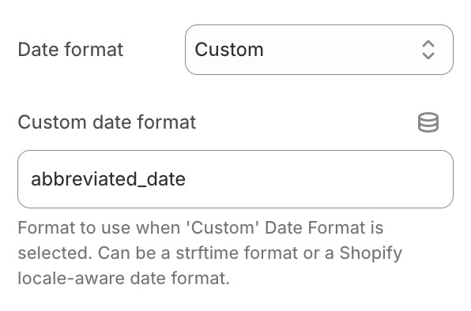

# 選択された国に応じた日付形式の切り替え

有効期限の日付フォーマットは、ユーザーが選択した国や地域に合わせて変更できます。これは、Shopify管理画面の[テーマコンテンツエディタ（言語エディタ）](https://help.shopify.com/ja/manual/online-store/themes/customizing-themes/language/change-wording#overview-of-the-language-editor)で設定された日付フォーマットに依存します。

[Shopifyテーマ連携機能](/docs/product-expiration-dates/shopify-pages)を使用している場合、「日付フォーマット」項目から「Custom」を選択し、Shopifyのロケール対応日付フォーマット名を入力することで設定できます。例えば、使用したいフォーマットの名前が `abbreviated_date` の場合、以下のように設定します：

Shopifyでは、使用できる日付フォーマット名が以下に制限されています：

-   `abbreviated_date`
-   `basic`
-   `date`
-   `date_at_time`
-   `default`
-   `on_date`
-   `short`
-   `long`

独自のカスタムフォーマット名も使用できますが、Shopifyテーマエディタ連携ブロックでは動作しません。この場合は、[テーマにスニペットを手動で追加](/docs/product-expiration-dates/shopify-pages#adding-liquid-snippet)し、`{{ allocation.time | date: format: "your_format_name" }}` のように形式を明示的に指定する必要があります。
