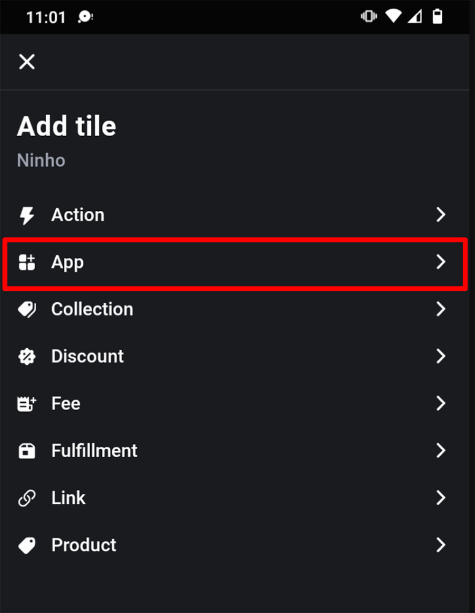
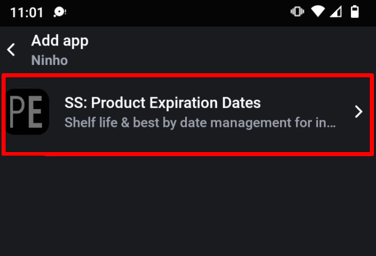
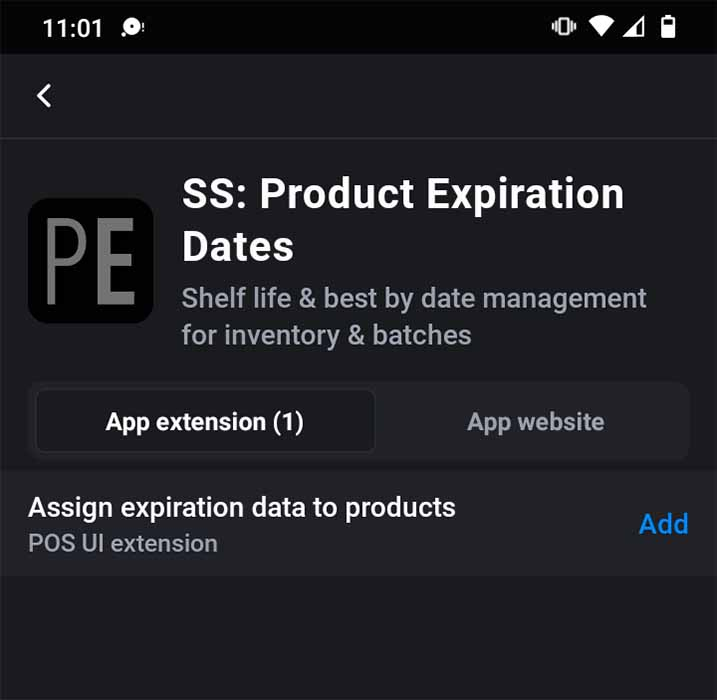
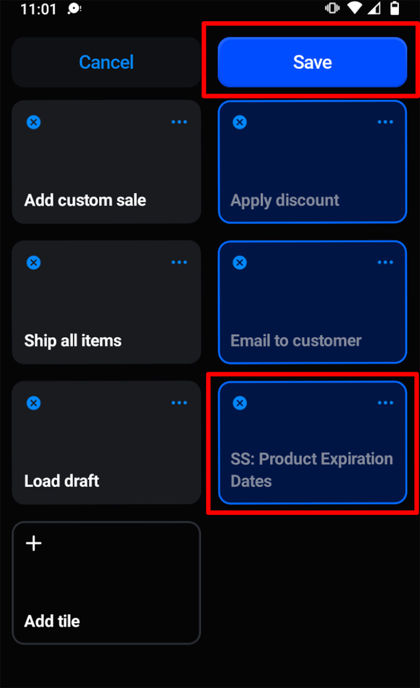

import Link from '@site/src/components/ProductExpirationDates/Link';

# Shopify POS（販売時点情報管理）連携

***Shopify POS連携は<Link path="/charges/recurring/new">Platinumプラン</Link>でのみご利用いただけます***

Shopify POS連携を使用すると、Shopify POS内から直接注文に在庫バッチを割り当てることができます。インストールするには、POSホーム画面にタイルとしてProduct Expiration Datesアプリを追加します：

1.  POSホーム画面で「タイルを追加」をタップし、「アプリ」を選択します：
    
    
    
2.  アプリ一覧から「SS: Product Expiration Dates」を選択します：
    
    
    
3.  「Assign expiration data to products」の横にある「追加」をクリックします：
    
    
    
4.  これにより、ホーム画面に「SS: Product Expiration Dates」タイルが表示されます：
    
    
    
5.  「保存」をタップします

これで、カートに商品が入っているときに「SS: Product Expiration Dates」タイルをタップして、在庫バッチを割り当てることができるようになります。表示されるバッチは、そのPOSのロケーションの在庫にあるものになります。
