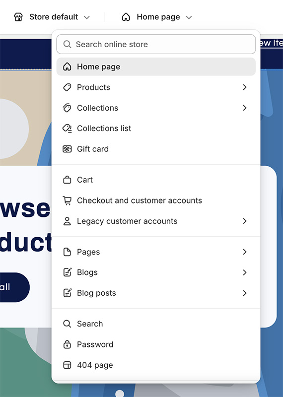
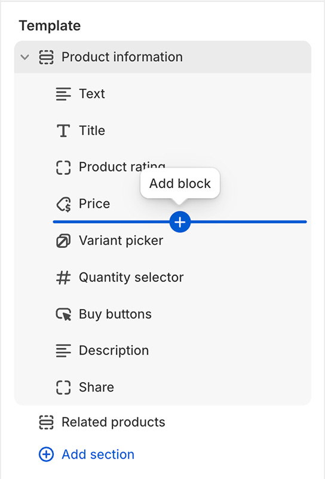
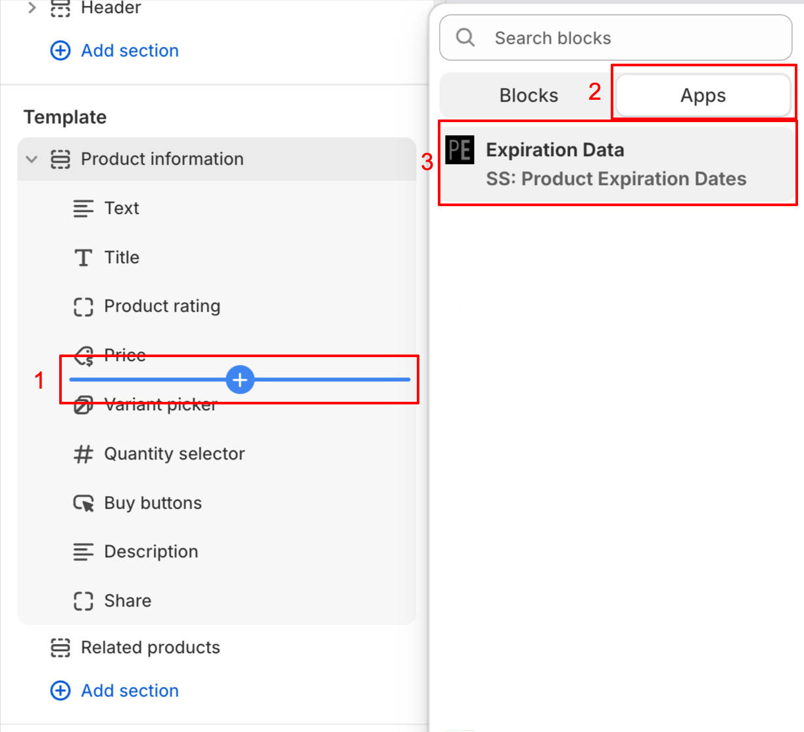
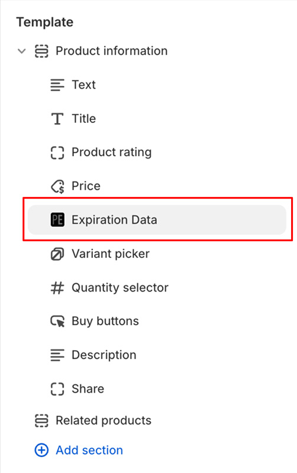

import ShopifyLink from '@theme/ShopifyAdminLink';
import ShopifyCurrentTheme from '@site/src/components/ShopifyCurrentTheme';

# サイトへの有効期限データの追加

サイト上から有効期限データにアクセスし、表示することができます。これには有効期限、数量、開封後の使用期限データが含まれます。この情報を表示する最も簡単な方法は、当社の[Shopifyテーマエディタ](https://help.shopify.com/ja/manual/online-store/themes/customizing-themes/theme-editor/using-the-theme-editor#access-the-theme-editor)連携機能を使用することです。これにより、有効期限データを[セクションまたはブロックとして](https://help.shopify.com/ja/manual/online-store/themes/customizing-themes/theme-editor/using-the-theme-editor#sections-and-blocks)追加できます。

1.  テーマエディタで<ShopifyCurrentTheme>テーマを開きます</ShopifyCurrentTheme>
1.  テーマエディタで、有効期限データを追加したいテンプレートを選択します：

    

1.  テンプレート内で追加したい場所を選択します。挿入したいエリアにカーソルを合わせることで選択できます：

    

1.  ブロック追加ボタンをクリックし、「アプリ」セクションから「Expiration Data」を選択します：

    

1.  選択したテンプレートに「Expiration Data」ブロックが追加されます：

    

1.  「Expiration Data」ブロックをクリックして、詳細設定オプションを開きます。複数のバリエーションがある商品の場合、選択されたバリエーションの有効期限データが表示されます。異なるユースケースに合わせて複数のブロックを追加することも可能です。例えば、有効期限を表示するブロックを1つ、使用期限データを表示するブロックをもう1つ追加することができます。
1.  <kbd>「保存」</kbd>をクリックします

## テーマへの独自スニペットの追加 {/* #adding-liquid-snippet */}

**有効期限データの追加は、通常[Shopifyテーマエディタ連携](/docs/product-expiration-dates/shopify-pages)を使用して行ってください。スニペットを明示的に追加するのは、特殊なカスタマイズが必要な場合のみです。**

1.  <ShopifyLink href={(shopify) => shopify.toString()}>Shopify管理画面を開きます</ShopifyLink>
2.  [テーマのコードエディタを開きます](https://shopify.dev/docs/storefronts/themes/tools/code-editor#accessing-the-code-editor)
3.  [新しいテーマファイルを追加します](https://shopify.dev/docs/storefronts/themes/tools/code-editor#adding-theme-files)
    -   「snippets」ディレクトリをクリックします
    -   「新しいスニペットを追加」をクリックします
    -   ファイル名に `ss-product-expiration-dates` と入力します
    -   「完了」をクリックします
4.  エディタ内で `snippets/ss-product-expiration-dates.liquid` という名前の新しい空のタブが開きます
5.  [当社のLiquidスニペット](/product-expiration-dates/images/ss-product-expiration-dates.txt)からコードをコピーし、そのタブに貼り付けます
6.  <kbd>「保存」</kbd>をクリックします

## 有効期限データの表示

[テーマにスニペットを追加](/docs/product-expiration-dates/shopify-pages#adding-liquid-snippet)したら、次は有効期限データを表示したい場所にレンダリングします。これは、Shopify管理画面のテーマカスタマイズページから行えます。

1.  テーマエディタで<ShopifyCurrentTheme>テーマを開きます</ShopifyCurrentTheme>
1.  テーマエディタで「商品」から「デフォルトの商品」（または対象のテンプレート）を選択します
1.  テンプレートセクションで「ブロックを追加」をクリックします
1.  「カスタムLiquid」（利用できない場合は「HTML」）を選択します（※「HTML」ブロックがLiquidをサポートしている必要があります）

-   お使いのテーマに「カスタムLiquid」も「HTML」オプションもない場合は、テーマのコード内に手動でスニペットを記述してレンダリングする必要があります
-   これは[テーマコードエディタ](https://shopify.dev/docs/themes/tools/code-editor)から行えます
-   サポートが必要な場合は、[お問い合わせ](https://screenstaring.com/#contact)ください

1.  選択後、カスタムLiquidブロックを有効期限データを表示したい位置に移動します
1.  追加したカスタムLiquidブロックをクリックします
1.  「カスタムLiquid」（または類似の項目）フィールドに、表示用のレンダリングコードを貼り付けます（例については以下の表示オプションを参照）
1.  <kbd>「保存」</kbd>をクリックします

## ユーザーの言語・地域に応じた有効期限の表示 {/* #display-language-region */}

サイトを多言語で表示している場合、現在選択されている言語や地域に応じて、有効期限の表示形式やテキストを変更できます。デフォルトのコードで有効期限をレンダリングする代わりに：

```liquid
{% render "ss-product-expiration-dates", product: product, prefix: "Best by:", format: "%B %d, %Y" %}
```

以下のコードを使用すると、選択された言語や地域を判定して、特定の形式で有効期限とテキストを表示できます：

```liquid



  {% render "ss-product-expiration-dates", product: product, prefix: "Consúmase antes de:", format: "%d/%m/%Y" %}

  {% render "ss-product-expiration-dates", product: product, prefix: "Mindestens haltbar bis:", format: "%d.%m.%Y" %}

  {% render "ss-product-expiration-dates", product: product, prefix: "Best by:", format: "%B %d, %Y" %}

```

ここでは、言語がスペイン語（`"es"`）の場合はテキスト「`Consúmase antes de:`」が表示され、日付は `DD/MM/YYYY` 形式で表示されます。言語がドイツ語（`"de"`）の場合はドイツ語話者に適した形式でテキストと日付が表示されます。そして、どちらでもない場合は英語話者に適した形式で日付が表示されます。

ユーザーの言語**および**国に基づいてテキストを表示したい場合は、`locale` 変数を判定する条件分岐を追加できます。以下の例では、ユーザーがスペインにいる場合は `YYYY/MM/DD` 形式で日付を表示し、他のスペイン語圏にいる場合は `DD/MM/YYYY` で表示します：

```liquid



 {% render "ss-product-expiration-dates", product: product, prefix: "Consúmase antes de:", format: "%Y/%m/%d" %}

  {% render "ss-product-expiration-dates", product: product, prefix: "Consúmase antes de:", format: "%d/%m/%Y" %}

  {% render "ss-product-expiration-dates", product: product, prefix: "Mindestens haltbar bis:", format: "%d.%m.%Y" %}

  {% render "ss-product-expiration-dates", product: product, prefix: "Best by:", format: "%B %d, %Y" %}

```
