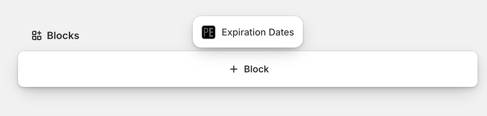
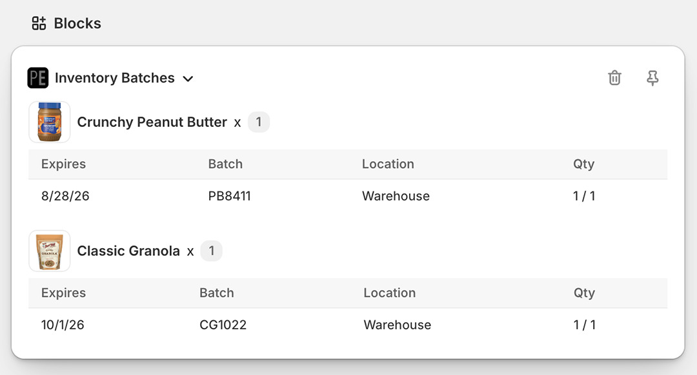
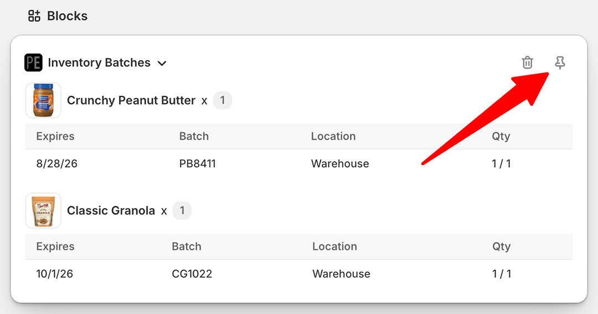
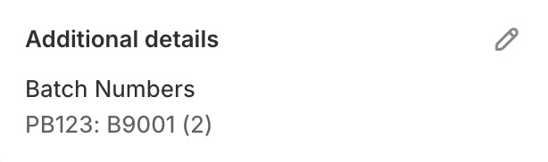

import Link from '@site/src/components/ProductExpirationDates/Link';

# Shopifyでの注文有効期限およびバッチ番号の確認

[Shopify管理画面の注文ページ](https://help.shopify.com/ja/manual/orders/manage-orders#view-an-order)から、注文に割り当てられたバッチ番号と有効期限を確認する方法は複数あります。

## 管理画面ブロック

注文ページに「Expiration Dates」ブロックを追加する手順：

1.  [Shopify管理画面](https://help.shopify.com/ja/manual/orders/manage-orders#view-an-order)で対象の注文を開きます
2.  注文ページの一番下までスクロールし、「ブロックを追加」を選択します

    

3.  ポップアップメニューから「Expiration Dates」を選択します
4.  これにより、注文明細に割り当てられている有効期限（存在する場合）が表示されます。なお、日付が表示されるのは2026年9月11日**以降**の注文のみとなりますのでご注意ください：

    

5.  注文ページで常にこのブロックが表示されるようにするには、ピン留めアイコンをクリックします：

    

## 「追加の詳細」セクション

バッチ番号は、注文ページの「追加の詳細」セクションに追加することもできます：

1.  アプリの設定画面で<Link path="/settings#orders">「注文」タブ</Link>に移動します
1.  「注文の在庫バッチ情報を含む注文の『追加の詳細』エントリを作成する」を選択します
1.  <kbd>「更新」</kbd>ボタンをクリックして設定を保存します

これで、新規注文の在庫バッチ情報がShopify管理画面の注文の「追加の詳細」セクションに追加されるようになります：

   

以下の情報が含まれます：

- `PB123`: 明細品目のSKU
- `B9001`: 明細品目に割り当てられたバッチ番号
- `(2)`: 数量

## アプリ内で注文を表示する

アプリ内で注文詳細ページを開く手順：

1.  Shopify管理画面で対象の注文を開きます
2.  注文ページで「その他の操作（More actions）」を選択します
3.  「Expiration Dates」を選択します
