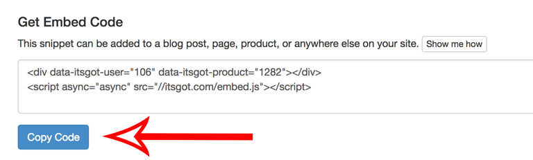
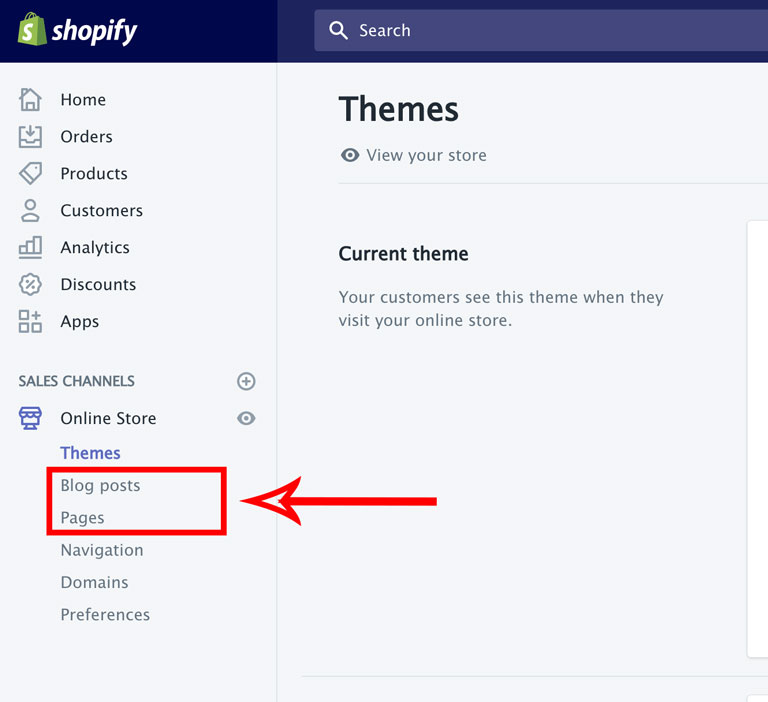
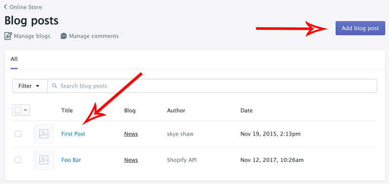
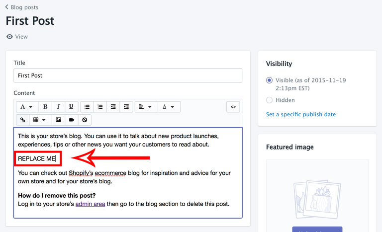
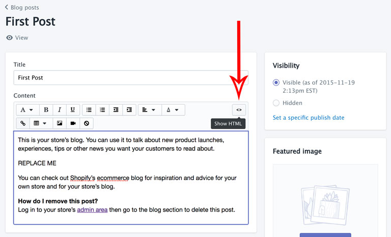
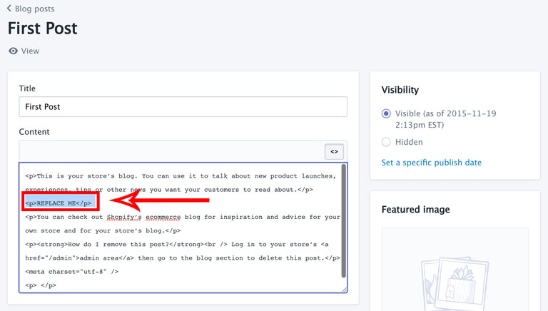
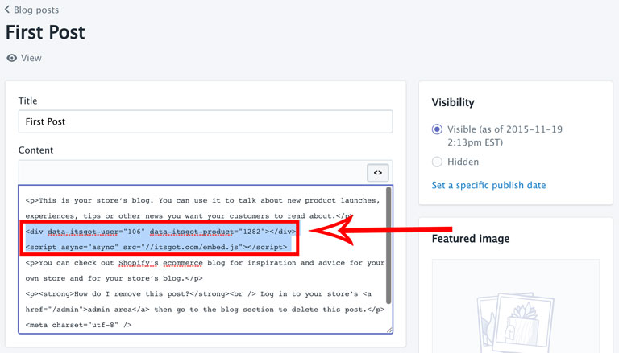
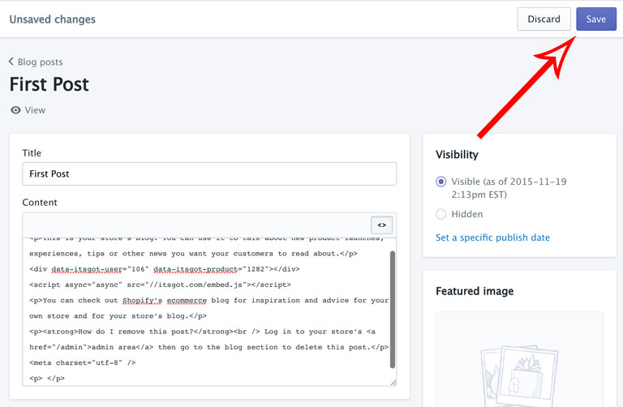

import Link from '@site/src/components/ItsGot/Link';

# Código de Incorporação do Rótulo

O código de incorporação do rótulo é um snippet HTML que permite adicionar um rótulo a qualquer página do seu site.

Para adicionar um rótulo usando o código de incorporação:

1. <Link path="/nutrition_facts/new">Crie um rótulo de produto</Link>.
   Se o produto já existir, localize-o na página <Link path="/nutrition_facts">Meus Rótulos</Link> e clique no nome do produto.

2. Clique no botão <kbd>Copiar Código</kbd> para copiar o código de incorporação para a área de transferência. Isso
   permitirá colar o código no seu site em uma etapa posterior:

   

3. Selecione onde deseja adicionar seu snippet. A captura de tela abaixo usa Posts do blog e Páginas,
   mas estas instruções também se aplicam a Coleções e Produtos:

   

4. Selecione um post de blog existente (ou página, coleção ou produto) ao qual deseja adicionar o rótulo.
   Se o post do blog não existir, adicione um novo:

   

5. Encontre o local na área de conteúdo onde deseja que o rótulo do produto seja exibido. Como você vai
   alternar para o modo HTML para inserir o código de incorporação, é uma boa ideia inserir algum texto
   marcador que você possa substituir depois. Neste caso, adicionamos o texto *REPLACE ME*:

   

6. Clique no botão para editar no modo HTML:

   

7. A área de Conteúdo agora mostra o código HTML:

   

8. Remova o texto *REPLACE ME* e cole o código de incorporação copiado na etapa 2:

   

9. Para concluir, clique no botão <kbd>Salvar</kbd>:

   

O rótulo do produto agora faz parte do post do blog.
