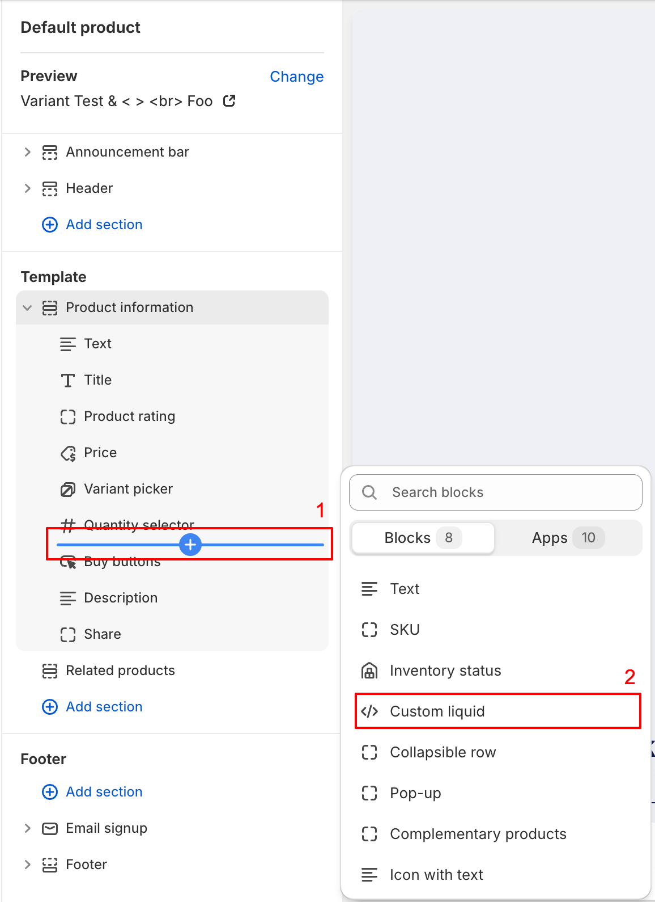
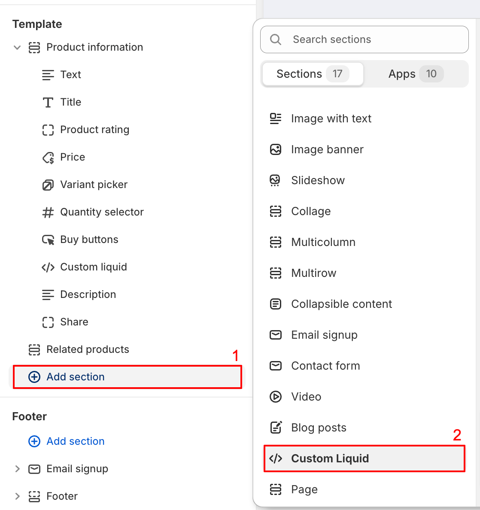
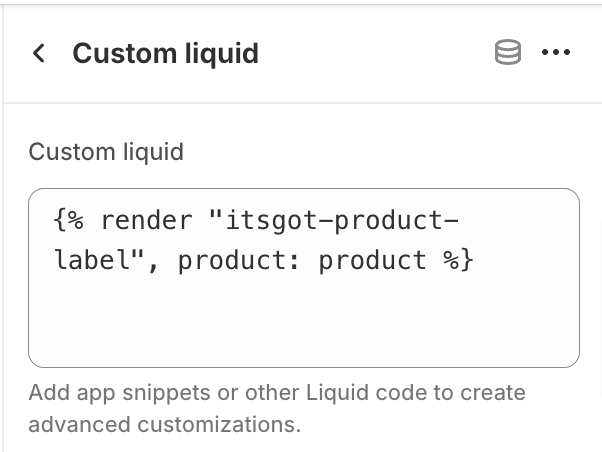

import ShopifyLink from '@theme/ShopifyAdminLink';
import ShopifyCurrentTheme from '@site/src/components/ShopifyCurrentTheme';

# Automaticamente ao Adicionar Nosso Snippet Liquid ao Seu Tema

:::info
A melhor maneira de adicionar rótulos de produtos ao seu site Shopify é [pelo editor de temas da Shopify](theme-editor).
As instruções aqui são apenas para os casos que não podem ser tratados pelo editor de temas.
:::

Este é um processo de duas etapas: 1) adicionar nosso snippet de código Liquid ao seu tema e 2) renderizar o snippet no local onde você deseja que o rótulo seja exibido.

## Adicionando Nosso Snippet ao Seu Tema {/* #adding-labels-liquid-snippet-theme */}

1. <ShopifyLink href={(shopify) => shopify.toString()}>Acesse o Admin da Shopify</ShopifyLink>
2. [Abra o editor de código do seu tema](https://shopify.dev/docs/storefronts/themes/tools/code-editor#accessing-the-code-editor)
3. [Adicione um novo arquivo de tema](https://shopify.dev/docs/storefronts/themes/tools/code-editor#adding-theme-files)
   - Clique no diretório *snippets*
   - Clique em <kbd>Adicionar novo snippet</kbd>
   - Para o nome do arquivo use `itsgot-product-label-embed-code.liquid`
   - Clique em <kbd>Concluído</kbd>
4. Isso abrirá uma nova aba em branco no editor com o nome `snippets/itsgot-product-label-embed-code.liquid`
5. Copie o código do [nosso snippet Liquid](/itsgot/images/itsgot-product-label-embed-code.txt) e cole na aba
6. Clique em <kbd>Salvar</kbd>
7. Clique novamente em [Adicionar um novo arquivo de tema](https://shopify.dev/docs/storefronts/themes/tools/code-editor#adding-theme-files)
   - Clique no diretório *snippets*
   - Clique em <kbd>Adicionar novo snippet</kbd>
   - Para o nome do arquivo use `itsgot-product-label.liquid`
   - Clique em <kbd>Concluído</kbd>
8. Isso abrirá uma nova aba em branco no editor com o nome `snippets/itsgot-product-label.liquid`
9. Copie o código do [nosso snippet Liquid](/itsgot/images/itsgot-product-label.txt) e cole na aba
10. Clique em <kbd>Salvar</kbd>

## Exibindo o Rótulo do Produto

Depois de [adicionar nosso snippet ao seu tema](#adding-labels-liquid-snippet-theme), a próxima etapa é renderizá-lo
no local onde você deseja que o rótulo seja exibido. Isso pode ser feito no Admin da Shopify, pela página de personalização do tema.

1. <ShopifyCurrentTheme>Abra seu tema</ShopifyCurrentTheme> no editor de temas
1. No editor de temas, selecione *Produtos* e depois *Produto padrão* (ou o modelo desejado)
1. Se você quiser adicionar o rótulo a uma seção existente, clique no botão de adicionar bloco dentro dessa seção e selecione *Liquid personalizado*
   ou, se não estiver disponível, *HTML* (observe que o bloco *HTML* deve ser compatível com Liquid):

   

1. Se você quiser adicionar o rótulo em uma nova seção, clique no botão <kbd>Adicionar seção</kbd> e selecione *Liquid personalizado* ou *HTML*, o que o seu tema oferecer:

   

1. Se o seu tema não tiver a opção *Liquid personalizado* nem *HTML*, você deve renderizar o snippet no seu tema manualmente.
   Isso pode ser feito pelo [editor de código do tema](https://shopify.dev/docs/themes/tools/code-editor).
   Se precisar de ajuda, [entre em contato com o suporte](https://screenstaring.com/#contact).
1. Clique no bloco ou na seção *Liquid personalizado* que você acabou de adicionar
1. No campo *Liquid personalizado* (ou similar), cole o seguinte código:

   ``

   

1. Clique em <kbd>Salvar</kbd>

Rótulos atuais e futuros agora aparecerão automaticamente na página dos produtos.
