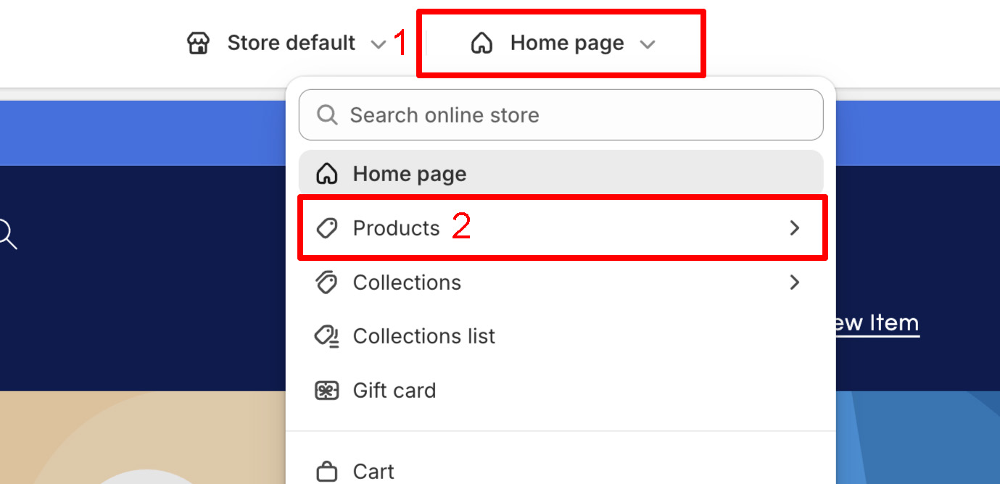
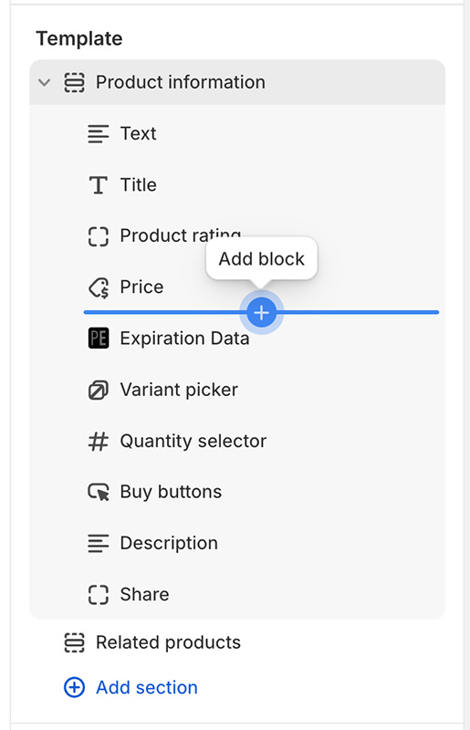
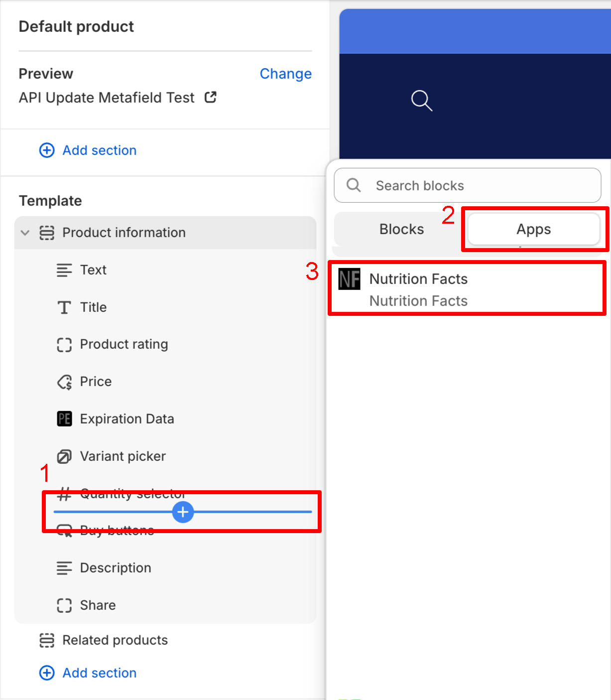
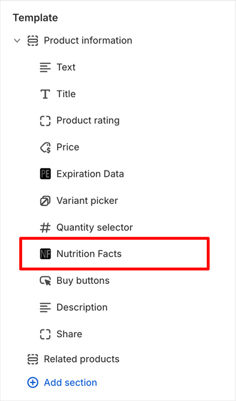
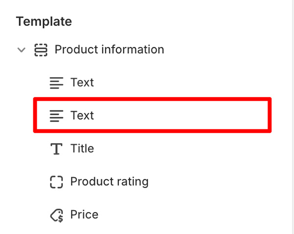
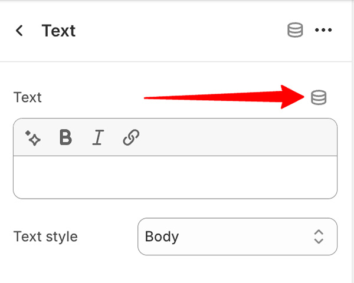
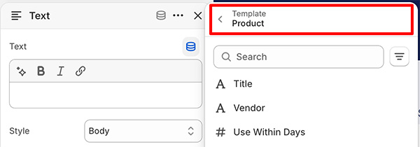
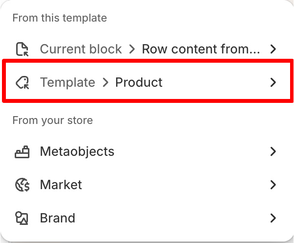
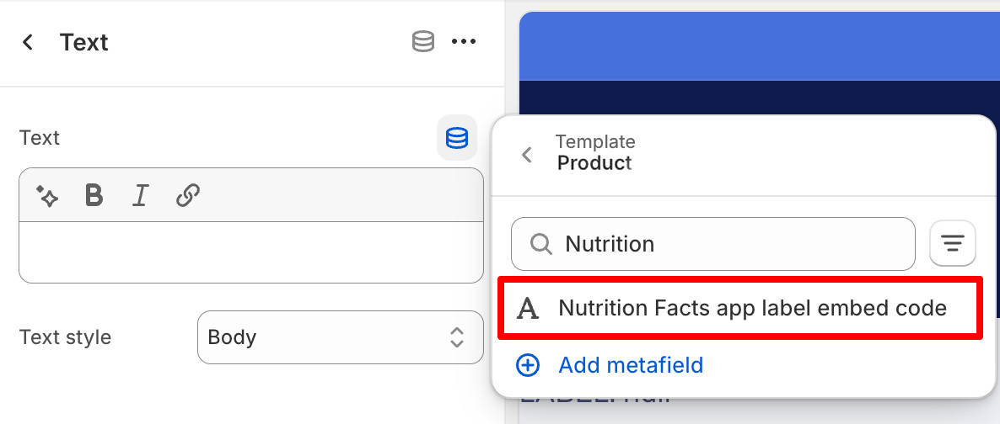
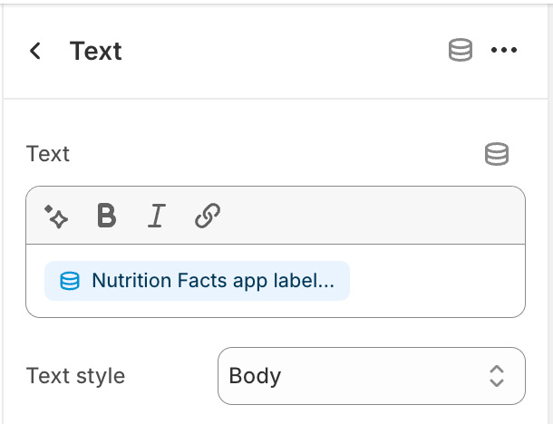

import ShopifyCurrentTheme from '@site/src/components/ShopifyCurrentTheme';

# Editor de Temas da Shopify

Usando o [editor de temas da Shopify](https://help.shopify.com/pt-BR/manual/online-store/themes/customizing-themes/theme-editor/using-the-theme-editor#access-the-theme-editor)
(personalização do tema), você pode adicionar rótulos
[como uma seção ou bloco](https://help.shopify.com/pt-BR/manual/online-store/themes/customizing-themes/theme-editor/using-the-theme-editor#sections-and-blocks)
a um modelo de produto ou conectá-los a uma seção ou bloco existente
[por meio de um metafield](https://help.shopify.com/pt-BR/manual/custom-data/metafields/displaying-metafields-on-your-online-store#theme-editor-metafields)
(fonte dinâmica).

## Adicionar Rótulo Como um Bloco

1. <ShopifyCurrentTheme>Abra seu tema</ShopifyCurrentTheme> no editor de temas
1. No editor de temas, selecione o modelo de produto ao qual você gostaria de adicionar os rótulos:

   

1. Selecione o local desejado dentro do modelo de produto. Isso pode ser feito passando o cursor sobre a área de inserção desejada:

   

1. Clique no botão de adicionar bloco e selecione *Nutrition Facts* na seção *Apps*:

   

1. Isso adicionará um bloco de *Nutrition Facts* ao modelo selecionado:

   

1. Clique no bloco de *Nutrition Facts* para acessar opções de configuração adicionais
1. Clique em <kbd>Salvar</kbd>

Os rótulos dos produtos agora serão exibidos em seu site.

## Adicionar Rótulo via Metafield

Isso só funciona se a seção ou o bloco de destino for compatível com fontes dinâmicas.

1. <ShopifyCurrentTheme>Abra seu tema</ShopifyCurrentTheme> no editor de temas
1. No editor de temas, encontre a seção ou o bloco ao qual você deseja adicionar os rótulos e clique nele. Neste exemplo, adicionamos a um bloco de *Texto*:

   

1. Nas configurações do bloco de *Texto*, clique no botão <kbd>Conectar fonte dinâmica</kbd>:

   

1. Certifique-se de que as fontes do modelo de produto estejam selecionadas:

   

   Se não estiverem selecionadas, clique no título selecionado atualmente e altere a fonte para o modelo de produto

   

1. Na lista de fontes dinâmicas, pesquise e escolha *Nutrition Facts app label embed code*:

   

1. Depois de selecionada, você a verá como fonte no campo associado:

   

1. Clique em <kbd>Salvar</kbd>

Os rótulos dos produtos agora serão exibidos em seu site.

## Em Outro Local

Se você quiser adicionar rótulos a um local fora do modelo de produto ou em qualquer outro lugar do seu site, tente uma das seguintes opções:

- [Snippet Liquid](/docs/itsgot/adding-labels/shopify/liquid-snippet)
- [Código de incorporação do rótulo](/docs/itsgot/adding-labels/embed-code)
