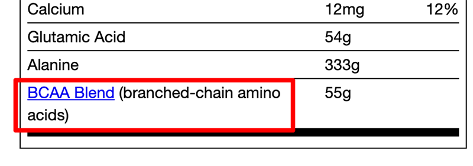

import Link from '@site/src/components/ItsGot/Link';

# Vinculando Páginas da Web a Nutrientes do Rótulo

Se a sua assinatura inclui <Link path="/app/plans">recursos do plano Premium</Link>, você pode transformar um nutriente ou ingrediente dietético do rótulo em um link para a página da web de sua escolha.

Para criar um link:

1. <Link path="/nutrition_facts/new">Crie</Link> ou edite um rótulo de produto existente
2. Na seção <Link path="/nutrition_facts/new#nutrients">Nutrientes</Link> ou <Link path="/nutrition_facts/new?label_format=supplement_vertical#dietary-ingredients">Ingredientes dietéticos</Link>, adicione ou edite um valor
3. Assim que um valor for inserido, você verá o link *Configurações de exibição*:

   

4. Clique no link para abrir a caixa de diálogo *Configurações de exibição*. No campo URL da seção *Link*, insira a página para a qual deseja criar o link.
5. Por padrão, o link será aberto na mesma página. Você pode configurá-lo para abrir em uma nova janela/aba selecionando *Abrir em uma nova janela/aba*.
6. Clique em <kbd>Salvar</kbd> ou <kbd>Atualizar</kbd> para salvar
7. Agora, quando o rótulo for exibido em seu site, aparecerá um link do nutriente ou ingrediente dietético para o URL informado

   

Para alterar a cor do link, consulte a seção [Modificar o Design de um Rótulo](/docs/itsgot/display-settings).
