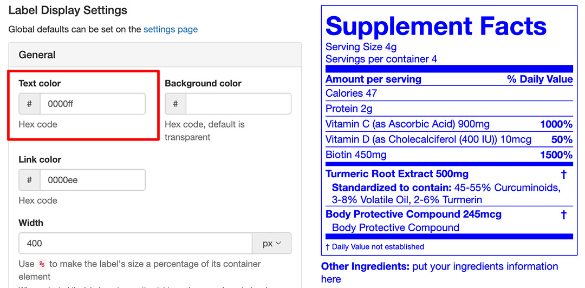
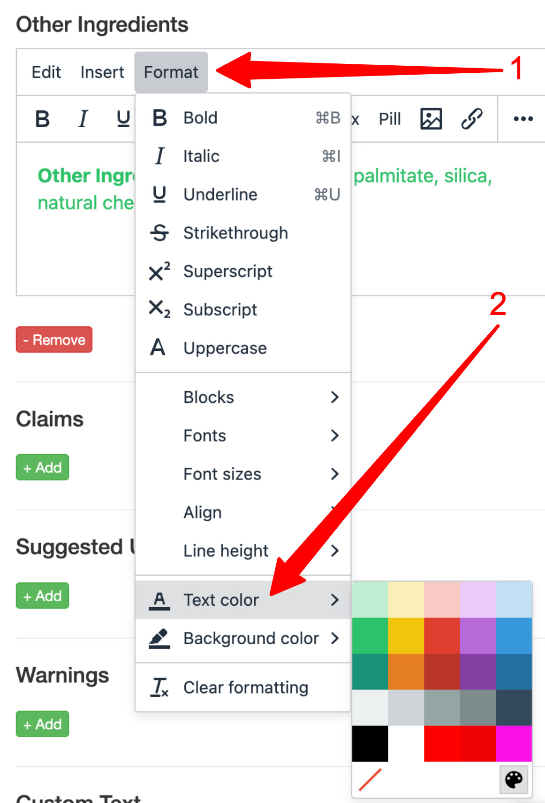
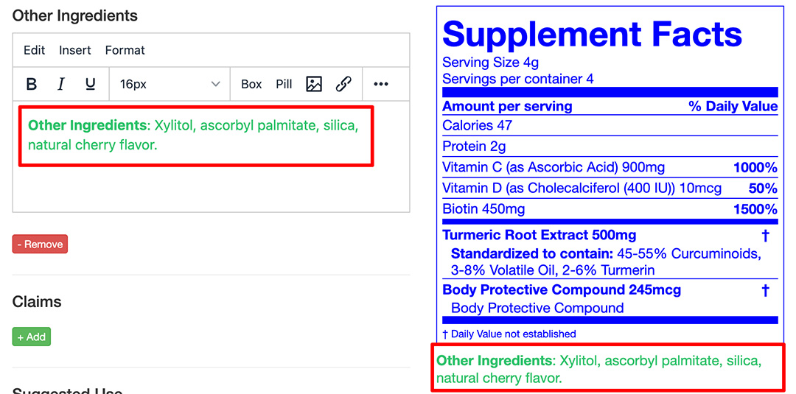
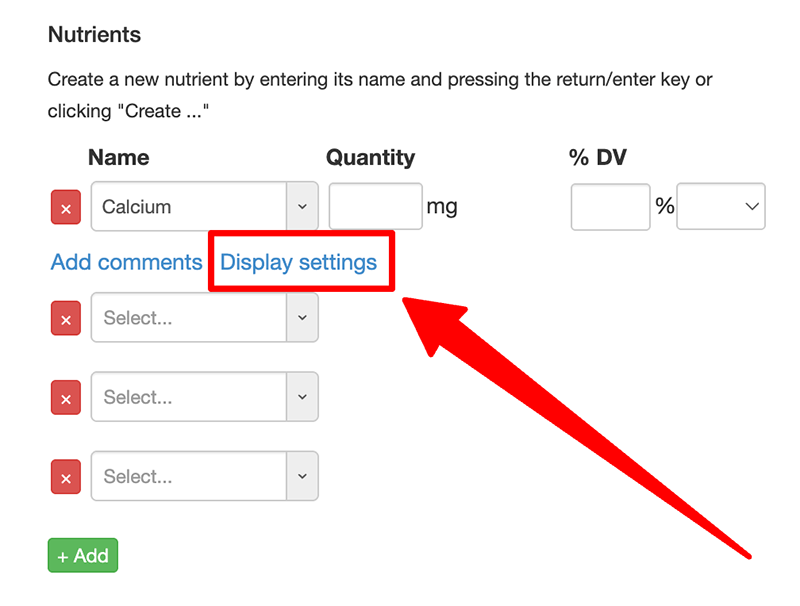

import Link from '@site/src/components/ItsGot/Link';

# Bordas, Cores e Recuo

:::info
Você pode definir valores padrão para essas opções na <Link path="/settings/edit#label-display-settings">página de configurações da sua conta</Link>
:::

## Definindo a Cor do Texto

A cor do rótulo e do seu texto pode ser definida na seção Configurações de Exibição do Rótulo. Blocos de texto e nutrientes individuais também podem ter suas cores definidas.

1. Encontre o produto desejado e clique no botão "Editar"
1. Acesse a seção Configurações de Exibição do Rótulo
1. Selecione "Geral"
1. Preencha o campo "Cor do texto" com o código de cor hexadecimal desejado:
   

     
   

1. Clique em <kbd>Atualizar</kbd>
1. Isso alterará todo o texto do rótulo para a cor selecionada

### Blocos de Texto

1. Na página do produto, acesse o bloco de texto desejado
1. No menu Formatar do bloco, selecione "Cor do texto"
1. Você pode escolher uma cor predefinida ou uma cor específica selecionando o ícone da paleta:
   

     
   

1. Clique em <kbd>Atualizar</kbd>
1. A cor será aplicada apenas ao bloco de texto. A cor padrão do rótulo não será afetada:
   

     
   

### Nutrientes

Use as configurações de exibição do nutriente para alterar sua cor:

1. No pop-up Configurações de Exibição, localize a seção Estilo
1. Preencha o campo "Cor do texto" com o código de cor hexadecimal desejado
1. Clique em <kbd>Ok</kbd>
1. Clique em <kbd>Atualizar</kbd>

## Definindo a Cor de Fundo

Por padrão, a cor de fundo é transparente para corresponder ao fundo do seu site.
Uma cor de fundo pode ser definida na seção Configurações de Exibição do Rótulo. Blocos de texto e nutrientes individuais também podem ter sua cor de fundo configurada.

1. Encontre o produto desejado e clique no botão "Editar"
1. Acesse a seção Configurações de Exibição do Rótulo
1. Selecione "Geral"
1. Preencha o campo "Cor de fundo" com o código de cor hexadecimal desejado
   {/* Image temporarily disabled: /itsgot/shopify/images/label-set-background-color.jpg not available
   

     
   

   */}
1. Clique em <kbd>Atualizar</kbd>
1. Isso fará com que todo o rótulo use a cor selecionada como fundo
