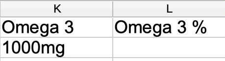
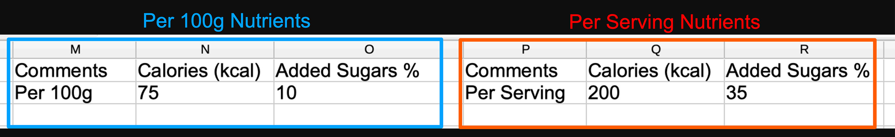

import Link from '@site/src/components/ItsGot/Link';

# Importando Produtos em Massa

Para importar seus produtos em massa:

1. [Baixe nosso modelo CSV](/itsgot/images/product-import-template.csv)
2. Adicione os dados do produto e as informações nutricionais
3. Acesse a página de <Link path="/products/import/new">Importação de produtos</Link> e faça upload do seu arquivo CSV
4. Observe que a planilha de exemplo não contém todos os nutrientes possíveis; consulte [Adicionando Nutrientes à Planilha](#adding-nutrients-to-the-spreadsheet)

O modelo CSV requer valores para as seguintes colunas:

- **Label Format** (Formato do rótulo)
  Deve ser um dos seguintes:

  - `ca:legacy:nutrition_facts:vertical`
  - `de:eu:nutrition_facts:vertical`
  - `dk:eu:nutrition_facts:vertical`
  - `se:eu:nutrition_facts:vertical`
  - `uk:eu:nutrition_facts:vertical`
  - `us:2016:nutrition_facts:tabular`
  - `us:2016:nutrition_facts:vertical`
  - `us:2016:nutrition_facts:emblems`
  - `us:legacy:nutrition_facts:vertical`
  - `us:legacy:supplement_facts:vertical_columns`
  - `us:legacy:supplement_facts:vertical`
  - `us:2016:supplement_facts:vertical_columns`
  - `us:2016:supplement_facts:vertical`

- **Uma coluna identificadora do produto**
  Deve ser uma das seguintes: ID do produto/ID da variante ou SKU. Elas serão usadas para associar o item a um produto correspondente na Shopify.

## Adicionando Nutrientes à Planilha {/* #adding-nutrients-to-the-spreadsheet */}

Qualquer nutriente pode ser importado. Por exemplo, para importar Ômega 3 com uma quantidade de 1000mg, adicione uma coluna *Omega 3* com o valor *1000mg* na linha do respectivo produto.
Se quiser especificar um percentual diário, adicione uma coluna *Omega 3 %*:

## Dados Nutricionais com Múltiplas Porções

Use uma coluna *Comments* para separar conjuntos de dados nutricionais para o mesmo produto.
Por exemplo, se você tiver dados nutricionais *Por porção* e *Por 100g*, separe cada conjunto de dados usando colunas *Comments*:

