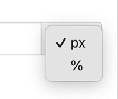

import Link from '@site/src/components/ItsGot/Link';

# Valor Fixo em Pixels

Uma largura fixa é definida em pixels selecionando `px` no menu de unidades. Por exemplo, para definir um rótulo com 400 pixels de largura:

1. Encontre o produto desejado e clique no botão "Editar"
1. Acesse a seção Configurações de Exibição do Rótulo
1. Selecione "Geral"
1. Preencha o campo "Largura" com a largura desejada, por exemplo `400`
1. Selecione `px` no menu de unidades:
   

       
   

1. Clique em <kbd>Atualizar</kbd>

Se nenhuma largura for definida, o rótulo usará <Link path="/settings/edit#label-display-settings">o seu padrão</Link>. Se nenhum padrão for definido, será usada a largura padrão do formato de rótulo selecionado. Isso equivale a 400 pixels para formatos verticais e 750 pixels para formatos tabulares.

A largura fixa é aplicada como uma largura máxima. Se o espaço disponível para o rótulo for menor que a largura do rótulo, o rótulo será reduzido para se ajustar. Um rótulo nunca será mais largo do que o espaço onde está inserido, como uma coluna estreita em um celular.

Para usar uma largura dinâmica com base no contêiner, [use uma porcentagem](percentage-of-its-parent-html-elements-size.md).
