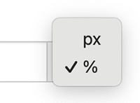

# Porcentagem do Tamanho do Elemento HTML Pai

Uma largura percentual torna o rótulo relativo ao elemento no qual ele está inserido, como um bloco de tema ou uma coluna na página do produto.
A largura muda quando o tamanho desse elemento muda.

Para fazer com que um rótulo fique tão largo quanto o elemento em que se encontra:

1. Encontre o produto desejado e clique no botão "Editar"
1. Acesse a seção Configurações de Exibição do Rótulo
1. Selecione "Geral"
1. Preencha o campo "Largura" com a porcentagem desejada. Na maioria dos casos, você inserirá `100` para que o rótulo ocupe toda a largura do seu elemento pai
1. Selecione `%` no menu de unidades:
   

       
   

1. Clique em <kbd>Atualizar</kbd>

Um rótulo com largura percentual ainda é limitado pelo espaço disponível. Por exemplo, um rótulo com largura de `100%` dentro de uma coluna de 300 pixels de largura também terá 300 pixels de largura.
