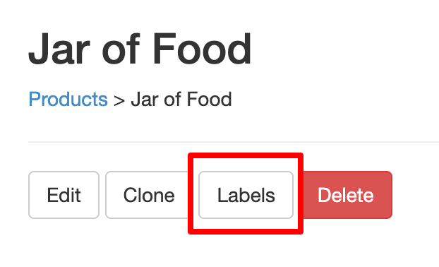
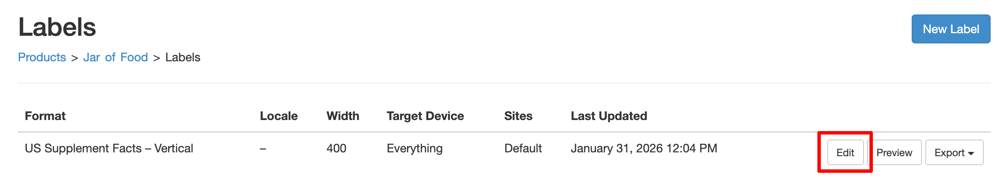
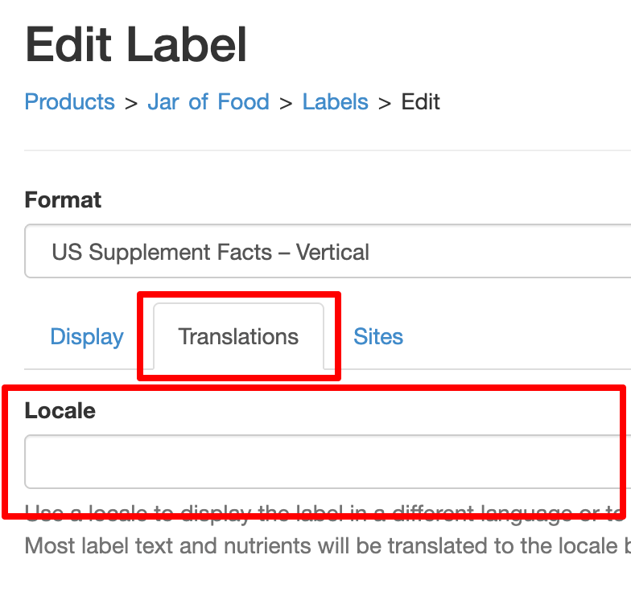
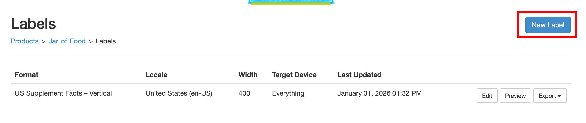
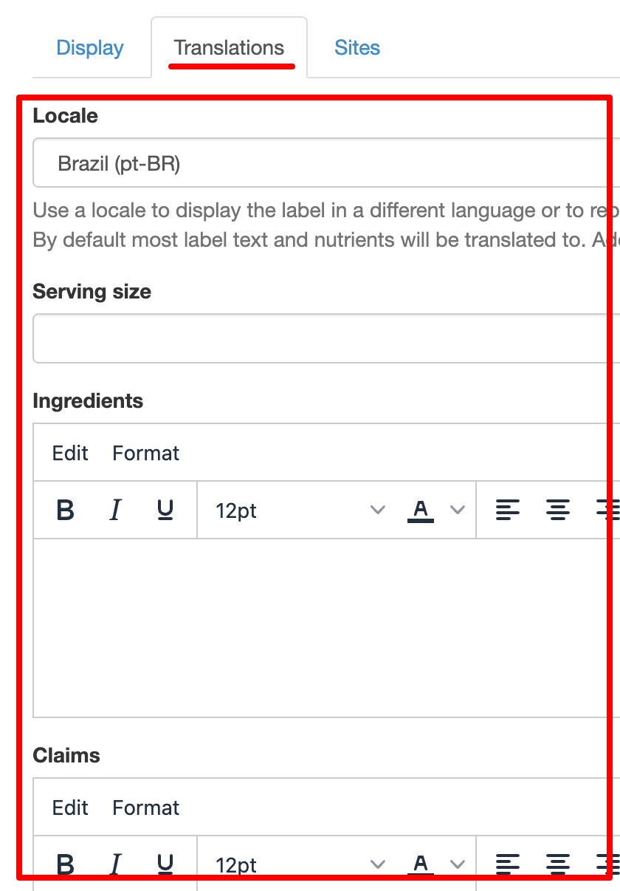
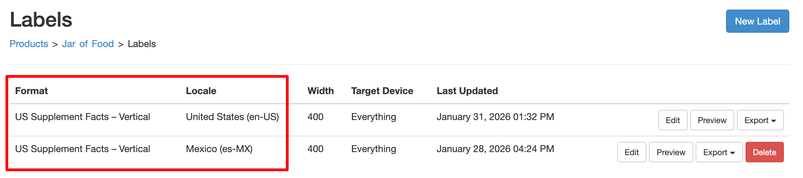
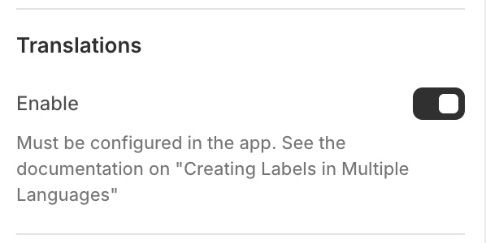

# Criando Rótulos em Vários Idiomas


Os produtos podem ter vários rótulos. Cada rótulo tem suas próprias configurações, incluindo o idioma em que é exibido. Essa configuração é o idioma regional (locale) do rótulo, que é uma combinação de idioma/país.
Por exemplo, para exibir um rótulo usando espanhol da Espanha, o locale seria `es-ES`. Espanhol do México seria `es-MX`.
Por padrão, o rótulo herdará o locale do seu formato. Um rótulo de Suplemento dos EUA terá o locale `en-US` para inglês americano.

## Definindo o Locale de um Rótulo {/* #multi-language-label-locale */}

O primeiro passo para exibir um rótulo em um idioma diferente é alterar seu locale.

1. Na página do produto no aplicativo, selecione *Rótulos*:

   

2. Em seguida, selecione *Editar* no rótulo desejado:

   

3. Na página do rótulo, selecione *Traduções*. Isso exibirá o campo de locale:

   

4. Escolha o locale desejado. Se não encontrar o locale desejado, [entre em contato com o suporte](https://screenstaring.com/#contact) e nós o adicionaremos.
5. Clique em <kbd>Atualizar</kbd> para salvar

Seu rótulo agora será exibido no idioma do locale escolhido.
O design do rótulo permanecerá o mesmo, mas o novo locale causa as seguintes alterações:

- Textos não editáveis no rótulo serão alterados, por exemplo *Por porção*
- Nutrientes definidos pelo sistema serão traduzidos
- Nutrientes, ingredientes, etc., definidos pelo usuário serão traduzidos caso haja traduções cadastradas para eles. Consulte Traduzindo Ingredientes e Outros Textos de Bloco.

Agora vamos criar um 2º rótulo. Ele terá um locale diferente e será traduzido para outro idioma.

## Traduzindo Ingredientes e Outros Textos de Bloco {/* #multi-language-label-translations */}

1. Na página do produto no aplicativo, selecione *Rótulos*:

   

2. Na página de rótulos, selecione *Novo Rótulo*:

   

3. Por padrão, o formato do novo rótulo será o mesmo do rótulo existente. Você pode alterá-lo se quiser.
4. Selecione *Traduções* e escolha o valor desejado no campo de locale:

   

5. Você pode adicionar traduções para ingredientes, avisos, notas de rodapé e muito mais. Esses valores serão usados ao
   exibir o rótulo no locale escolhido. O texto do rótulo original não será afetado.
6. Clique em <kbd>Atualizar</kbd> para salvar

Agora você tem 2 rótulos, cada um com seu próprio locale:



## Ativando Traduções no Seu Site {/* #multi-language-shopify-theme-editor */}

Se estiver usando o [editor de temas da Shopify](/docs/itsgot/adding-labels/shopify/theme-editor), você pode ativar as traduções selecionando *Habilitar* na seção *Traduções*:



Se não estiver usando o editor de temas da Shopify, você pode adicionar o atributo `data-localize="true"` à tag de script do código de incorporação. Por exemplo:

```html
<div data-itsgot-user="1234" data-itsgot-label="9999"></div>
<script src="//itsgot.com/embed.js" data-localize="true" async></script>
```

Por padrão, o usuário verá o idioma correspondente ao atributo `lang` da tag `html` da página. Isso funciona na maioria dos sites.
[Entre em contato com o suporte](https://screenstaring.com/#contact) se precisar usar um método diferente.
