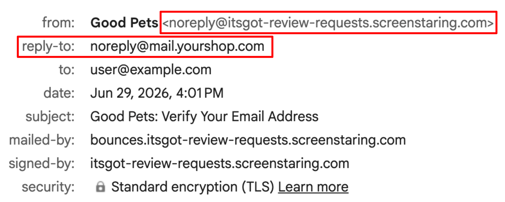
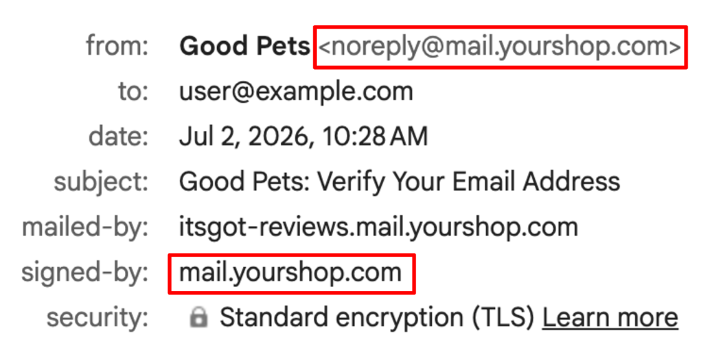

import Link from '@site/src/components/ItsGot/Link';

# Verificação de Domínio do E-mail de Solicitação de Avaliação

Para enviar e-mails de solicitação de avaliação usando seu próprio endereço de e-mail e domínio, você deve primeiro verificar que é o proprietário do domínio.
A verificação do seu domínio permite que os destinatários vejam que o e-mail foi enviado diretamente por você, e os provedores de e-mail tendem a confiar mais nele.
Isso ajuda a melhorar a entregabilidade, aumentando a probabilidade de suas mensagens chegarem à caixa de entrada em vez de serem marcadas como spam.
As capturas de tela a seguir mostram a diferença entre e-mails com e sem domínio verificado.

**Sem domínio verificado**

Observe que o endereço *De* usa o endereço do aplicativo e o e-mail do seu site é usado como endereço de *Responder a*.

**Com domínio verificado**

O uso de um domínio verificado permite usar seu endereço personalizado no campo *De*, eliminando a necessidade de um endereço *Responder a*.

A verificação do domínio de e-mail é feita adicionando registros DNS às configurações do seu site para autorizar nossa infraestrutura de envio.
Assim que o domínio for verificado, o campo *E-mail de envio* na <Link path="/app/reviews/email/edit">página de configurações de e-mail de solicitação de avaliação</Link> será habilitado.

## Verifique Seu Domínio

1. Acesse a <Link path="/app/reviews/email/edit">página de configurações de e-mail de solicitação de avaliação</Link>
2. Clique no botão <kbd>Verificar</kbd> ao lado do campo *E-mail de envio*
3. Insira o seu domínio de envio (ex.: `mail.exemplo.com`) e clique em <kbd>Registrar domínio</kbd>.
4. Isso gerará vários registros DNS que devem ser adicionados às configurações de DNS do seu domínio.
   Os registros podem ser visualizados clicando no botão <kbd>Verificar domínio</kbd> na <Link path="/app/reviews/email/edit">página de configuração de e-mail</Link>.
5. Adicione os registros gerados anteriormente à configuração de DNS do seu site.
   Para mais informações, consulte [Adicionando Registros à Configuração de DNS do Seu Site](#adding-dns-records).
6. Depois que os registros forem adicionados, clique no botão <kbd>Registros adicionados</kbd> na <Link path="/app/reviews/email/edit#verification">página de verificação</Link>
7. Aguarde a propagação das alterações de DNS e a conclusão da verificação. Isso pode levar até 24 horas.
   Após a verificação, o campo *E-mail de envio* será habilitado e você poderá definir um endereço de envio personalizado.
8. Você pode acompanhar o status da verificação na <Link path="/app/reviews/email/edit">página de configurações de e-mail de solicitação de avaliação</Link>

## Adicionando Registros à Configuração de DNS do Seu Site {/* #adding-dns-records */}

A autenticação de domínio depende de alguns registros DNS que comprovam que você tem controle sobre o domínio a partir do qual está enviando.
Adicione-os no painel de controle do seu provedor de DNS, mantendo este aplicativo aberto em outra aba — você copiará e colará valores entre os dois.

A interface de cada provedor de DNS varia um pouco, portanto os nomes dos campos mencionados aqui podem não ser exatamente iguais aos que você vê.
Se você normalmente não gerencia o DNS da sua organização, fale com quem gerencia — sua equipe de TI ou provedor de hospedagem geralmente pode adicionar esses registros em poucos minutos.

Depois de adicionados, aguarde alguns minutos para que as alterações entrem em vigor e clique em <kbd>Verificar registros</kbd> na <Link path="/app/reviews/email/edit">página de configurações de e-mail de solicitação de avaliação</Link>.

Assim que o aplicativo confirmar que os registros estão configurados, clique em <kbd>Concluído</kbd> para finalizar.
