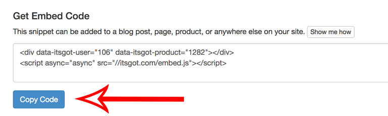
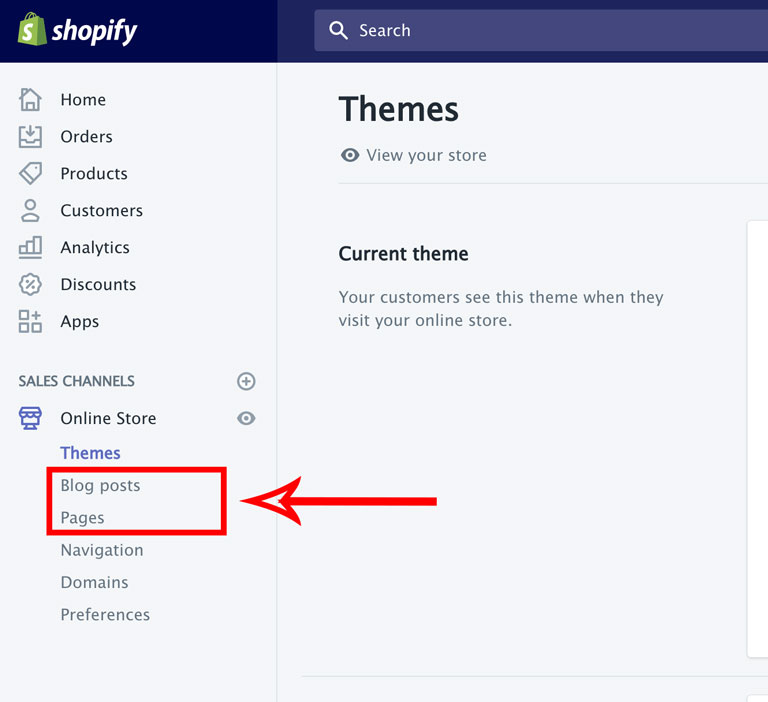
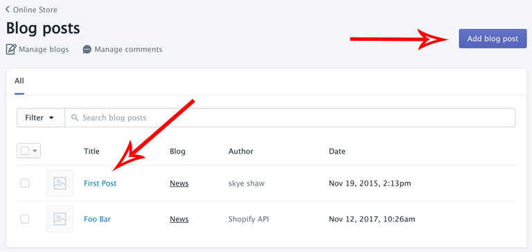
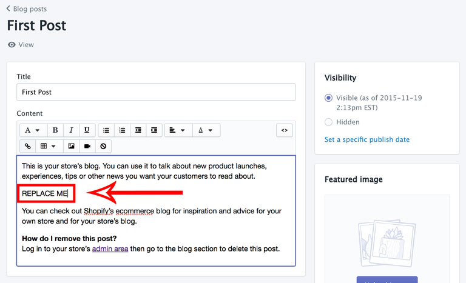
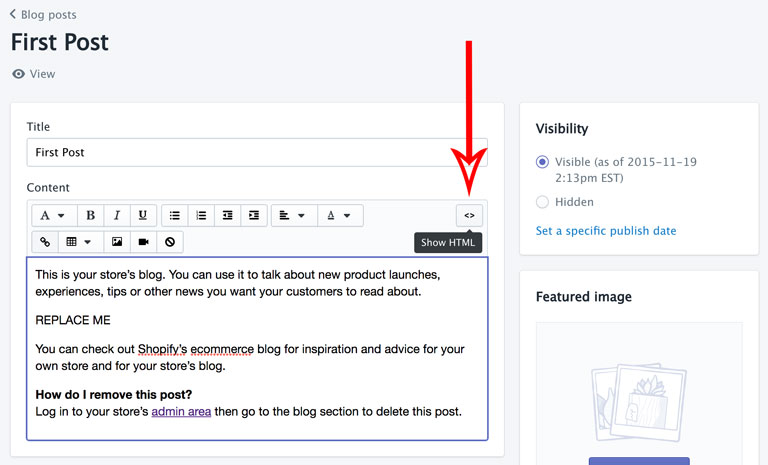
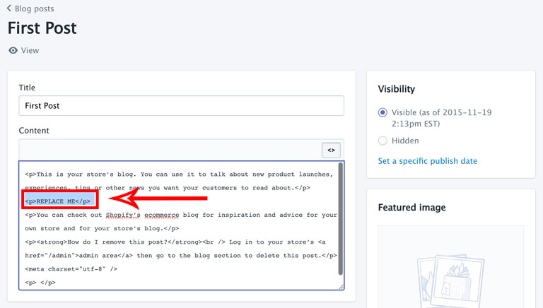
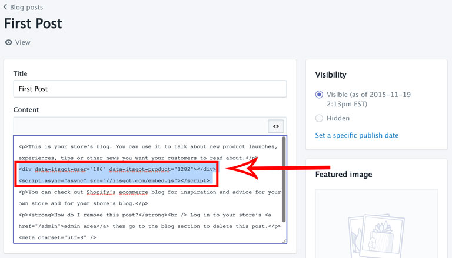
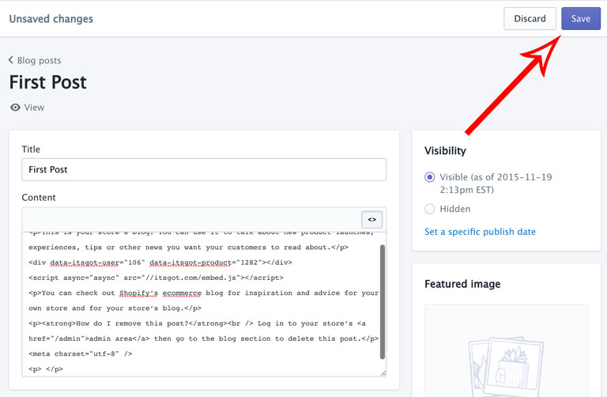

import Link from '@site/src/components/ItsGot/Link';

# Código de Incorporação do Rótulo

O código de incorporação do rótulo é um snippet HTML que lhe permite adicionar um rótulo a qualquer página do seu site.

Para adicionar um rótulo utilizando o código de incorporação:

1. <Link path="/nutrition_facts/new">Crie um rótulo de produto</Link>.
   Se o produto já existir, localize-o a partir da página <Link path="/nutrition_facts">Os meus rótulos</Link> e clique no nome do produto.

2. Clique no botão <kbd>Copiar Código</kbd> para copiar o código de incorporação para a área de transferência. Isto
   permitir-lhe-á colar o código no seu site numa etapa posterior:

   

3. Selecione onde pretende adicionar o seu snippet. A captura de ecrã abaixo utiliza Artigos do blogue e Páginas,
   mas estas instruções aplicam-se igualmente a Coleções e Produtos:

   

4. Selecione um artigo do blogue existente (ou página, coleção ou produto) ao qual pretende adicionar o rótulo.
   Se o artigo do blogue não existir, adicione um novo:

   

5. Localize a área de conteúdo onde pretende que o rótulo do produto seja apresentado. Uma vez que irá alternar
   para o modo HTML para introduzir o código de incorporação, é recomendável introduzir um texto marcador que possa
   depois substituir. Neste exemplo, adicionámos o texto *REPLACE ME*:

   

6. Clique no botão para editar no modo HTML:

   

7. A área de Conteúdo apresenta agora o código HTML:

   

8. Remova o texto *REPLACE ME* e cole o código de incorporação copiado no passo 2:

   

9. Para concluir, clique no botão <kbd>Guardar</kbd>:

   

O rótulo do produto faz agora parte do artigo do blogue.
