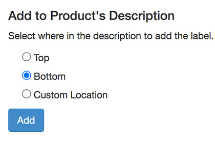

import Link from '@site/src/components/ItsGot/Link';

# Botão Adicionar à Descrição do Produto

Um rótulo pode ser adicionado no topo, na parte inferior ou numa localização personalizada na descrição do seu produto.
Pode definir uma destas opções como predefinição a partir da <Link path="/settings/edit">página de definições da sua conta</Link>.

Uma localização personalizada é habitualmente utilizada quando a descrição contém separadores ou um acordeão e pretende
que o rótulo seja adicionado a um painel específico (consulte as instruções abaixo para obter mais informações).

Para adicionar um rótulo à descrição do produto:

1. <Link path="/nutrition_facts/new">Crie um rótulo de produto</Link>. Se o produto já existir, localize-o a partir da página <Link path="/nutrition_facts">Os meus rótulos</Link> e clique no nome do produto.

2. Na página do produto, localize a secção *Adicionar à Descrição do Produto*
3. Selecione onde pretende adicionar o rótulo: topo, parte inferior ou personalizado:

   

   O valor para a localização personalizada tem de ser [um seletor CSS ou XPath](https://www.awesome-testing.com/2017/05/how-to-find-test-cssselector-using.html).

4. Clique no botão <kbd>Adicionar</kbd>

O rótulo será inserido na descrição do seu produto. Pode demorar até 1 minuto para que o rótulo seja apresentado na página do produto.

:::warning

Tenha o cuidado de não remover o código de incorporação do rótulo ao editar a descrição do produto no Admin da Shopify

:::

Também pode adicionar rótulos às descrições dos seus produtos ao [importar produtos em massa](/docs/itsgot/importing-products).
