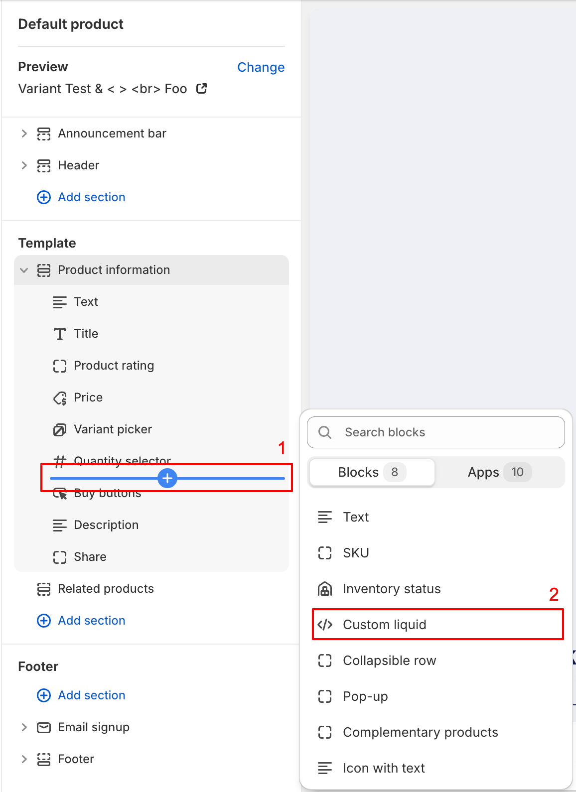
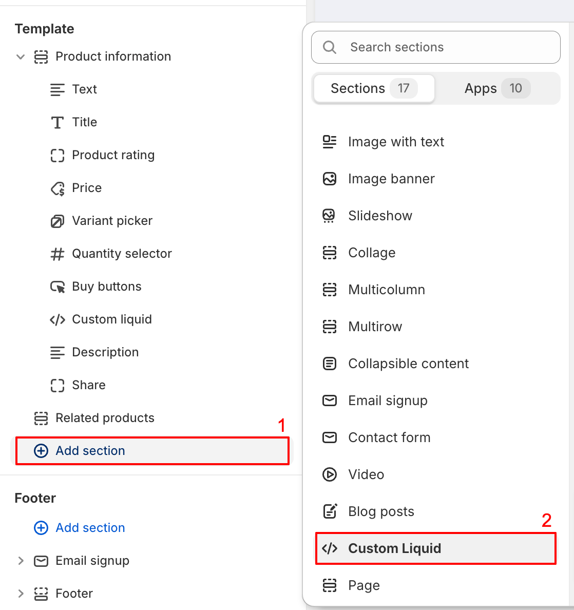
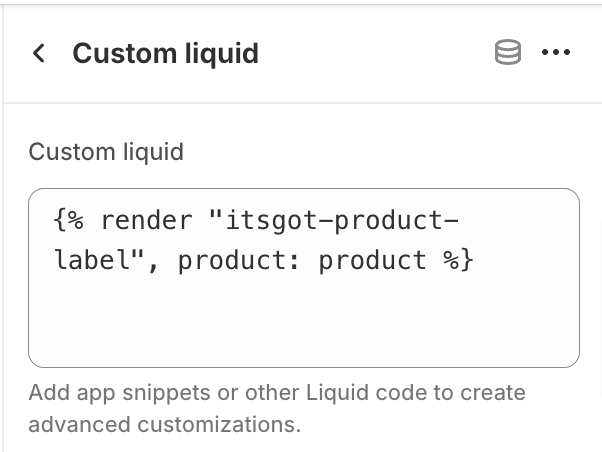

import ShopifyLink from '@theme/ShopifyAdminLink';
import ShopifyCurrentTheme from '@site/src/components/ShopifyCurrentTheme';

# Automaticamente ao Adicionar o Nosso Snippet Liquid ao Seu Tema

:::info
A melhor forma de adicionar rótulos de produtos ao seu site Shopify é [através do editor de temas da Shopify](theme-editor).
As instruções aqui apresentadas destinam-se apenas a casos que não possam ser tratados pelo editor de temas.
:::

Este é um processo em duas etapas: 1) adicionar o nosso snippet de código Liquid ao seu tema e 2) renderizar o snippet na localização onde pretende que o rótulo seja apresentado.

## Adicionar o Nosso Snippet ao Seu Tema {/* #adding-labels-liquid-snippet-theme */}

1. <ShopifyLink href={(shopify) => shopify.toString()}>Aceda ao Admin da Shopify</ShopifyLink>
2. [Abra o editor de código do seu tema](https://shopify.dev/docs/storefronts/themes/tools/code-editor#accessing-the-code-editor)
3. [Adicione um novo ficheiro de tema](https://shopify.dev/docs/storefronts/themes/tools/code-editor#adding-theme-files)
   - Clique no diretório *snippets*
   - Clique em <kbd>Adicionar novo snippet</kbd>
   - Para o nome do ficheiro utilize `itsgot-product-label-embed-code.liquid`
   - Clique em <kbd>Concluído</kbd>
4. Isto abrirá um novo separador em branco no editor com o nome `snippets/itsgot-product-label-embed-code.liquid`
5. Copie o código do [nosso snippet Liquid](/itsgot/images/itsgot-product-label-embed-code.txt) e cole-o no separador
6. Clique em <kbd>Guardar</kbd>
7. Clique novamente em [Adicionar um novo ficheiro de tema](https://shopify.dev/docs/storefronts/themes/tools/code-editor#adding-theme-files)
   - Clique no diretório *snippets*
   - Clique em <kbd>Adicionar novo snippet</kbd>
   - Para o nome do ficheiro utilize `itsgot-product-label.liquid`
   - Clique em <kbd>Concluído</kbd>
8. Isto abrirá um novo separador em branco no editor com o nome `snippets/itsgot-product-label.liquid`
9. Copie o código do [nosso snippet Liquid](/itsgot/images/itsgot-product-label.txt) e cole-o no separador
10. Clique em <kbd>Guardar</kbd>

## Apresentar o Rótulo do Produto

Depois de [adicionar o nosso snippet ao seu tema](#adding-labels-liquid-snippet-theme), a etapa seguinte consiste em renderizá-lo
na localização onde pretende que o rótulo seja apresentado. Pode fazê-lo no Admin da Shopify, através da página de personalização do tema.

1. <ShopifyCurrentTheme>Abra o seu tema</ShopifyCurrentTheme> no editor de temas
1. No editor de temas, selecione *Produtos* e, em seguida, *Produto predefinido* (ou o modelo pretendido)
1. Se pretender adicionar o rótulo a uma secção existente, clique no botão de adicionar bloco dentro dessa secção e selecione *Liquid personalizado*
   ou, se não estiver disponível, *HTML* (note que o bloco *HTML* tem de suportar Liquid):

   

1. Se pretender adicionar o rótulo a uma nova secção, clique no botão <kbd>Adicionar secção</kbd> e selecione *Liquid personalizado* ou *HTML*, conforme o fornecido pelo seu tema:

   

1. Se o seu tema não dispuser da opção *Liquid personalizado* nem *HTML*, terá de renderizar o snippet manualmente no seu tema.
   Pode fazê-lo através do [editor de código do tema](https://shopify.dev/docs/themes/tools/code-editor).
   Se necessitar de assistência, [contacte o apoio](https://screenstaring.com/#contact).
1. Clique no bloco ou secção *Liquid personalizado* que acabou de adicionar
1. No campo *Liquid personalizado* (ou similar), cole o seguinte código:

   ``

   

1. Clique em <kbd>Guardar</kbd>

Os rótulos atuais e futuros serão agora apresentados automaticamente na página de produtos.
