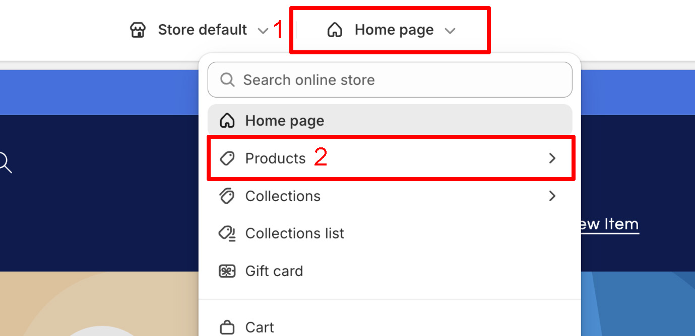
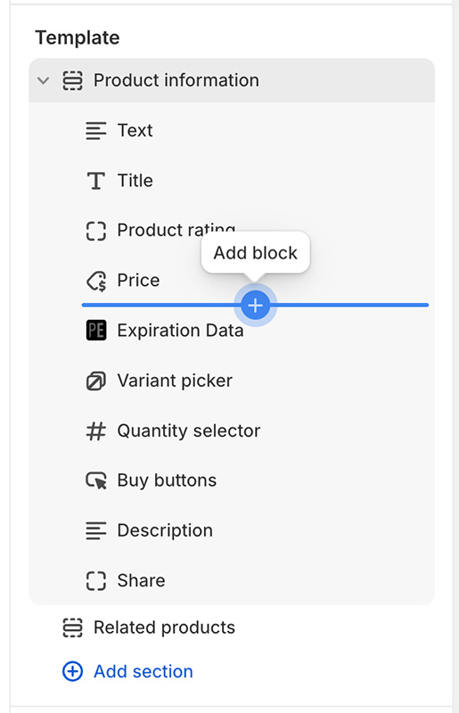
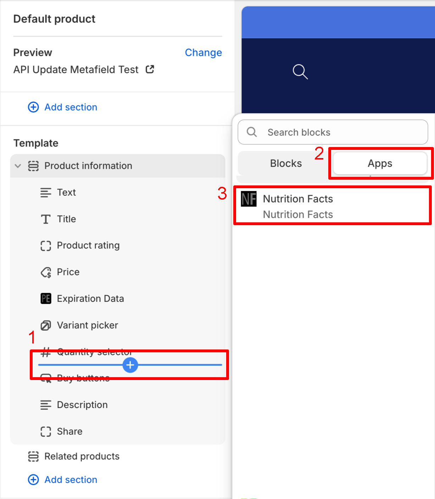
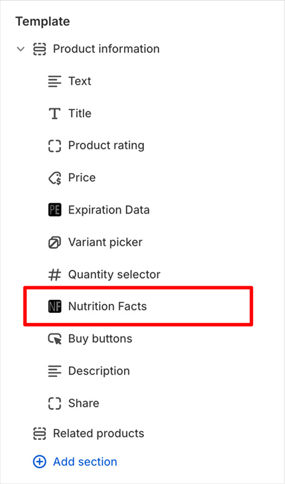
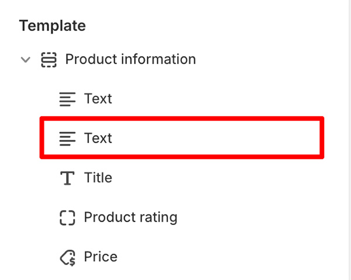
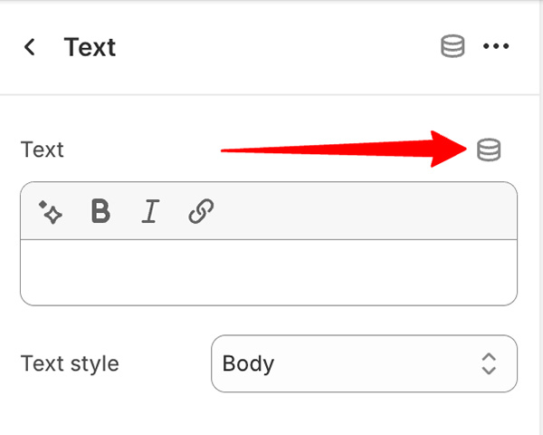
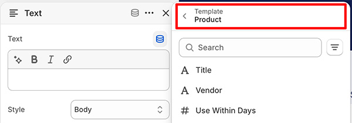
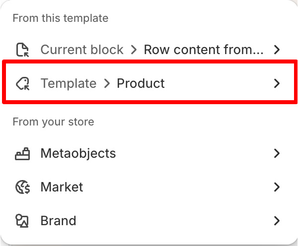
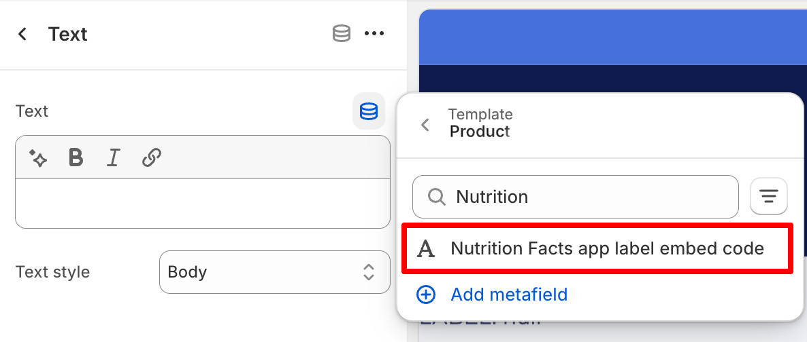
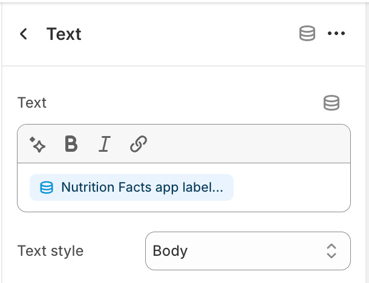

import ShopifyCurrentTheme from '@site/src/components/ShopifyCurrentTheme';

# Editor de Temas da Shopify

Utilizando o [editor de temas da Shopify](https://help.shopify.com/pt-PT/manual/online-store/themes/customizing-themes/theme-editor/using-the-theme-editor#access-the-theme-editor)
(personalização do tema), pode adicionar rótulos
[como uma secção ou bloco](https://help.shopify.com/pt-PT/manual/online-store/themes/customizing-themes/theme-editor/using-the-theme-editor#sections-and-blocks)
a um modelo de produto ou associá-los a uma secção ou bloco existente
[através de um metafield](https://help.shopify.com/pt-PT/manual/custom-data/metafields/displaying-metafields-on-your-online-store#theme-editor-metafields)
(fonte dinâmica).

## Adicionar Rótulo Como Bloco

1. <ShopifyCurrentTheme>Abra o seu tema</ShopifyCurrentTheme> no editor de temas
1. No editor de temas, selecione o modelo de produto ao qual pretende adicionar rótulos:

   

1. Selecione a localização pretendida dentro do modelo de produto. Pode fazê-lo passando o cursor sobre a área de inserção pretendida:

   

1. Clique no botão de adicionar bloco e selecione *Nutrition Facts* na secção *Aplicações*:

   

1. Isto adicionará um bloco *Nutrition Facts* ao modelo selecionado:

   

1. Clique no bloco *Nutrition Facts* para aceder a opções de configuração adicionais
1. Clique em <kbd>Guardar</kbd>

Os rótulos dos produtos serão agora apresentados no seu site.

## Adicionar Rótulo via Metafield

Isto só funciona se a secção ou bloco de destino suportar fontes dinâmicas.

1. <ShopifyCurrentTheme>Abra o seu tema</ShopifyCurrentTheme> no editor de temas
1. No editor de temas, localize a secção ou bloco ao qual pretende adicionar rótulos e clique no mesmo. Neste exemplo, adicionamo-los a um bloco de *Texto*:

   

1. Na configuração do bloco de *Texto*, clique no botão <kbd>Ligar fonte dinâmica</kbd>:

   

1. Certifique-se de que as fontes do modelo de produto estão selecionadas:

   

   Se não estiverem selecionadas, clique no cabeçalho atualmente selecionado e altere a fonte para o modelo de produto

   

1. Na lista de fontes dinâmicas, pesquise e selecione *Nutrition Facts app label embed code*:

   

1. Uma vez selecionada, verá a mesma como fonte no campo associado:

   

1. Clique em <kbd>Guardar</kbd>

Os rótulos dos produtos serão agora apresentados no seu site.

## Em Outro Local

Se pretender adicionar rótulos a uma localização fora do modelo de produto ou em qualquer outro ponto do seu site, tente uma das seguintes opções:

- [Snippet Liquid](/docs/itsgot/adding-labels/shopify/liquid-snippet)
- [Código de incorporação do rótulo](/docs/itsgot/adding-labels/embed-code)
