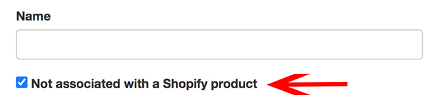

import Link from '@site/src/components/ItsGot/Link';

# Combinar Componentes de Refeição para Gerar um Rótulo


Se tem um site de refeições preparadas ou de restauração, provavelmente pretenderá introduzir os componentes da refeição uma única vez e apresentar um rótulo
com base na seleção do cliente. Por exemplo, se disponibiliza uma proteína com um hidrato de carbono, pretende
gerar um rótulo com base na seleção de cada um destes. Se o utilizador selecionar frango e arroz, o rótulo tem de conter os
nutrientes combinados de frango e arroz. Se selecionar frango e batata assada, o rótulo tem de conter os
nutrientes combinados de frango e batata assada. Etc.

Isto pode ser alcançado através das seguintes etapas:

1. [Criar rótulos que não estejam associados a um produto da Shopify](#combine-api-create-component-label)
2. [Criar um rótulo para o produto principal da Shopify](#combine-api-create-product-label)
3. [Adicionar o código da API Combine ao seu site](#combine-api-add-code)

## Criar Rótulos Que Não Estejam Associados a um Produto da Shopify {/* #combine-api-create-component-label */}

Para poder utilizar componentes de refeição, tem de criar um rótulo com a opção *Não associado a um produto da Shopify* ativada:



Em *Nome*, introduza o nome do componente da refeição *exatamente* como surge no seu site, por exemplo *Batata-doce frita (Grande)*.
Em seguida, introduza as informações nutricionais e guarde o rótulo.

## Criar um Rótulo para o Produto Principal da Shopify {/* #combine-api-create-product-label */}

Se o produto for um pacote ou recipiente, ou seja, algo que não contenha dados nutricionais, por exemplo, *plano de almoço de 10 dias*, pode ignorar esta parte.
Se o produto for um prato ou componente de refeição, tem igualmente de introduzir informações nutricionais para o mesmo.

Neste cenário, não deve ativar a opção *Não associado a um produto da Shopify*. Em vez disso, introduza os primeiros carateres do nome do produto,
selecione-o a partir da lista, introduza as informações nutricionais e guarde.

## Adicionar o Código da API Combine ao Seu Site {/* #combine-api-add-code */}

Depois de introduzir as informações nutricionais na aplicação, tem de adicionar código ao seu site para obter e inserir o rótulo com base na seleção do cliente.
Este código tem de obter as variantes selecionadas e transmiti-las à API combine do It's Got. Isto envolve duas etapas:

### 1. Carregar a API Combine e o Snippet

O snippet pode ser consultado na <Link path="/settings/edit#combine-api-snippet">página de definições</Link>. Onde quer que este snippet
seja colocado é onde o rótulo será apresentado. Pode ser inserido em qualquer ponto do seu site. Consulte [este exemplo](/docs/itsgot/adding-labels/embed-code).

### 2. Obter as Variantes Selecionadas e Chamar a API Combine

Isto é o que carregará o rótulo com base nas variantes selecionadas para o snippet adicionado na etapa 1 acima.
A forma de obter as variantes selecionadas depende do seu tema. Não existe uma solução universal.
Pode [contactar o apoio](https://screenstaring.com/#contact) para obter assistência, mas experimente primeiro o [exemplo abaixo](#combine-api-example).

A API Combine requer a seguinte chamada JavaScript:

`ItsGot.combine(components, options)`

| Argumento    | Descrição |
| ----------- | ----------- |
| `components` | Uma matriz de cadeias de carateres contendo os componentes da refeição para os quais pretende construir o rótulo. Estes valores provêm das variantes atualmente selecionadas. |
| `options`   | Opcional. Um objeto que pode conter as seguintes propriedades: |
|             | `format` - Formato do rótulo a renderizar. A predefinição é `us:2016:nutrition_facts:emblems`. Outros formatos suportados são: `ca:legacy:nutrition_facts:vertical`, `de:eu:nutrition_facts:vertical`, `dk:eu:nutrition_facts:vertical`, `se:eu:nutrition_facts:vertical`, `uk:eu:nutrition_facts:vertical`, `us:2016:nutrition_facts:tabular`, `us:2016:nutrition_facts:vertical`, `us:legacy:nutrition_facts:vertical`, `us:legacy:supplement_facts:vertical_columns`, `us:legacy:supplement_facts:vertical`, `us:2016:supplement_facts:vertical_columns` e `us:2016:supplement_facts:vertical` |
|             | `only` - Uma matriz de nutrientes a apresentar. Quando especificada, apenas serão apresentados os valores nutricionais para os nutrientes indicados. Ex.: `sodium`, `calories`. Válido apenas para o formato `us:2016:nutrition_facts:emblems`. |

### Exemplo da API Combine {/* #combine-api-example */}

Adicione este código à descrição do produto ou ao ficheiro Liquid adequado na localização onde pretende que o rótulo surja
(note que o snippet para a sua conta pode ser obtido na <Link path="/settings/edit#combine-api-snippet">página de definições</Link>):

```html
<script async="async" src="//itsgot.com/embed.js"></script>
<div data-itsgot-user="YOUR_ID" data-itsgot-combine></div>
```

Em seguida, adicione este código ao modelo Liquid do produto (ou equivalente):

```html
<script>
  document.addEventListener('DOMContentLoaded', _ => {
    // ====================
    // AVISO: getSelectedVariants() é um exemplo e não funcionará com todos os temas Shopify.
    // A forma de obter as variantes selecionadas depende do seu tema. Não existe uma solução universal.
    // ====================
    function getSelectedVariants() {
      return document.querySelectorAll('[class^=single-option-selector]');
    }

    function showLabel() {
      const components = [];

      getSelectedVariants().forEach(element => {
        if(element.value) components.push(element.value);
      });

      ItsGot.combineLabels(components, {
        format: 'us:2016:nutrition_facts:emblems',
        only: ['calories', 'protein', 'total carbohydrate', 'total fat', 'dietary fiber', 'total sugars']
      });
    }

    getSelectedVariants().forEach(element => element.addEventListener('change', showLabel));
  });
</script>
```
