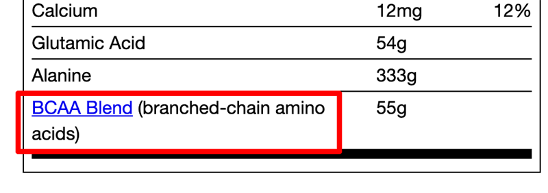

import Link from '@site/src/components/ItsGot/Link';

# Criar Ligações para Páginas Web a Partir de Nutrientes do Rótulo

Se a sua subscrição incluir <Link path="/app/plans">funcionalidades do plano Premium</Link>, pode transformar um nutriente ou ingrediente dietético do rótulo numa ligação para a página Web da sua preferência.

Para criar uma ligação:

1. <Link path="/nutrition_facts/new">Crie</Link> ou edite um rótulo de produto existente
2. Na secção <Link path="/nutrition_facts/new#nutrients">Nutrientes</Link> ou <Link path="/nutrition_facts/new?label_format=supplement_vertical#dietary-ingredients">Ingredientes dietéticos</Link>, adicione ou edite um valor
3. Assim que um valor for introduzido, verá a ligação *Definições de apresentação*:

   

4. Clique na ligação para abrir a caixa de diálogo *Definições de apresentação*. No campo URL da secção *Ligação*, introduza a página para a qual pretende criar a ligação.
5. Por predefinição, a ligação abrirá na mesma página. Pode defini-la para abrir numa nova janela/separador selecionando *Abrir em nova janela/separador*.
6. Clique em <kbd>Guardar</kbd> ou <kbd>Atualizar</kbd> para guardar
7. Agora, quando o rótulo for apresentado no seu site, surgirá uma ligação a partir do nutriente ou ingrediente dietético para o URL indicado

   

Para alterar a cor da ligação, consulte a secção [Modificar o Design de um Rótulo](/docs/itsgot/display-settings).
