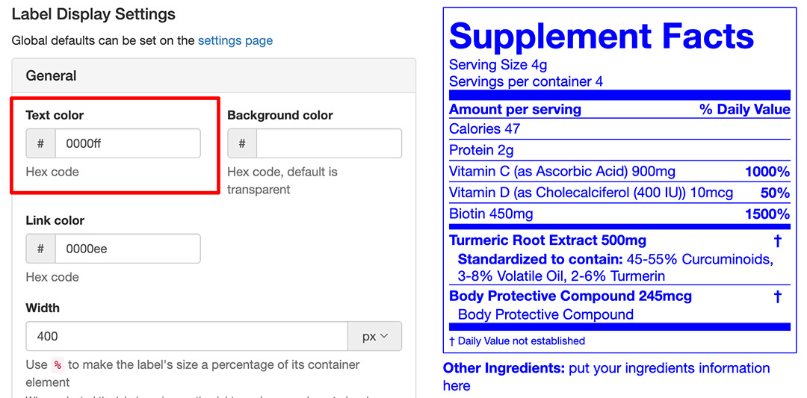
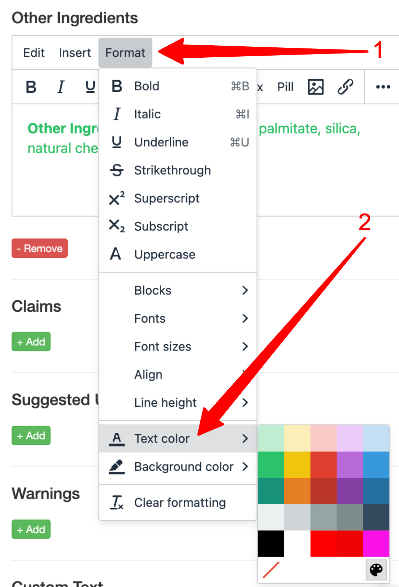
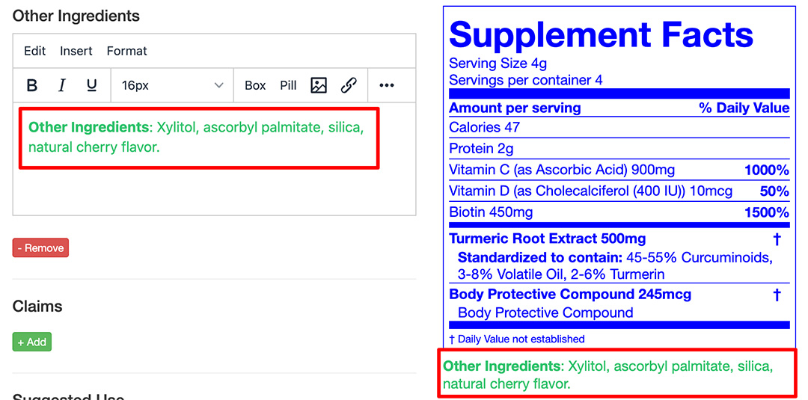

import Link from '@site/src/components/ItsGot/Link';

# Contornos, Cores e Avanço

:::info
Pode definir valores predefinidos para estas opções na <Link path="/settings/edit#label-display-settings">página de definições da sua conta</Link>
:::

## Definir a Cor do Texto

A cor do rótulo e do respetivo texto pode ser configurada a partir da secção Definições de Apresentação do Rótulo. Os blocos de texto e nutrientes individuais também podem ter a sua cor personalizada.

1. Localize o produto pretendido e clique no botão "Editar"
1. Aceda à secção Definições de Apresentação do Rótulo
1. Selecione "Geral"
1. Preencha o campo "Cor do texto" com o código de cor hexadecimal pretendido:
   

     
   

1. Clique em <kbd>Atualizar</kbd>
1. Isto alterará todo o texto do rótulo para a cor selecionada

### Blocos de Texto

1. A partir da página do produto, aceda ao bloco de texto pretendido
1. No menu Formatar do bloco, selecione "Cor do texto"
1. Pode escolher uma cor predefinida ou uma cor específica selecionando o ícone da paleta:
   

     
   

1. Clique em <kbd>Atualizar</kbd>
1. A cor será aplicada apenas ao bloco de texto. A cor predefinida do rótulo não será afetada:
   

     
   

### Nutrientes

Utilize as definições de apresentação do nutriente para alterar a respetiva cor:

1. Na janela de Definições de Apresentação, localize a secção Estilo
1. Preencha o campo "Cor do texto" com o código de cor hexadecimal pretendido
1. Clique em <kbd>Ok</kbd>
1. Clique em <kbd>Atualizar</kbd>

## Definir a Cor de Fundo

Por predefinição, a cor de fundo é transparente para corresponder ao fundo do seu site.
Uma cor de fundo pode ser configurada na secção Definições de Apresentação do Rótulo. Os blocos de texto e nutrientes individuais também podem ter a respetiva cor de fundo personalizada.

1. Localize o produto pretendido e clique no botão "Editar"
1. Aceda à secção Definições de Apresentação do Rótulo
1. Selecione "Geral"
1. Preencha o campo "Cor de fundo" com o código de cor hexadecimal pretendido
   {/* Image temporarily disabled: /itsgot/shopify/images/label-set-background-color.jpg not available
   

     
   

   */}
1. Clique em <kbd>Atualizar</kbd>
1. Isto fará com que todo o rótulo utilize a cor selecionada como fundo
