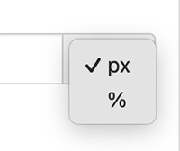

import Link from '@site/src/components/ItsGot/Link';

# Valor Fixo em Píxeis

Uma largura fixa é definida em píxeis selecionando `px` no menu de unidades. Por exemplo, para definir um rótulo com 400 píxeis de largura:

1. Localize o produto pretendido e clique no botão "Editar"
1. Aceda à secção Definições de Apresentação do Rótulo
1. Selecione "Geral"
1. Preencha o campo "Largura" com a largura pretendida, por exemplo `400`
1. Selecione `px` no menu de unidades:
   

       
   

1. Clique em <kbd>Atualizar</kbd>

Se não for definida qualquer largura, o rótulo utilizará a <Link path="/settings/edit#label-display-settings">sua predefinição</Link>. Se não houver uma predefinição definida, será utilizada a largura predefinida do formato de rótulo selecionado. Isto corresponde a 400 píxeis para formatos verticais e 750 píxeis para formatos tabulares.

A largura fixa é aplicada como uma largura máxima. Se o espaço disponível para o rótulo for inferior à respetiva largura, o rótulo é reduzido para se ajustar. Um rótulo nunca será mais largo do que o espaço onde está inserido, como uma coluna estreita num telemóvel.

Para utilizar uma largura dinâmica baseada no contentor, [utilize uma percentagem](percentage-of-its-parent-html-elements-size.md).
