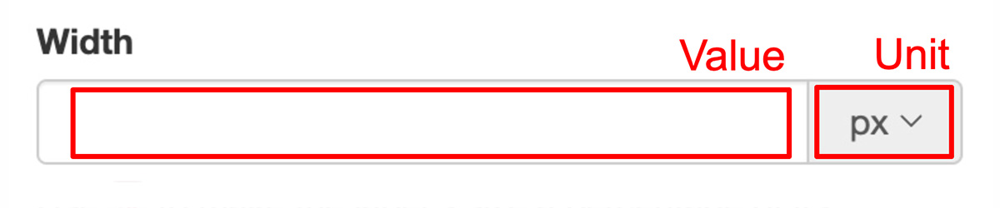

import Link from '@site/src/components/ItsGot/Link';

# Definir a Largura de um Rótulo

A largura de um rótulo pode:

- Ser um valor fixo em píxeis
- Ser uma percentagem do tamanho do elemento HTML ascendente
- Variar consoante o dispositivo do utilizador (ex.: tablet vs computador)

As larguras fixas e percentuais podem ser definidas através do campo "Largura" do rótulo, localizado na secção Geral das Definições de Apresentação do Rótulo.
O campo de largura é composto pelo valor da largura e pela respetiva unidade:

    

A unidade pode ser píxeis (`px`) ou percentagem (`%`).

Uma largura predefinida pode ser definida na <Link path="/settings/edit#label-display-settings">página de definições da sua conta</Link>.

Cada opção é descrita nas seguintes páginas:

- [Valor fixo em píxeis](fixed-pixel-value.md)
- [Percentagem do tamanho do elemento HTML ascendente](percentage-of-its-parent-html-elements-size.md)
- [Variar consoante o dispositivo do utilizador](vary-by-a-users-device.md)
