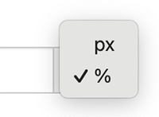

# Percentagem do Tamanho do Elemento HTML Ascendente

Uma largura percentual torna o rótulo relativo ao elemento onde se encontra inserido, como um bloco de tema ou a coluna de uma página de produto.
A largura altera-se quando o tamanho desse elemento é alterado.

Para que um rótulo fique tão largo quanto o elemento onde se encontra:

1. Localize o produto pretendido e clique no botão "Editar"
1. Aceda à secção Definições de Apresentação do Rótulo
1. Selecione "Geral"
1. Preencha o campo "Largura" com a percentagem pretendida. Na maioria dos casos, introduzirá `100` para que o rótulo ocupe a largura total do elemento ascendente
1. Selecione `%` no menu de unidades:
   

       
   

1. Clique em <kbd>Atualizar</kbd>

Um rótulo com largura percentual continua limitado pelo espaço concedido. Por exemplo, um rótulo com largura de `100%` dentro de uma coluna de 300 píxeis de largura terá igualmente 300 píxeis de largura.
