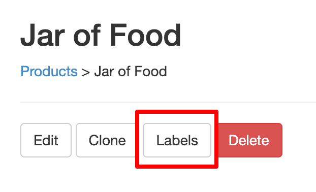
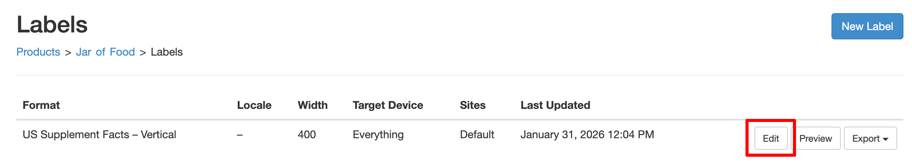
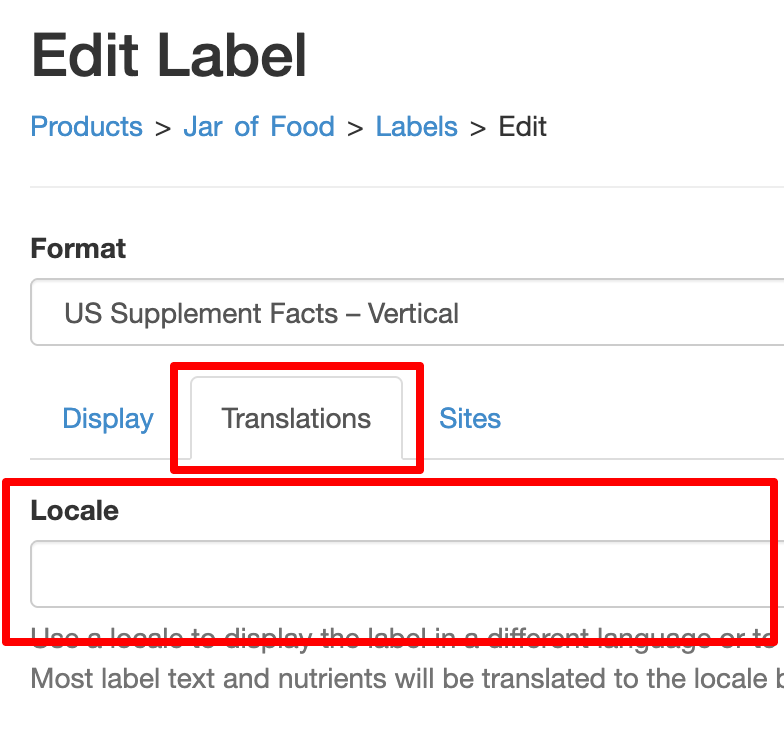
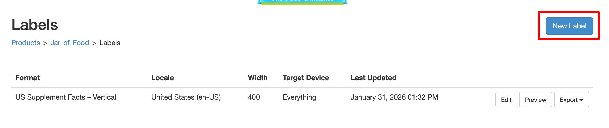
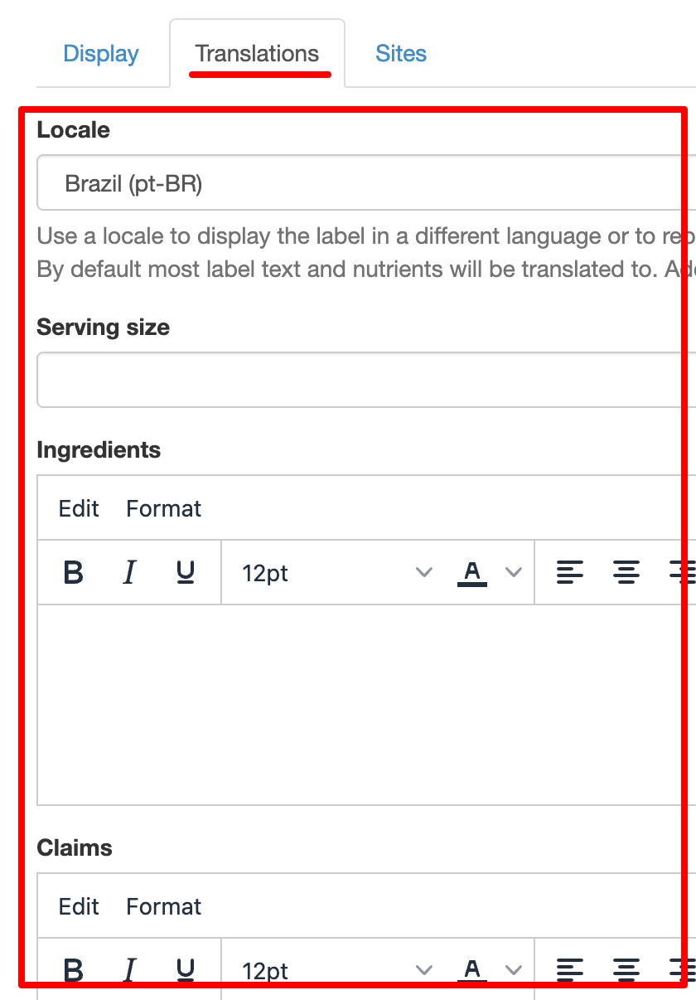
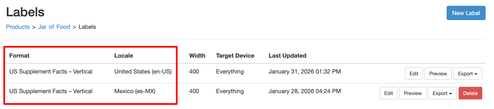
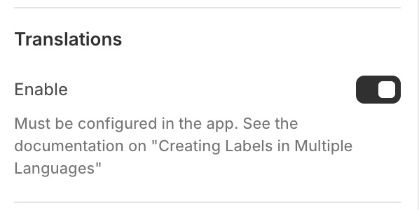

# Criar Rótulos em Vários Idiomas


Os produtos podem ter vários rótulos. Cada rótulo dispõe das suas próprias definições, incluindo o idioma em que é apresentado. Esta definição é o idioma regional (locale) do rótulo, que corresponde a uma combinação de idioma/país.
Por exemplo, para apresentar um rótulo em espanhol de Espanha, o locale seria `es-ES`. Espanhol do México seria `es-MX`.
Por predefinição, o rótulo herdará o locale do respetivo formato. Um rótulo de Suplemento dos EUA terá o locale `en-US` para inglês americano.

## Definir o Locale de um Rótulo {/* #multi-language-label-locale */}

O primeiro passo para apresentar um rótulo num idioma diferente consiste em alterar o respetivo locale.

1. A partir da página do produto na aplicação, selecione *Rótulos*:

   

2. Em seguida, selecione *Editar* no rótulo pretendido:

   

3. Na página do rótulo, selecione *Traduções*. Isto apresentará o campo de locale:

   

4. Escolha o locale pretendido. Se não encontrar o locale pretendido, [contacte o apoio](https://screenstaring.com/#contact) para que o possamos adicionar.
5. Clique em <kbd>Atualizar</kbd> para guardar

O seu rótulo será agora apresentado no idioma do locale selecionado.
O design do rótulo manter-se-á inalterado, mas o novo locale aplicará as seguintes alterações:

- O texto não editável no rótulo será alterado, por exemplo *Por dose*
- Os nutrientes predefinidos pelo sistema serão traduzidos
- Os nutrientes, ingredientes, etc., definidos pelo utilizador serão traduzidos caso tenham sido definidas traduções para os mesmos. Consulte Traduzir Ingredientes e Outro Texto de Bloco.

Criemos agora um 2.º rótulo. Este terá um locale diferente e será traduzido para outro idioma.

## Traduzir Ingredientes e Outro Texto de Bloco {/* #multi-language-label-translations */}

1. A partir da página do produto na aplicação, selecione *Rótulos*:

   

2. Na página de rótulos, selecione *Novo Rótulo*:

   

3. Por predefinição, o formato do novo rótulo será idêntico ao do rótulo existente. Pode alterá-lo se preferir.
4. Selecione *Traduções* e escolha o valor pretendido no campo de locale:

   

5. Pode adicionar traduções para ingredientes, avisos, notas de rodapé e muito mais. Estes valores serão utilizados ao
   apresentar o rótulo no locale escolhido. O texto do rótulo original não será afetado.
6. Clique em <kbd>Atualizar</kbd> para guardar

Passa agora a dispor de 2 rótulos, cada um com o seu próprio locale:



## Ativar Traduções no Seu Site {/* #multi-language-shopify-theme-editor */}

Se estiver a utilizar o [editor de temas da Shopify](/docs/itsgot/adding-labels/shopify/theme-editor), pode ativar as traduções selecionando *Ativar* na secção *Traduções*:



Se não estiver a utilizar o editor de temas da Shopify, pode adicionar o atributo `data-localize="true"` à etiqueta de script do código de incorporação. Por exemplo:

```html
<div data-itsgot-user="1234" data-itsgot-label="9999"></div>
<script src="//itsgot.com/embed.js" data-localize="true" async></script>
```

Por predefinição, o utilizador verá o idioma correspondente ao atributo `lang` da etiqueta `html` da página. Isto funciona na grande maioria dos sites.
[Contacte o apoio](https://screenstaring.com/#contact) se necessitar de utilizar um método diferente.
