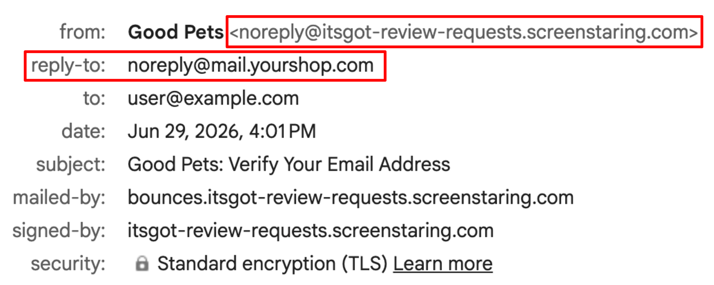
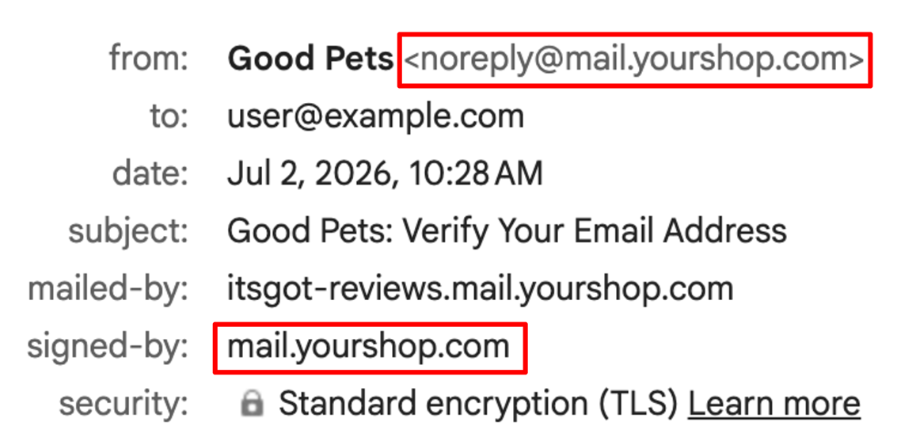

import Link from '@site/src/components/ItsGot/Link';

# Verificação de Domínio do E-mail de Pedido de Avaliação

Para enviar e-mails de pedido de avaliação utilizando o seu próprio endereço de e-mail e domínio, tem de verificar primeiro que é o proprietário do domínio.
A verificação do seu domínio permite aos destinatários verem que o e-mail foi enviado diretamente por si, e os fornecedores de e-mail tenderão a confiar mais na mensagem.
Isto ajuda a melhorar a capacidade de entrega, aumentando a probabilidade de as suas mensagens chegarem à caixa de entrada em vez de serem sinalizadas como spam.
As seguintes capturas de ecrã ilustram a diferença entre e-mails com e sem domínio verificado.

**Sem domínio verificado**

Note que o endereço *De* utiliza o endereço da aplicação e o e-mail do seu site é utilizado como endereço de *Responder a*.

**Com domínio verificado**

A utilização de um domínio verificado permite-lhe utilizar o seu endereço personalizado no campo *De*, eliminando a necessidade de um endereço *Responder a*.

A verificação do domínio de e-mail é efetuada adicionando registos DNS às definições do seu site para autorizar a nossa infraestrutura de envio.
Assim que o domínio for verificado, o campo *E-mail de envio* na <Link path="/app/reviews/email/edit">página de definições do e-mail de pedido de avaliação</Link> ficará ativo.

## Verificar o Seu Domínio

1. Aceda à <Link path="/app/reviews/email/edit">página de definições do e-mail de pedido de avaliação</Link>
2. Clique no botão <kbd>Verificar</kbd> junto ao campo *E-mail de envio*
3. Introduza o seu domínio de envio (ex.: `mail.exemplo.com`) e clique em <kbd>Registar domínio</kbd>.
4. Isto irá gerar vários registos DNS que têm de ser adicionados às definições de DNS do seu domínio.
   Os registos podem ser visualizados clicando no botão <kbd>Verificar domínio</kbd> na <Link path="/app/reviews/email/edit">página de configuração de e-mail</Link>.
5. Adicione os registos gerados anteriormente à configuração de DNS do seu site.
   Para obter mais informações, consulte [Adicionar Registos à Configuração de DNS do Seu Site](#adding-dns-records).
6. Após adicionar os registos, clique no botão <kbd>Registos adicionados</kbd> na <Link path="/app/reviews/email/edit#verification">página de verificação</Link>
7. Aguarde a propagação das alterações de DNS e a conclusão da verificação. Este processo pode demorar até 24 horas.
   Uma vez verificado, o campo *E-mail de envio* ficará ativo e poderá configurar um endereço de envio personalizado.
8. Pode acompanhar o estado da verificação na <Link path="/app/reviews/email/edit">página de definições do e-mail de pedido de avaliação</Link>

## Adicionar Registos à Configuração de DNS do Seu Site {/* #adding-dns-records */}

A autenticação de domínio assenta em alguns registos DNS que comprovam o seu controlo sobre o domínio a partir do qual envia as mensagens.
Adicione-os no painel de controlo do seu fornecedor de DNS enquanto mantém esta aplicação aberta noutro separador — irá copiar e colar valores entre ambos.

A interface de cada fornecedor de DNS varia ligeiramente, pelo que os nomes dos campos aqui mencionados podem não coincidir exatamente com os apresentados no seu ecrã.
Se normalmente não efetua a gestão de DNS da sua organização, contacte quem o faz — a sua equipa de TI ou fornecedor de alojamento consegue normalmente adicionar estes registos em poucos minutos.

Após adicioná-los, aguarde alguns minutos para que as alterações produzam efeito e clique em <kbd>Verificar registos</kbd> a partir da <Link path="/app/reviews/email/edit">página de definições do e-mail de pedido de avaliação</Link>.

Assim que a aplicação confirmar que os registos estão corretamente configurados, clique em <kbd>Concluído</kbd> para concluir a configuração.
