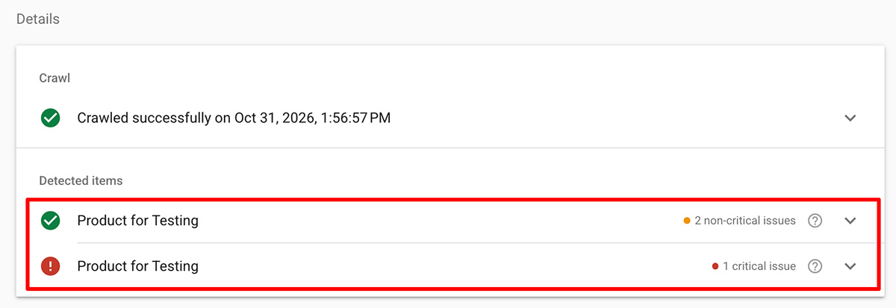
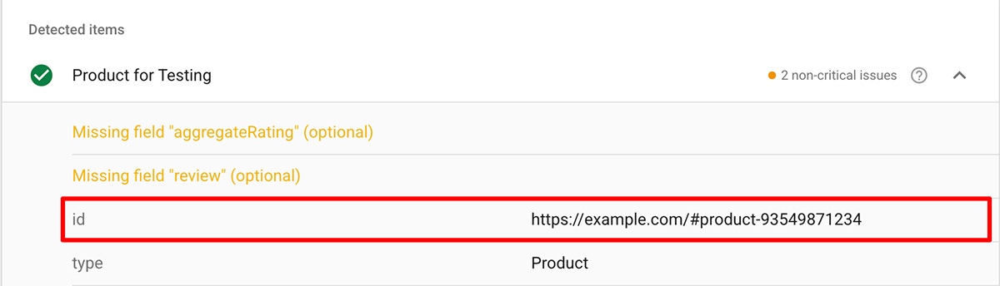
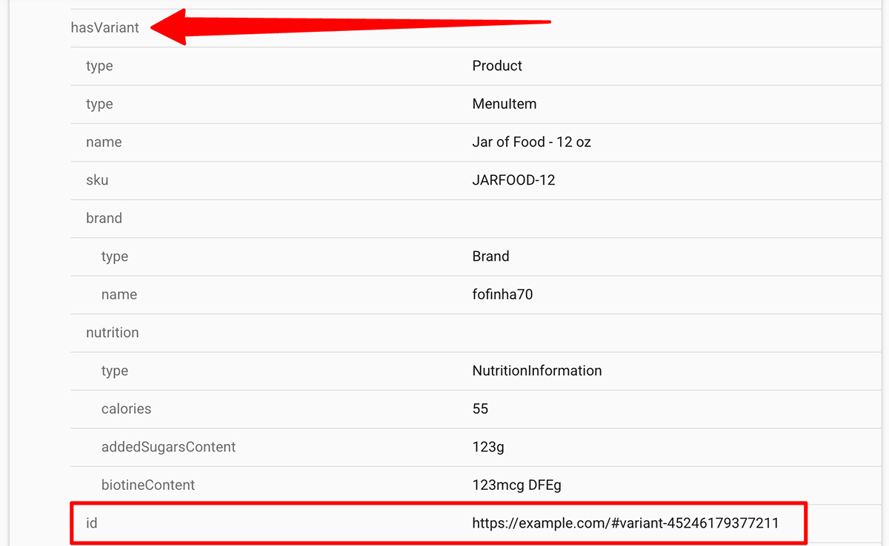

import Link from '@site/src/components/ItsGot/Link';
import StructuredDataAppEmbedLink from '@site/src/components/ItsGot/StructuredDataAppEmbedLink';

# Utilizar Dados Estruturados para Melhorar o SEO e as AIO

Os dados estruturados fornecem informações de contexto dos produtos às páginas da sua loja para que os motores de busca e os assistentes de IA possam compreender instantaneamente detalhes essenciais como preços, inventário e atributos dos produtos.
Isto ajuda as plataformas de pesquisa a apresentar Rich Snippets apelativos nos respetivos resultados e a citar os seus produtos com precisão nas respostas de IA, potenciando uma maior visibilidade na pesquisa e taxas de clique mais elevadas.

O It's Got pode apresentar dados nutricionais como parte dos dados estruturados dos seus produtos. Se estiver a utilizar a nossa funcionalidade de avaliações de produtos, os dados das avaliações serão igualmente incluídos.

## Shopify

Os utilizadores da Shopify têm de <StructuredDataAppEmbedLink>ativar a aplicação incorporada *Dados Estruturados para SEO*</StructuredDataAppEmbedLink> no tema. Uma vez ativada, os dados estruturados de produtos e variantes gerados pela aplicação serão automaticamente apresentados nas páginas de produto.

### Identificadores de Produto {/* #product-identifiers */}

Os identificadores constituem a forma como os fragmentos de dados estruturados são associados entre si.
Se o seu tema da Shopify já contiver dados estruturados de produtos existentes, a informação nutricional e/ou os dados de avaliações gerados pela aplicação deverão ficar associados a estes automaticamente.
Se tal não acontecer, terá de definir o identificador a utilizar.

Pode utilizar o [Teste de Resultados Ricos](https://search.google.com/test/rich-results) da Google para determinar se necessita de especificar explicitamente um identificador:

1. Aceda ao [Teste de Resultados Ricos](https://search.google.com/test/rich-results)
1. Introduza o URL da página de um produto
1. Clique em "Testar URL"

Se o seu produto surgir listado mais de uma vez:

  

Terá de [configurar o identificador de produto na aplicação](#setting-a-default-product-identifier).

### Configurar um Identificador de Produto Predefinido {/* #setting-a-default-product-identifier */}

A configuração de um identificador de produto apenas é necessária se não estiver a utilizar o [identificador de produto/variante predefinido da Shopify](#product-identifiers).

Para configurar um identificador de produto na aplicação, deve primeiro verificar qual o identificador que o seu tema está a utilizar atualmente:

1. Aceda ao [Teste de Resultados Ricos da Google](https://search.google.com/test/rich-results)
1. Introduza o URL da página de um produto
1. Clique em "Testar URL"
1. Na página de resultados, clique no nome do produto. Se não vir o nome do seu produto, poderá ter de clicar primeiro em "Fragmentos de produto"
1. Abaixo do nome do produto, localize o campo "id":
   

     
   

1. Neste caso, o seu identificador é `#product-ID`, em que `ID` corresponde ao ID de produto da Shopify. Pode ignorar a parcela do domínio (`https://example.com`).
1. Aceda à secção Dados Estruturados da <Link path="/settings/edit#structured_data">página de definições</Link>
1. No campo *Identificador de produto*, introduza: `#product-{{product_id}}`
1. Clique em "Guardar"

Deste modo, os dados estruturados gerados pela aplicação coincidirão com a saída existente do seu tema.

Para as variantes, pode repetir estes mesmos passos; contudo, neste caso, não deverá utilizar a primeira entrada "id" no Teste de Resultados Ricos, mas sim a que se encontra sob "hasVariant":

  

