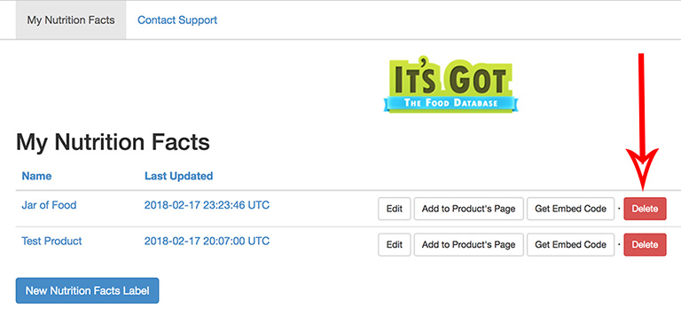

import {SupportEmail} from '@site/src/components/Contact';
import Link from '@site/src/components/ItsGot/Link';

# Desinstalar a Aplicação

Antes de desinstalar a aplicação, os rótulos de produtos existentes têm de ser removidos.
Isto inclui:

1. Rótulos adicionados automaticamente às descrições dos seus produtos
2. Rótulos adicionados manualmente através de código de incorporação

## Rótulos Adicionados Automaticamente às Descrições dos Seus Produtos

Estes rótulos podem ser removidos eliminando todos os seus rótulos. Para o fazer:

1. Aceda à página <Link path="/nutrition_facts">Os meus rótulos</Link>
2. Para cada rótulo que tenha sido adicionado automaticamente, clique no respetivo botão <kbd>Eliminar</kbd>:

   

Se necessitar de ajuda, <SupportEmail subject="Remove Product Labels">contacte a nossa equipa de apoio</SupportEmail>.

## Rótulos Adicionados Manualmente via Código de Incorporação

O código de incorporação que adicionou manualmente ao seu site não será removido automaticamente. Tem de o fazer manualmente.
Se necessitar de ajuda, <SupportEmail subject="Remove Product Labels">contacte a nossa equipa de apoio</SupportEmail>.
