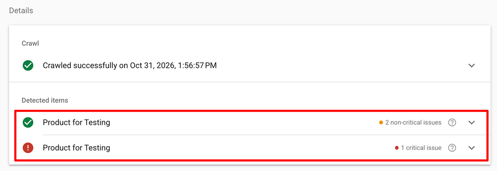
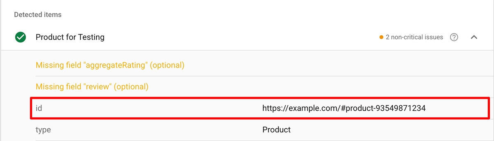
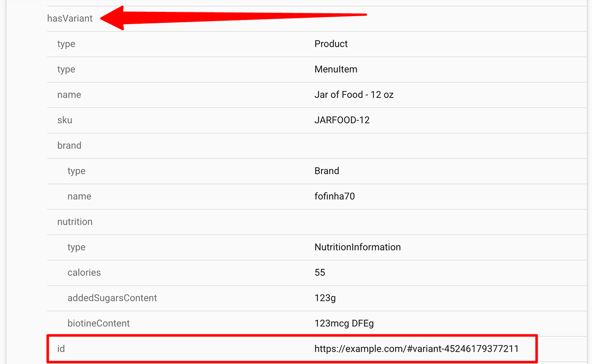

import Link from '@site/src/components/ItsGot/Link';
import StructuredDataAppEmbedLink from '@site/src/components/ItsGot/StructuredDataAppEmbedLink';

# Usando Dados Estruturados para Melhorar o SEO e as AIO

Os dados estruturados fornecem informações de contexto dos produtos às páginas da sua loja para que os mecanismos de busca e os assistentes de IA possam entender instantaneamente detalhes importantes como preços, estoque e atributos dos produtos.
Isso ajuda as plataformas de busca a exibirem Rich Snippets atraentes em seus resultados e a citarem seus produtos com precisão nas respostas de IA, aumentando a visibilidade na busca e as taxas de cliques.

O It's Got pode exibir dados nutricionais como parte dos dados estruturados dos seus produtos. Se você estiver usando nosso recurso de avaliações de produtos, os dados das avaliações também serão exibidos.

## Shopify

Os usuários do Shopify devem <StructuredDataAppEmbedLink>ativar a incorporação do app *Dados Estruturados para SEO*</StructuredDataAppEmbedLink> no tema. Uma vez ativada, os dados estruturados de produtos e variantes do aplicativo serão exibidos automaticamente nas páginas de produto.

### Identificadores de Produto {/* #product-identifiers */}

Os identificadores são a forma como os trechos de dados estruturados são associados uns aos outros.
Se o seu tema do Shopify contiver dados estruturados de produtos existentes, as informações nutricionais e/ou as informações de avaliações geradas pelo aplicativo deverão ser vinculadas a eles automaticamente.
Se não, você deve definir o identificador a ser usado.

Você pode usar o [Teste de resultados aprimorados](https://search.google.com/test/rich-results) do Google para determinar se precisa especificar explicitamente um identificador:

1. Acesse o [Teste de resultados aprimorados](https://search.google.com/test/rich-results)
1. Insira a URL da página de um produto
1. Clique em "Testar URL"

Se você vir seu produto listado mais de uma vez:

  

Você terá que [configurar o identificador do produto no aplicativo](#setting-a-default-product-identifier).

### Configurando um Identificador de Produto Padrão {/* #setting-a-default-product-identifier */}

Só é necessário configurar um identificador de produto se você não estiver usando o [identificador de produto/variante padrão do Shopify](#product-identifiers).

Para configurar um identificador de produto no aplicativo, primeiro você deve descobrir qual identificador seu tema está usando atualmente:

1. Acesse o [Teste de resultados aprimorados do Google](https://search.google.com/test/rich-results)
1. Insira a URL da página de um produto
1. Clique em "Testar URL"
1. Na página de resultados, clique no nome do produto. Se você não vir o nome do seu produto, talvez precise primeiro clicar em "Trechos de produto"
1. Abaixo do nome do produto, encontre a entrada "id":
   

     
   

1. Aqui, seu identificador é `#product-ID`, onde `ID` é o ID do produto do Shopify. Você pode ignorar a parte do domínio (`https://example.com`).
1. Vá para a seção Dados Estruturados da <Link path="/settings/edit#structured_data">página de configurações</Link>
1. No campo *Identificador do produto*, insira: `#product-{{product_id}}`
1. Clique em "Salvar"

Agora, os dados estruturados gerados pelo aplicativo corresponderão à saída existente do seu tema.

Para variantes, você pode repetir estas etapas, mas, neste caso, não deve usar a primeira entrada "id" no Teste de resultados aprimorados. Use a que está em "hasVariant":

  

