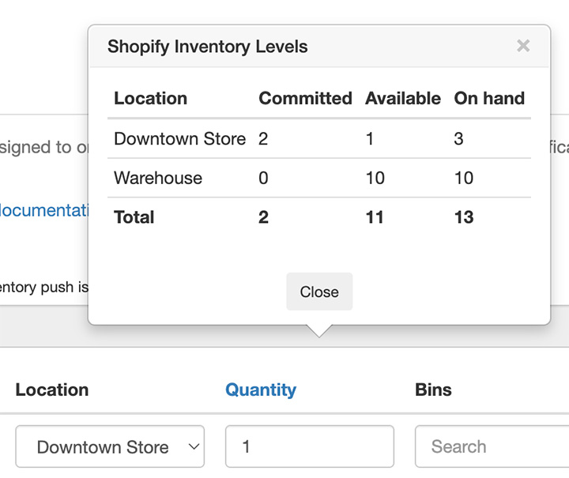

import Link from '@site/src/components/ProductExpirationDates/Link';

# 为产品添加到期数据

您可以在产品的<Link path="/inventories/new">库存批次页面</Link>上为产品添加到期数据。此外，您还可以通过[批量导入到期数据](/docs/product-expiration-dates/batch-import)或[扫描产品条码](/docs/product-expiration-dates/barcode-scanner)来添加数据。系统支持提供以下 3 组数据：

-   库存批次
-   开封后使用期限数值
-   产品折扣

您可以点击[此处](https://youtu.be/vjLB_v1OHpw)观看功能介绍视频。

## 库存批次

库存批次是到期数据中最核心的部分。所填写的数值将被分配给订单、用于发送到期提醒通知，并决定何时对产品进行打折销售。
您还可以[在您的网店中展示库存批次信息](/docs/product-expiration-dates/shopify-pages)，向顾客展示产品的最佳保质期和/或开封后使用建议。

:::info
在创建批次之前，请务必先[选择您的库存管理方法](/docs/product-expiration-dates/selecting-inventory-management-method)。
:::

### 分配库存批次的时机

“分配库存批次的时机”字段用于指定库存批次分配给订单的时间节点：是在客户下单创建订单时，还是在订单明细项发货时。系统默认在订单创建时进行分配。例如，如果您使用的是先到期先出 (FEFO) <Link path="/settings#inventory">库存管理方法</Link>，则最早到期的批次将被分配给新订单。有关如何配置所选地点的说明，请参阅[订单库存批次的地点分配](/docs/product-expiration-dates/order-batch-location-assignment)。

### 到期日、批次号、数量与地点

“到期日”是指定批次的过期日期。“数量”是可用库存数量（详情请参阅下文的*可售库存量与现有库存量*）。“地点”是该批次所在的 Shopify 地点。“批次号”是批次的编号，为选填项。您可以点击“数量”链接，查看该产品或多属性在 Shopify 中的可售数量：

例如，产品 A 在 Shopify 中的 Warehouse 地点有 10 件库存。其中 6 件将于 2025 年到期，4 件将于 2024 年到期。在应用中录入的数据如下：

-   到期日：`2025-01-01`，数量：`6`，地点：`Warehouse`
-   到期日：`2024-11-21`，数量：`4`，地点：`Warehouse`

### 发票号、批号、入库日期、生产日期、备注等 {/* #lot-number-etc-assignment */}

每个库存批次还可以关联其他补充数据。您可以通过在“批次”选项卡上点击齿轮图标，启用这些字段的显示：

勾选所需的字段，然后点击 <kbd>保存</kbd> 按钮。

### 可售库存量与现有库存量

如果您启用了库存推送功能，可以设置现有库存量 (On hand) 或可售库存量 (Available)。有关更多信息，请参阅[库存推送](/docs/product-expiration-dates/inventory-push)文档。

### 配置发货地点

请参阅[订单库存批次的地点分配](/docs/product-expiration-dates/order-batch-location-assignment)。

### 下一步会发生什么？

假设您使用的是先到期先出 (FEFO) <Link path="/settings#inventory">库存管理方法</Link>，已为产品录入了库存批次数据，并在“分配库存批次的时机”选项中选择了“订单创建时”。现在，每当该产品产生新订单时，应用将从分配给该订单的地点（针对店内订单）中分配最早到期的库存批次；如果订单未指定地点，应用将根据录入的所有数值分配最早到期的库存批次。如果某个订单明细项被重新入库、退款等，其最早到期的库存批次将被释放，并可供后续订单再次分配。

您可以在<Link path="/order_line_items">应用的“订单”页面</Link>上查看已分配给订单的库存批次。

您还可以[在您的网店中展示到期相关信息](/docs/product-expiration-dates/shopify-pages)，或[将其添加到装箱单或通知中](/docs/product-expiration-dates/notifications-and-packing-slip)。

## 开封后使用期限数值

这是可在您的网店中展示的补充信息。它代表制造商建议在产品开封后使用或消耗的时间期限。例如，您可以同时展示来自库存批次的 `最佳食用日期：2025年7月1日` 以及来自此处的 `开封后30天内使用`。

## 产品折扣

***产品折扣功能自<Link path="/charges/recurring/new">高级版套餐</Link>起提供***

:::info
我们建议使用[规则集](/docs/product-expiration-dates/discounts#rulesets)来创建产品折扣。
借助规则集，您可以创建分阶段的阶梯折扣，而通过常规设置或“折扣”选项卡配置的传统折扣无法实现这一功能。
:::

针对特定产品的折扣可以在“折扣”选项卡中录入。当库存批次临近其到期日时，产品价格将按所设百分比进行折减。

这些字段的默认值可以在折扣设置页面的<Link path="/settings#discounts~product_defaults">“产品默认设置”区域</Link>中录入。向应用添加新产品时，此处录入的值将自动预填到“折扣”选项卡的相应字段中。

如需配置适用于所有产品的全局折扣，请参阅[对即将到期的产品打折销售](/docs/product-expiration-dates/discounts)。
